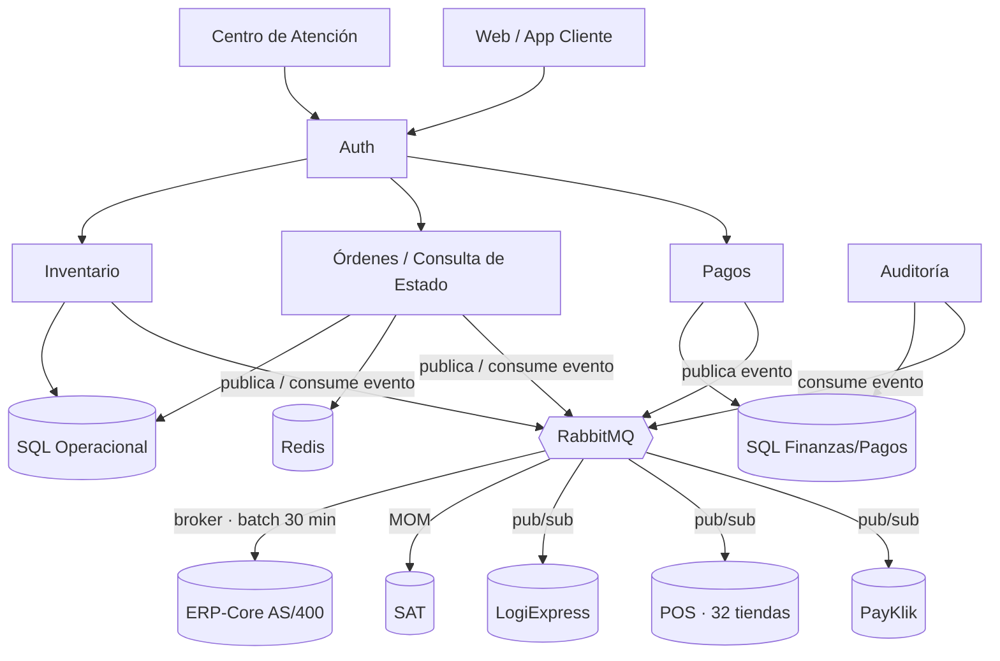
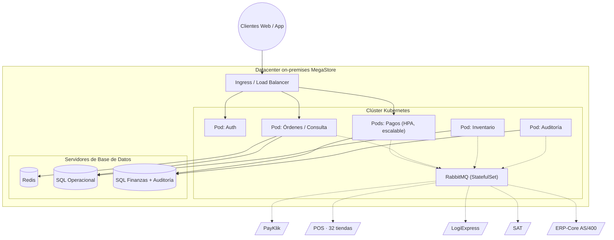

# Sección 3 — Calidad y Despliegue

**Responsable:** Julio Herrera (202300850)

Cómo los Escenarios de Atributos de Calidad (EAC) de disponibilidad y rendimiento se resuelven en la arquitectura de despliegue de SGO-Logic (vista lógica y física), a partir de las decisiones de arquitectura ya acordadas por el equipo.

---

## Decisiones de arquitectura aplicadas

- **Servicios:** separados por dominio, bajo acoplamiento / alta cohesión — Auth, Pagos, Inventario, Órdenes/Consulta de Estado, Auditoría (catálogo completo aún en construcción).
- **Orquestación:** Kubernetes on-premises, con capacitación del equipo presupuestada ($1,500–$4,000, dentro de la inversión inicial).
- **Mensajería:** un único clúster de RabbitMQ, configurado de tres formas según el caso — pub/sub (topic/fanout) para Inventario, PayKlik, POS y LogiExpress; MOM para SAT; broker (cola) para el batch hacia ERP-Core cada 30 minutos.
- **Datos:** Redis (NoSQL) para lecturas rápidas; una instancia SQL para inventario/operativo; una instancia SQL separada para finanzas/pagos, con la bitácora de auditoría en tabla propia dentro de esa instancia, de solo inserción.

---

## 1. Disponibilidad en Black Friday

**EAC:** el sistema no debe perder la orden si PayKlik falla o no responde durante el pico de demanda (hasta 8x lo normal); cada intento fallido queda auditado.

**Cómo se resuelve:**

- El servicio **Pagos** corre en Kubernetes con autoescalado horizontal (HPA) y al menos 2 réplicas activas en todo momento, para tolerar tanto la caída de PayKlik como la caída de un nodo propio.
- Antes de llamar a PayKlik, Pagos persiste el intento en SQL-Finanzas y publica el evento en RabbitMQ (patrón outbox). Si PayKlik falla, la orden queda en estado pendiente/reintento sin bloquear el resto del flujo; RabbitMQ reintenta automáticamente (dead-letter exchange + TTL).
- Cada intento, exitoso o fallido, es consumido por el servicio de **Auditoría** vía el mismo evento, quedando registrado.

## 2. Performance de consulta de estado (< 5 s)

**EAC:** una consulta de estado de orden (compra, pago, despacho, entrega) responde en menos de 5 segundos.

**Cómo se resuelve:**

- El servicio **Órdenes/Consulta de Estado** lee de **Redis** (vista consolidada precomputada), en vez de orquestar en tiempo real llamadas a ERP-Core, POS, PayKlik y LogiExpress.
- Redis corre en el mismo datacenter/segmento de red que el servicio de consulta, evitando saltos de red entre sitios.
- El servicio escala horizontalmente en Kubernetes durante los picos de demanda.

## 3. Performance de auditoría / Trazabilidad (< 1 s)

**EAC:** recuperar la evidencia completa de una transacción específica toma menos de 1 segundo; el 100% de las operaciones fiscalmente relevantes queda registrado de forma inmutable.

**Cómo se resuelve:**

- El servicio **Auditoría** consume, vía RabbitMQ, los eventos generados por todos los demás servicios y los inserta en su propia tabla dentro de la instancia SQL-Finanzas, indexada por transacción.
- Esa tabla tiene permisos restringidos a solo `INSERT` (sin `UPDATE` ni `DELETE`), lo que garantiza inmutabilidad sin necesitar una tecnología de auditoría especializada.
- Al recibir los datos de forma asíncrona, sus lecturas no compiten con la carga transaccional de Pagos durante Black Friday, lo que sostiene el <1s.

---

## Diagrama — Vista lógica

## Diagrama — Vista física (despliegue)

---

## Pendiente

- Completar el catálogo de servicios más allá de Auth, Pagos, Inventario, Órdenes y Auditoría (ej. Notificaciones).
- Definir el mínimo/máximo de réplicas de Pagos con pruebas de carga que simulen el pico de 8x, antes de la fecha fija de Black Friday.
- Formalizar estas decisiones como ADR (Contexto / Decisión / Alternativas / Consecuencias) y anexar estos diagramas a la entrega final.
- Revisar esta misma vista contra los EAC de Escalabilidad ante picos de demanda y Consistencia de inventario (prioridad Alta, no desarrollados aquí por no estar asignados a esta sección).
