# Documento de Definición de Arquitectura (DDA)
# SGO-Logic — Sistema de Gestión de Órdenes y Logística Omnicanal

**Cliente:** MegaStore
**Versión:** 1.0
**Naturaleza del documento:** Definición de arquitectura de la Fase 1. Comprende la delimitación del problema, la identificación de partes interesadas y drivers, las decisiones de arquitectura y las vistas que las sustentan.

---

## Índice

1. Resumen ejecutivo
2. Catálogo de evidencia y convención de identificadores
3. Partes interesadas y preocupaciones arquitectónicas
4. Caso de negocio: casos de uso de negocio y primera descomposición
5. Características del sistema priorizadas
6. Drivers de requisitos funcionales y casos de uso expandidos
7. Drivers de calidad: escenarios de atributos de calidad
8. Drivers de restricción
9. Restricciones de infraestructura
10. Decisiones de arquitectura (ADR)
11. Vistas arquitectónicas
    - 11.1 Diagrama de contexto
    - 11.2 Diagrama de bloques
    - 11.3 Diagrama de componentes
    - 11.4 Diagramas de despliegue (lógico y físico)
    - 11.5 Diagramas de casos de uso expandidos
12. Matrices de trazabilidad
13. Vacíos de información y supuestos

---

# 1. Resumen ejecutivo

MegaStore es una cadena regional de tiendas por departamentos con presencia en Guatemala, El Salvador y Costa Rica: 32 tiendas físicas, 6,500 empleados, un canal de comercio electrónico que representa el 25% de las ventas y crece cerca del 15% anual, y una facturación anual aproximada de USD 450 millones. Su operación actual se apoya en aplicaciones y procedimientos que evolucionaron de forma independiente, sin una visión unificada: cada tienda conserva información local de ventas e inventario, el comercio electrónico opera con datos separados, las devoluciones pueden tardar hasta siete días hábiles por falta de una vista consolidada y Finanzas concilia ventas de forma manual con hojas de cálculo.

SGO-Logic es la iniciativa que resuelve esa fragmentación. Su objetivo es permitir que un cliente inicie, continúe y complete una compra desde cualquier canal —tienda física, web, aplicación móvil o centro de atención— con una experiencia consistente, sobre una única visión de inventario, cobro, facturación fiscal y despacho.

Este documento define la arquitectura de SGO-Logic. Establece el alcance del sistema, identifica a las partes interesadas y sus preocupaciones, deriva los drivers funcionales, de calidad y de restricción, y documenta las decisiones de arquitectura con sus alternativas y consecuencias. Cada decisión se sustenta en evidencia del negocio y se refleja en al menos una vista arquitectónica.

La arquitectura adopta un estilo de microservicios organizados por contexto delimitado, con comunicación orientada a eventos sobre un bus de mensajería, orquestación del ciclo de vida de la orden mediante una saga centralizada, y separación entre el modelo de escritura y el modelo de lectura para sostener los tiempos de respuesta exigidos. El despliegue inicial es on-premises, empaquetado en contenedores, con una ruta de migración a la nube preparada. Las decisiones priorizan el valor para el negocio, la resiliencia ante fallas de sistemas externos, la trazabilidad fiscal y la operación dentro de los límites de presupuesto y de las capacidades del equipo.

---

# 2. Catálogo de evidencia y convención de identificadores

Esta sección extrae y numera la evidencia del caso de negocio, y fija la convención de identificadores que da coherencia y trazabilidad al resto del documento. Cada afirmación de la arquitectura apunta a por lo menos una evidencia de este catálogo.

## 2.1 Convención de identificadores

| Prefijo | Artefacto |
|---|---|
| `EV-##` | Evidencia del caso de negocio |
| `STK-##` | Parte interesada (stakeholder) |
| `PRE-##` | Preocupación arquitectónica |
| `CAR-##` | Característica priorizada del sistema |
| `CUN-##` | Caso de uso de negocio |
| `CU-##` | Caso de uso expandido del sistema |
| `DRF-##` | Driver de requisito funcional |
| `EAC-##` | Escenario de atributo de calidad |
| `RES-##` | Driver de restricción |
| `ADR-###` | Registro de decisión de arquitectura |
| `CON-##` | Conflicto entre preocupaciones |
| `VAC-##` | Vacío de información |
| `AN-##` / `TN-##` | Actor / trabajador de negocio |
| `AS-##` | Actor del sistema |

## 2.2 Contexto organizacional

| ID | Evidencia | Implicación arquitectónica |
|---|---|---|
| EV-01 | Cadena con 25 años de operación en Guatemala, El Salvador y Costa Rica: 32 tiendas, 6,500 empleados, USD 450M de facturación anual. | Sistema multi-país y multi-tienda; zonas horarias, monedas y normativa fiscal por país. |
| EV-02 | El comercio electrónico es el 25% de las ventas y crece cerca del 15% anual. | El canal digital es material; la arquitectura se dimensiona para crecimiento sostenido. |
| EV-03 | Comercializa línea blanca, electrónica, ropa y calzado, con promociones estacionales, combos y financiamiento a 3, 6 y 12 meses. | El catálogo y el motor de precios tienen complejidad propia. |
| EV-04 | La Dirección busca que un cliente inicie, continúe y complete una compra desde cualquier canal con experiencia consistente. | Objetivo estratégico raíz: identidad de cliente unificada y estado de compra compartido. |
| EV-05 | Opera dos centros de distribución sin una visión centralizada de existencias, ubicaciones, reservas, entradas y salidas. | Justifica un contexto de inventario unificado. |
| EV-06 | No existe una herramienta integrada para que el centro de atención consulte el historial completo de compras, devoluciones e incidencias. | Justifica un modelo de lectura consolidado. |

## 2.3 Situación actual y costos del problema

| ID | Evidencia | Implicación arquitectónica |
|---|---|---|
| EV-07 | Las aplicaciones evolucionaron por separado; cada tienda y el comercio electrónico operan con información aislada. | Diagnóstico de silos; sustenta un sistema de registro único. |
| EV-08 | Ante una compra en línea, el personal de logística llama por teléfono a cada tienda para confirmar existencia. | Proceso manual a eliminar; justifica el inventario en tiempo real. |
| EV-09 | Las devoluciones y cambios tardan hasta siete días hábiles por falta de una vista consolidada de compra, pago, despacho y entrega. | Línea base de postventa; refuerza el modelo de lectura consolidado. |
| EV-10 | Finanzas concilia ventas manualmente con hojas de cálculo de distintos canales y tiendas. | Justifica la sincronización automatizada con el ERP. |
| EV-11 | En el último Black Friday la pasarela de pagos estuvo indisponible 45 minutos, con pérdidas estimadas en USD 150,000. | Evidencia cuantificada del riesgo de dependencia externa. |
| EV-12 | Cada envío incorrecto cuesta cerca de USD 25 en logística inversa; el objetivo es reducir estos errores en 70%. | Meta medible ligada a la confiabilidad del inventario. |

## 2.4 Sistemas existentes y restricciones de integración

| ID | Evidencia | Implicación arquitectónica |
|---|---|---|
| EV-13 | El ERP es la plataforma contable-financiera, sobre AS/400 de los años noventa. | Sistema legacy con semántica propia; requiere capa anticorrupción. |
| EV-14 | La Junta Directiva determinó que el ERP no se reemplaza ni modifica en este horizonte. | Restricción dura no negociable. |
| EV-15 | El ERP solo recibe resúmenes de ventas por archivo CSV o XML, procesables cada 30 minutos. | Integración batch; consistencia contable eventual con ventana de 30 minutos. |
| EV-16 | Las 32 instancias de POS no se reemplazan y deben recibir eventos con manejo de errores y reintentos. | El POS es consumidor de eventos; exige entrega confiable e idempotente. |
| EV-17 | PayKlik ofrece REST con latencia de 800 ms hasta 5 s en picos, con contrato vigente por tres años. | Dependencia externa lenta y variable; no puede invocarse de forma bloqueante. |
| EV-18 | LogiExpress ofrece REST con cerca de 1 de cada 50 solicitudes en timeout, con contrato vigente por dos años. | Tasa de fallo del 2%; obliga a reintentos con respaldo. |
| EV-19 | La emisión de factura por XML a la SAT es obligatoria antes de finalizar la orden, con tiempos de respuesta variables. | Obligación fiscal frente a un servicio de latencia impredecible. |
| EV-20 | Un proveedor externo presta SMS, correo y notificaciones push, con disponibilidad fuera de control. | Las notificaciones deben ser estrictamente asíncronas. |

## 2.5 Operación omnicanal esperada

| ID | Evidencia | Implicación arquitectónica |
|---|---|---|
| EV-21 | Una compra puede iniciar en un canal y finalizar en otro, reconociendo al cliente durante todo el proceso. | Identidad unificada y estado de compra fuera de la sesión del canal. |
| EV-22 | Antes de confirmar una venta debe verificarse la disponibilidad para no comprometer una unidad a más de un cliente. | Único punto que exige consistencia fuerte; define el mecanismo de reserva. |
| EV-23 | Cuando una compra no concluye, el inventario reservado debe liberarse en un tiempo acorde con la operación. | Reservas con vencimiento automático. |
| EV-24 | Se aceptan tarjetas, transferencias bancarias y billeteras digitales. | Múltiples medios de pago con flujos distintos. |
| EV-25 | Por cumplimiento, no se almacenan números completos de tarjeta ni códigos de seguridad. | Tokenización; descarta un procesador de tarjeta propio. |
| EV-26 | Cada intento de cobro debe quedar relacionado con la orden, el canal, la fecha y su resultado. | Registro de intentos, no solo del resultado final. |
| EV-27 | Para el próximo Black Friday se espera una demanda de hasta ocho veces la de un día normal. | Factor de escalamiento declarado. |
| EV-28 | Se busca no perder la orden si el proveedor de pago falla, procesar sin depender totalmente de él y auditar cada intento fallido. | Exige desacoplar la captura del cobro; rutas alternativas, no procesador propio. |
| EV-29 | Tras confirmar la venta se genera la documentación fiscal y se mantiene la relación entre venta, devoluciones y reembolsos. | Trazabilidad documental encadenada. |
| EV-30 | Por auditorías de la SAT, Finanzas debe reconstruir quién ejecutó cada operación, cuándo y qué cambió, recuperable en menos de un segundo. | Registro append-only indexado. |
| EV-31 | El despacho puede salir de un centro de distribución, una tienda o recogida, y el método puede cambiar tras confirmar. | La orden es un agregado de larga vida y mutable. |
| EV-32 | Logística necesita saber qué preparar, desde qué ubicación despachar y a quién entregar, con inventario en tiempo real. | Vista operativa dedicada, alimentada por eventos. |
| EV-33 | Consultar el estado de una orden desde cualquier dispositivo no puede superar los cinco segundos. | Presupuesto de latencia de consulta explícito. |
| EV-34 | El cliente debe recibir notificaciones, pero una falla de comunicación no puede detener la operación principal. | El desacople de notificaciones está autorizado. |
| EV-35 | Habrá un carrito unificado entre canales, con métodos de pago según el canal. | El carrito es estado compartido, no de sesión. |

## 2.6 Partes interesadas, restricciones y proceso

| ID | Evidencia | Implicación arquitectónica |
|---|---|---|
| EV-36 | La Dirección de Comercialización exige la misma experiencia en todos los canales, sin silos. | Confirma el objetivo omnicanal. |
| EV-37 | El Gerente de TI operará la solución; rechaza modificar ERP-Core o POS, exige mantenibilidad interna y monitoreo de sistemas externos. | Restringe el espacio de alternativas; poder de rechazo técnico. |
| EV-38 | La Directora de Finanzas tiene veto sobre decisiones que reduzcan la trazabilidad o comprometan el cumplimiento fiscal. | Cualquier optimización que sacrifique auditoría es inviable. |
| EV-39 | El Jefe de Logística prioriza reducir errores de despacho y la visibilidad oportuna de órdenes. | Conecta con las metas de logística. |
| EV-40 | La Junta ratifica la permanencia del ERP-Core y del POS. | Origen de restricciones de integración. |
| EV-41 | La inversión inicial aprobada es de USD 150,000 para todo el proyecto. | Límite de inversión, fondo compartido. |
| EV-42 | El costo operativo mensual no debe superar USD 1,200 sin aprobación adicional. | Techo operativo estrecho. |
| EV-43 | El Black Friday de noviembre es fecha fija; se espera una ruta viable de pagos y facturación en el primer mes. | Restricción temporal y criterio de priorización. |
| EV-44 | La solución cumple protección de datos y facturación electrónica de la SAT en los tres países. | Cumplimiento regulatorio multi-país. |
| EV-45 | Los contratos vigentes con PayKlik y LogiExpress deben respetarse. | Impide reemplazar proveedores en el horizonte. |
| EV-46 | El equipo domina Java, .NET y Docker básico; toda desviación debe cuantificar adopción y capacitación. | Restricción de capacidad organizacional. |
| EV-47 | Se busca minimizar el consumo energético y mantener la facturación totalmente electrónica. | Penaliza el sobredimensionamiento permanente. |
| EV-48 | El despliegue inicial es on-premises, reutilizando la inversión existente. | Fija la topología inicial. |
| EV-49 | La arquitectura debe permitir una migración planificada a la nube sin rediseño. | Requisito de portabilidad diferida. |
| EV-50 | Se emplea UML 2.5.1 cuando corresponde, declarando explícitamente cualquier notación complementaria. | Convención de notación. |
| EV-51 | La priorización de trabajo antepone los componentes base de la arquitectura a los cosméticos. | El backlog se ordena por backbone. |
| EV-53 | Las decisiones se registran mediante ADR como registro vivo, y los diagramas son vistas del documento. | Relación entre artefactos. |

---

# 3. Partes interesadas y preocupaciones arquitectónicas

## 3.1 Partes interesadas

**Gobierno y patrocinio**

| ID | Parte interesada | Interés principal | Poder |
|---|---|---|---|
| STK-01 | Junta Directiva | Preservar la inversión en sistemas existentes y limitar el riesgo de transición. | Decisorio; su determinación sobre ERP y POS es no negociable. |
| STK-02 | Dirección / Gerencia General | Habilitar la operación omnicanal dentro del presupuesto y del plazo comercial. | Decisorio; aprueba inversión y fija el plazo. |

**Ejecutivos con interés directo**

| ID | Parte interesada | Interés principal | Poder |
|---|---|---|---|
| STK-03 | Carlos Méndez — Gerente de TI | Operar sin interrupciones en picos, sin tocar el legacy, con equipo interno capaz de mantener. | Alto; rechaza propuestas que modifiquen ERP o POS. |
| STK-04 | Ana Lucía Fuentes — Directora de Finanzas | Trazabilidad completa y cumplimiento fiscal ante auditorías de la SAT. | Alto, con veto formal. |
| STK-05 | Roberto Quezada — Jefe de Logística | Reducir errores de despacho y obtener visibilidad oportuna de órdenes. | Medio; define metas operativas medibles. |
| STK-06 | Dirección de Comercialización | Experiencia de compra idéntica en todos los canales. | Medio-alto; voz del objetivo omnicanal. |
| STK-07 | Jefatura de Operaciones | Evitar la repetición de la pérdida por indisponibilidad en alta demanda. | Medio; aporta la evidencia del incidente y la proyección de demanda. |

**Operativos internos**

| ID | Parte interesada | Interés principal |
|---|---|---|
| STK-08 | Equipo interno de desarrollo y mantenimiento | Que la solución sea construible y mantenible con Java, .NET y Docker básico. |
| STK-09 | Personal de tienda | Vender sin depender de llamadas telefónicas, sin cambiar su herramienta. |
| STK-10 | Agentes del centro de atención | Consultar en una sola vista compras, pagos, despachos, devoluciones e incidencias. |
| STK-11 | Personal de logística y centros de distribución | Saber qué preparar, desde dónde despachar y a quién entregar, con inventario confiable. |
| STK-12 | Personal de Finanzas y contabilidad | Conciliar ventas sin hojas de cálculo manuales y cerrar el mes sin retrasos. |

**Externos**

| ID | Parte interesada | Interés principal | Poder |
|---|---|---|---|
| STK-13 | Cliente final | Comprar desde cualquier canal con experiencia consistente y seguimiento del estado. | Determinante en valor. |
| STK-14 | SAT | Recibir documentación fiscal válida y poder auditar las operaciones. | Alto, no negociable. |
| STK-15 | PayKlik | Mantener el contrato y su interfaz REST. | Alta dependencia técnica por su latencia variable. |
| STK-16 | LogiExpress | Mantener el contrato y su integración REST. | Alta dependencia técnica por su tasa de timeout. |
| STK-17 | Proveedor de notificaciones | Prestar el servicio bajo sus propias condiciones. | Baja; disponibilidad fuera de control. |
| STK-18 | Reguladores de protección de datos | Cumplimiento de la normativa en los tres países. | Alto, no negociable. |

## 3.2 Preocupaciones arquitectónicas

**Continuidad y resiliencia**

- **PRE-01** — El sistema sostiene picos de hasta ocho veces la carga normal sin interrupción de la venta. (STK-03, STK-07, STK-02)
- **PRE-02** — La falla de un sistema externo no provoca la pérdida de una orden ya iniciada. (STK-03, STK-07, STK-02)
- **PRE-03** — Las fallas de canales secundarios, en particular las notificaciones, permanecen aisladas del flujo principal. (STK-03, STK-13)
- **PRE-04** — El comportamiento y la disponibilidad de las dependencias externas son observables de forma continua. (STK-03)

**Trazabilidad y cumplimiento**

- **PRE-05** — Es posible reconstruir quién ejecutó cada operación, cuándo y qué se modificó. (STK-04, STK-14)
- **PRE-06** — La documentación fiscal es válida, oportuna y mantiene la relación entre venta, devoluciones y reembolsos. (STK-04, STK-14, STK-12)
- **PRE-07** — Ninguna transacción queda sin respaldo recuperable. (STK-04, STK-14)
- **PRE-08** — El tratamiento de datos personales y de medios de pago cumple la normativa, sin almacenar datos sensibles de tarjeta. (STK-18, STK-04, STK-13)

**Integridad y consistencia del negocio**

- **PRE-09** — Una misma unidad de inventario no se compromete a más de un cliente. (STK-05, STK-06, STK-13)
- **PRE-10** — El inventario reservado por compras no concluidas se libera automáticamente. (STK-05, STK-06)
- **PRE-11** — La información propagada hacia los sistemas legacy no se pierde ni se duplica. (STK-03, STK-12, STK-04)
- **PRE-12** — La consistencia contable con el ERP está sujeta a una ventana de hasta 30 minutos y es conciliable. (STK-04, STK-12)

**Experiencia y valor para el negocio**

- **PRE-13** — La experiencia de compra es equivalente en todos los canales, permitiendo iniciar en uno y concluir en otro. (STK-06, STK-13, STK-02)
- **PRE-14** — Las consultas de estado e historial responden dentro de límites de tiempo aceptables. (STK-10, STK-13, STK-04)
- **PRE-15** — La operación cuenta con visibilidad oportuna de órdenes e inventario para reducir errores de despacho. (STK-05, STK-11)

**Viabilidad técnica y económica**

- **PRE-16** — Los sistemas ERP-Core y POS no se modifican ni se reemplazan. (STK-01, STK-03)
- **PRE-17** — La arquitectura es mantenible por el equipo interno con sus competencias actuales. (STK-03, STK-08)
- **PRE-18** — La inversión inicial y el costo operativo mensual se mantienen dentro de los límites aprobados. (STK-02, STK-01)
- **PRE-19** — La solución se despliega on-premises y permite una migración planificada a la nube sin rediseño. (STK-01, STK-03, STK-02)
- **PRE-20** — Existe una ruta viable de pagos y facturación para el primer mes, antes del Black Friday. (STK-02, STK-07, STK-03)

## 3.3 Conflictos entre preocupaciones

| ID | Conflicto | Preocupaciones enfrentadas | Resolución adoptada |
|---|---|---|---|
| CON-01 | Trazabilidad exhaustiva frente a rendimiento en picos | PRE-05, PRE-07 vs. PRE-01, PRE-14 | Registro de auditoría desacoplado de la ruta crítica, en base separada (ADR-006). |
| CON-02 | Obligación fiscal previa al cierre frente a experiencia | PRE-06 vs. PRE-13, PRE-14 | Certificación fiscal asíncrona con estado intermedio (ADR-011). |
| CON-03 | Independencia del proveedor de pagos frente a no almacenar datos de tarjeta | PRE-02 vs. PRE-08 | Rutas de pago alternativas y tokenización delegada (ADR-010). |
| CON-04 | Resiliencia y elasticidad frente al techo presupuestario | PRE-01, PRE-19 vs. PRE-18 | Stack open source on-premises con escalado bajo demanda (ADR-001, RES-04). |
| CON-05 | No modificar el legacy frente a consistencia contable oportuna | PRE-16, PRE-12 vs. PRE-07 | Consistencia eventual con ventana de 30 minutos y reconciliación (ADR-008). |
| CON-06 | Mantenibilidad con competencias actuales frente a sofisticación técnica | PRE-17 vs. PRE-01, PRE-02 | Número acotado de tecnologías, con capacitación presupuestada (RES-06). |

---

# 4. Caso de negocio: casos de uso de negocio y primera descomposición

## 4.1 Notación

Se emplea UML 2.5.1 con extensiones de modelado de negocio: actor de negocio (externo), trabajador de negocio (rol interno) y caso de uso de negocio (proceso que produce valor observable). Los casos describen qué hace el negocio, con independencia de su grado de automatización.

## 4.2 Actores de negocio y trabajadores de negocio

| ID | Actor de negocio | Papel |
|---|---|---|
| AN-01 | Cliente | Inicia, continúa y concluye compras; solicita devoluciones y consulta estados. |
| AN-02 | SAT | Recibe y certifica documentación fiscal; audita operaciones. |
| AN-03 | PayKlik | Procesa los cobros con tarjeta. |
| AN-04 | LogiExpress | Genera guías y comunica estados de entrega. |
| AN-05 | Proveedor de notificaciones | Entrega mensajes por SMS, correo y push. |

| ID | Trabajador de negocio | Papel |
|---|---|---|
| TN-01 | Vendedor de tienda | Registra ventas presenciales y atiende recogidas. |
| TN-02 | Agente del centro de atención | Atiende compras y postventa; consulta historial. |
| TN-03 | Operador de logística y CD | Prepara, despacha y da seguimiento a pedidos. |
| TN-04 | Analista de Finanzas | Concilia ventas y participa en el cierre contable. |
| TN-05 | Responsable de comercialización | Define catálogo, precios, combos y promociones. |

## 4.3 Casos de uso de negocio de alto nivel

| ID | Caso de uso de negocio | Valor producido |
|---|---|---|
| CUN-01 | Gestionar venta omnicanal | Una orden confirmada, iniciada en cualquier canal y concluida en cualquier otro, con inventario comprometido de forma confiable. |
| CUN-02 | Administrar inventario unificado | Una única visión de existencias, ubicaciones y reservas de tiendas y centros de distribución. |
| CUN-03 | Gestionar cobro | Un cobro aplicado y auditado, o una orden preservada cuando el cobro no se completa. |
| CUN-04 | Emitir documentación fiscal | Documentos fiscales válidos, certificados y relacionados con la venta original. |
| CUN-05 | Ejecutar despacho y entrega | El producto entregado desde el origen correcto, con seguimiento hasta la recepción. |
| CUN-06 | Atender postventa | Devoluciones, cambios e incidencias resueltos con una vista consolidada. |
| CUN-07 | Conciliar y cerrar contablemente | Ventas conciliadas, sincronizadas con el ERP y con evidencia recuperable. |
| CUN-08 | Administrar catálogo, precios y promociones | Catálogo consistente en todos los canales. Gestionado por el Catálogo Comercial, dependencia externa al sistema. |
| CUN-09 | Comunicar al cliente el estado de su orden | El cliente informado sobre confirmación, preparación, tránsito, entrega o incidencias. |

El diagrama de casos de uso de negocio de alto nivel se presenta en la sección 11.

## 4.4 Primera descomposición

**CUN-01 Gestionar venta omnicanal:** reconocer al cliente en cualquier canal (CUN-01.1); mantener el carrito unificado (CUN-01.2); verificar disponibilidad y reservar inventario (CUN-01.3); confirmar la orden (CUN-01.4); modificar una orden confirmada (CUN-01.5); liberar reservas de compras no concluidas (CUN-01.6).

**CUN-02 Administrar inventario unificado:** consolidar existencias de tiendas y centros (CUN-02.1); registrar entradas y salidas (CUN-02.2); gestionar reservas y su vencimiento (CUN-02.3); consultar disponibilidad en tiempo real (CUN-02.4).

**CUN-03 Gestionar cobro:** ofrecer medios de pago según el canal (CUN-03.1); procesar un intento de cobro (CUN-03.2); registrar y auditar cada intento (CUN-03.3); preservar la orden ante indisponibilidad del proveedor (CUN-03.4); procesar reembolsos (CUN-03.5).

**CUN-04 Emitir documentación fiscal:** generar el documento fiscal (CUN-04.1); certificarlo ante la SAT (CUN-04.2); emitir documentos por devolución o reembolso (CUN-04.3); conservar y relacionar la evidencia fiscal (CUN-04.4).

**CUN-05 Ejecutar despacho y entrega:** determinar el origen del despacho (CUN-05.1); preparar el pedido (CUN-05.2); coordinar la guía con el proveedor (CUN-05.3); atender la recogida en tienda (CUN-05.4); dar seguimiento al estado de entrega (CUN-05.5).

**CUN-06 Atender postventa:** consultar el historial consolidado (CUN-06.1); registrar una devolución o cambio (CUN-06.2); reingresar el producto al inventario (CUN-06.3); gestionar incidencias (CUN-06.4).

**CUN-07 Conciliar y cerrar contablemente:** consolidar resúmenes por canal y tienda (CUN-07.1); transferirlos al ERP (CUN-07.2); conciliar diferencias (CUN-07.3); reconstruir evidencia para auditoría (CUN-07.4).

**CUN-09 Comunicar al cliente:** emitir notificaciones del ciclo de vida (CUN-09.1); atender la consulta de estado bajo demanda (CUN-09.2).

## 4.5 Delimitación del sistema

| Caso de negocio | Alcance en SGO-Logic |
|---|---|
| CUN-01 Gestionar venta omnicanal | Completo. SGO-Logic es el sistema de registro de la orden. |
| CUN-02 Administrar inventario unificado | Completo. |
| CUN-03 Gestionar cobro | Orquestación y registro propios; la ejecución del cobro con tarjeta permanece en PayKlik. |
| CUN-04 Emitir documentación fiscal | Generación y certificación propias; el registro contable permanece en el ERP. |
| CUN-05 Ejecutar despacho y entrega | Decisión y seguimiento propios; el transporte y las guías permanecen en LogiExpress. |
| CUN-06 Atender postventa | Completo. |
| CUN-07 Conciliar y cerrar contablemente | Consolidación, transferencia y conciliación; el cierre contable permanece en el ERP. |
| CUN-08 Administrar catálogo | Fuera del alcance. El Catálogo Comercial es una dependencia externa que el sistema consulta para resolver precios. |
| CUN-09 Comunicar al cliente | Orquestación propia; la entrega efectiva depende del proveedor de notificaciones. |

---

# 5. Características del sistema priorizadas

## 5.1 Criterios de priorización

Cada característica se evalúa en cuatro criterios con escala Alto (3), Medio (2), Bajo (1): valor para el negocio, riesgo de no atenderla, urgencia frente al Black Friday e impacto sobre la arquitectura. Toda característica ligada a pago y facturación hereda urgencia alta por el compromiso de contar con una ruta protegida en el primer mes (EV-43). Ante puntaje igual, precede la característica de la que dependen otras.

## 5.2 Catálogo y priorización

| ID | Característica | Decisión que la soporta | Puntaje | Nivel |
|---|---|---|---|---|
| CAR-03 | Orquestación del ciclo de vida de la orden | ADR-002 | 12 | Backbone |
| CAR-02 | Inventario único con reserva y expiración | ADR-005 | 12 | Backbone |
| CAR-04 | Cobro resiliente y auditable | ADR-009, ADR-010 | 12 | Backbone |
| CAR-06 | Registro inmutable de auditoría | ADR-006 | 12 | Backbone |
| CAR-05 | Facturación electrónica asíncrona | ADR-011 | 11 | Backbone |
| CAR-01 | Identidad de cliente y carrito unificado | ADR-001, ADR-004 | 11 | Backbone |
| CAR-10 | Propagación confiable de eventos a POS | ADR-003, ADR-012 | 10 | Backbone |
| CAR-07 | Consulta de estado y vista 360 | ADR-004 | 9 | Alto |
| CAR-08 | Origen de despacho y seguimiento | ADR-012 | 9 | Alto |
| CAR-12 | Observabilidad de sistemas externos | Prometheus + Grafana | 9 | Alto |
| CAR-09 | Sincronización batch con el ERP | ADR-008 | 8 | Medio |
| CAR-13 | Postventa | ADR-002 | 7 | Medio |
| CAR-11 | Catálogo, precios y promociones (externo) | Dependencia externa | 7 | Medio |
| CAR-14 | Notificaciones al cliente | Coreografía por eventos | 5 | Bajo |

## 5.3 Secuencia del backbone

**Ola 1 — Núcleo transaccional:** CAR-06, CAR-02, CAR-03, CAR-04, CAR-05. Esta ola constituye la ruta protegida de pagos y facturación exigida para el primer mes.

**Ola 2 — Habilitadores omnicanal:** CAR-01, CAR-10, CAR-07.

**Ola 3 — Operación extendida y visibilidad:** CAR-08, CAR-12, CAR-09.

**Ola 4 — Complementarias:** CAR-13, CAR-11, CAR-14.

## 5.4 Justificación de prioridades no evidentes

El registro de auditoría (CAR-06) encabeza el backbone porque el veto de Finanzas y las auditorías fiscales hacen inaceptable una operación sin registro desde la primera transacción; la bitácora debe existir antes que las operaciones que registra. La facturación (CAR-05) conserva urgencia alta pese a su certificación asíncrona, porque el desacople es una decisión de diseño y la prioridad es un compromiso comercial. El carrito (CAR-01) no encabeza la lista pese a ser la cara visible del omnicanal, porque el riesgo de no tenerlo es de experiencia, mientras que las características que lo preceden evitan pérdidas cuantificadas. Las notificaciones (CAR-14) cierran la secuencia porque su falla no debe detener la operación.

---

# 6. Drivers de requisitos funcionales y casos de uso expandidos

## 6.1 Contextos delimitados

Cada contexto es dueño exclusivo de sus datos; ningún contexto accede a la base de otro. Cuando un contexto necesita información o una acción de otro, la solicita mediante un evento o una llamada explícita.

| Contexto | Responsabilidad | Es dueño de |
|---|---|---|
| Borde / API Gateway | Punto único de entrada, autenticación y ruteo. | Enrutamiento y validación de acceso. |
| Auth | Identidad y sesión. | Credenciales, tokens, roles. |
| Órdenes | Ciclo de vida de la orden; orquestador de la saga. | Orden, estados y transiciones. |
| Inventario | Existencias unificadas, reservas y expiración. | Existencias por ubicación, reservas. |
| Pagos | Intentos de cobro y su resultado. | Intentos de pago, estado de pago. |
| Facturación | Generación y certificación fiscal. | Documentos fiscales y su estado. |
| Auditoría | Registro inmutable de operaciones. | Bitácora append-only. |
| Consulta de Estado | Modelo de lectura consolidado. | Vista materializada de órdenes. |
| Despacho | Origen del despacho y seguimiento. | Instrucción de despacho, estado de entrega. |
| Integración ERP | Consolidación y envío batch al AS/400. | Lotes de resúmenes de venta. |
| Integración POS | Envío confiable de eventos a las 32 instancias de POS. | Cola de eventos hacia POS. |
| Notificaciones | Envío de avisos al cliente. | Solicitudes de notificación. |

El **Catálogo Comercial** (productos, precios, promociones, combos y financiamiento) es una dependencia externa. El sistema lo consulta para resolver precios y no administra su contenido.

## 6.2 Casos de uso expandidos

| ID | Caso de uso | Contexto | Actor primario |
|---|---|---|---|
| CU-01 | Reservar inventario para una orden | Inventario | Órdenes (sistema) |
| CU-02 | Confirmar orden | Órdenes | Cliente |
| CU-03 | Procesar cobro con preservación de la orden | Pagos | Órdenes (sistema) |
| CU-04 | Certificar documento fiscal ante la SAT | Facturación | Órdenes (sistema) |
| CU-05 | Registrar evento de auditoría | Auditoría | Cualquier contexto (sistema) |
| CU-06 | Liberar reserva vencida | Inventario | Temporizador (sistema) |
| CU-07 | Reconocer cliente y mantener carrito | Órdenes / Auth | Cliente |
| CU-08 | Publicar eventos pendientes (Outbox) | Contextos de escritura | Publicador (sistema) |
| CU-09 | Propagar evento de venta al POS | Integración POS | Órdenes (sistema) |
| CU-10 | Consultar estado de una orden | Consulta de Estado | Cliente / Agente |
| CU-11 | Determinar origen de despacho y solicitar guía | Despacho | Órdenes (sistema) |
| CU-12 | Actualizar estado de entrega | Despacho | LogiExpress |
| CU-13 | Consolidar y transferir ventas al ERP | Integración ERP | Temporizador (sistema) |
| CU-14 | Registrar devolución o cambio | Órdenes | Agente |
| CU-15 | Notificar cambio de estado de orden | Notificaciones | Órdenes (sistema) |

## 6.3 Descripción textual de los casos del núcleo

### CU-01 Reservar inventario para una orden

- **Objetivo:** comprometer las unidades solicitadas garantizando que una misma unidad no se asigne a dos clientes.
- **Precondición:** existe una orden en construcción con productos y una ubicación candidata.
- **Flujo principal:** el sistema recibe la solicitud con productos, cantidades y la versión conocida del registro de existencias; verifica que la existencia cubre la cantidad; aplica la reserva incrementando la versión del registro; crea una reserva con marca de expiración; devuelve la reserva confirmada.
- **Flujo alternativo — conflicto de versión:** si la versión ya cambió, el sistema rechaza la operación e indica que debe reintentarse con la existencia actualizada.
- **Flujo alternativo — existencia insuficiente:** el sistema responde sin reservar e indica la cantidad disponible.
- **Poscondición:** las unidades quedan comprometidas con una expiración definida, o no se compromete nada y se informa el motivo.
- **Interacciones:** recibe la solicitud de Órdenes; emite un evento de reserva que consumen Auditoría y Consulta de Estado.

### CU-02 Confirmar orden

- **Objetivo:** cerrar la intención de compra y coordinar cobro, facturación y despacho con compensación ante fallas.
- **Precondición:** el cliente tiene un carrito con productos y un medio de pago seleccionado.
- **Flujo principal:** Órdenes crea la orden y registra el evento en Auditoría; solicita la reserva (CU-01); con la reserva confirmada solicita el cobro (CU-03); con el cobro aceptado pasa la orden a "Confirmada - Pendiente Fiscal" y solicita la certificación (CU-04) de forma asíncrona; solicita el despacho (CU-11); cada transición queda registrada y publicada.
- **Flujo alternativo — falla la reserva:** la orden no avanza; permite reintento o cambio de ubicación, sin haber cobrado.
- **Flujo alternativo — falla el cobro:** la saga libera la reserva y deja la orden en "Pago Pendiente". La orden no se pierde.
- **Flujo alternativo — falla la certificación:** la orden ya está confirmada para el cliente; la certificación se reintenta en segundo plano.
- **Poscondición:** la orden queda confirmada y en curso, o preservada en un estado intermedio con su reserva liberada según corresponda.
- **Interacciones:** orquesta Inventario, Pagos, Facturación y Despacho mediante solicitudes explícitas; registra en Auditoría; publica eventos para Consulta de Estado, Integración POS y Notificaciones.

### CU-03 Procesar cobro con preservación de la orden

- **Objetivo:** ejecutar el cobro dejando constancia de cada intento y sin perder la orden si el proveedor falla.
- **Precondición:** existe una orden con monto y medio de pago. No se almacenan datos completos de tarjeta.
- **Flujo principal:** Pagos registra un intento con orden, canal, fecha y estado; invoca a la pasarela; ante respuesta positiva marca el intento como exitoso y responde a Órdenes; el intento queda registrado en Auditoría.
- **Flujo alternativo — el proveedor falla:** el intento se marca como fallido; la orden pasa a "Pago Pendiente" y se genera un enlace de reintento que se envía al cliente por correo.
- **Flujo alternativo — reintento del cliente:** genera un nuevo intento ligado a la misma orden, conservando el historial.
- **Poscondición:** el cobro queda aplicado y registrado, o la orden queda en "Pago Pendiente" con todos los intentos auditados.
- **Interacciones:** responde a Órdenes; solicita el correo de reintento a Notificaciones; registra en Auditoría.

### CU-04 Certificar documento fiscal ante la SAT

- **Objetivo:** generar el documento fiscal y obtener su certificación sin bloquear la confirmación de la orden.
- **Precondición:** existe una orden confirmada con los datos fiscales necesarios.
- **Flujo principal:** Facturación genera el documento conservando identificador tributario y serie; lo encola hacia la SAT por el canal de mensajería dedicado; al recibir la certificación, marca el documento como certificado y notifica a Órdenes que la orden puede cerrarse fiscalmente; registra el resultado.
- **Flujo alternativo — la SAT tarda o no responde:** el documento permanece en cola con reintentos; la orden se mantiene en "Confirmada - Pendiente Fiscal" sin que el cliente perciba espera.
- **Flujo alternativo — devolución o reembolso:** genera el documento de reversión conservando la relación con la venta original.
- **Poscondición:** el documento queda certificado y ligado a la orden, o en reintento controlado.
- **Interacciones:** responde a Órdenes; se comunica con la SAT por el canal dedicado; registra en Auditoría.

### CU-05 Registrar evento de auditoría

- **Objetivo:** conservar de forma inmutable quién ejecutó cada operación, cuándo y qué cambió, recuperable en menos de un segundo.
- **Flujo principal:** Auditoría recibe el evento con actor, momento, operación y datos del cambio; lo inserta en su base propia, que solo admite inserción; lo indexa por identificador de transacción.
- **Flujo alternativo — consulta de evidencia:** ante una solicitud, recupera por identificador de transacción todos los registros asociados y los devuelve en menos de un segundo.
- **Poscondición:** el evento queda registrado de forma permanente e inalterable.
- **Interacciones:** recibe eventos de todos los contextos de escritura; no escribe en ninguna otra base.

### CU-06 Liberar reserva vencida

- **Objetivo:** devolver al inventario disponible las unidades reservadas por compras que no concluyeron.
- **Flujo principal:** al vencer el tiempo de vida de la reserva, esta se marca como expirada; las unidades vuelven a contarse como disponibles; se registra el evento y se publica.
- **Flujo alternativo — la orden se concretó antes de vencer:** la reserva se consumió y no expira.
- **Poscondición:** el inventario refleja la disponibilidad real sin retener unidades de compras abandonadas.
- **Interacciones:** notifica a Órdenes que la reserva expiró; registra en Auditoría.

Los casos CU-07 a CU-15 se documentan con la misma estructura y se representan en los diagramas de la sección 11.

---

# 7. Drivers de calidad: escenarios de atributos de calidad

Cada escenario se expresa en formato de seis partes: fuente del estímulo, estímulo, ambiente, artefacto, respuesta y medida de respuesta.

| ID | Atributo | Enunciado | Prioridad |
|---|---|---|---|
| EAC-01 | Disponibilidad | El sistema no pierde la orden si PayKlik falla durante el pico de Black Friday; cada intento fallido queda auditado. | Alta |
| EAC-02 | Rendimiento (consulta) | Consultar el estado de una orden responde en menos de 5 segundos. | Alta |
| EAC-03 | Rendimiento (auditoría) | Recuperar la evidencia completa de una transacción toma menos de 1 segundo. | Alta |
| EAC-04 | Escalabilidad | El sistema escala ante el crecimiento sostenido del canal digital y ante picos estacionales, sin rediseño. | Alta |
| EAC-05 | Consistencia de inventario | Ninguna unidad se compromete a más de un cliente, incluso con reservas concurrentes. | Alta |

**EAC-01 — Disponibilidad ante falla del proveedor de pago.** Fuente: PayKlik. Estímulo: indisponibilidad o falla al procesar un cobro. Ambiente: producción durante Black Friday con demanda de hasta ocho veces la normal. Artefacto: servicio de Pagos y su ruta de reintento. Respuesta: la orden no se pierde; el intento se registra antes de invocar a PayKlik; si falla, el evento se reintenta de forma asíncrona sin bloquear el flujo; cada intento se audita. Medida: cero órdenes perdidas por indisponibilidad del proveedor; 100% de intentos fallidos auditados; disponibilidad del servicio de Pagos igual o superior a 99.9% durante el evento.

**EAC-02 — Rendimiento en consulta de estado.** Fuente: cliente o personal de atención desde cualquier dispositivo. Estímulo: solicitud de consulta del estado de una orden. Ambiente: operación normal y en pico. Artefacto: servicio de Consulta de Estado. Respuesta: retorna el estado desde su modelo de lectura, sin orquestar llamadas en tiempo real a sistemas externos. Medida: tiempo de respuesta inferior a 5 segundos para el 100% de las consultas, incluso bajo carga pico.

**EAC-03 — Rendimiento en recuperación de evidencia.** Fuente: Finanzas o auditoría de la SAT. Estímulo: solicitud de reconstrucción de una transacción. Ambiente: cualquier momento posterior a la venta. Artefacto: servicio de Auditoría. Respuesta: recupera la evidencia desde su propia base, sin competir con la carga transaccional. Medida: recuperación en menos de 1 segundo; cero transacciones sin respaldo.

**EAC-04 — Escalabilidad.** Fuente: volumen de usuarios y transacciones del canal digital. Estímulo: crecimiento sostenido cercano al 15% anual y pico estacional de hasta ocho veces. Ambiente: producción en condiciones normales con tendencia de crecimiento y en la ventana de alta demanda. Artefacto: servicios del backbone en el clúster de contenedores. Respuesta: los servicios escalan horizontalmente de forma independiente según su propio patrón de carga, sin rediseño ni migración forzada. Medida: sostiene una demanda de ocho veces sin degradar EAC-01, EAC-02 ni EAC-03; la capacidad base se incrementa año a año dentro del techo operativo sin cambios arquitectónicos.

**EAC-05 — Consistencia de inventario.** Fuente: múltiples clientes sobre el mismo producto. Estímulo: dos o más reservas concurrentes sobre la misma unidad. Ambiente: operación normal y en pico. Artefacto: servicio de Inventario con bloqueo optimista y expiración. Respuesta: detecta el conflicto de versión al escribir y rechaza la segunda reserva; libera automáticamente las reservas no concluidas al expirar. Medida: cero unidades comprometidas a más de un cliente; reservas no concluidas liberadas dentro del tiempo de expiración definido.

---

# 8. Drivers de restricción

A diferencia de un escenario de calidad, una restricción elimina alternativas de diseño sin negociación posible.

| ID | Restricción | Categoría | Decisión que la satisface |
|---|---|---|---|
| RES-01 | No modificar ni reemplazar el ERP-Core (AS/400). | Técnica / gobierno | Capa anticorrupción y worker batch (ADR-007, ADR-008). |
| RES-02 | Integración con el ERP solo por archivo CSV/XML cada 30 minutos. | Técnica | Worker de consolidación (ADR-008). |
| RES-03 | No reemplazar los POS; solo recepción de eventos con reintentos. | Técnica / gobierno | Propagación por eventos idempotentes (ADR-012). |
| RES-04 | PayKlik se integra tal cual, respetando el contrato. | Contractual | Resiliencia del lado de SGO-Logic (ADR-009). |
| RES-05 | LogiExpress se integra tal cual, respetando el contrato. | Contractual | Capa anticorrupción y circuit breaker (ADR-009). |
| RES-06 | La falla del proveedor de notificaciones no bloquea el flujo. | Técnica | Notificaciones desacopladas por eventos. |
| RES-07 | Facturación fiscal por XML a la SAT antes de finalizar la orden. | Regulatoria | Canal dedicado y estado Pendiente Fiscal (ADR-011). |
| RES-08 | No se almacenan datos completos de tarjeta ni códigos de seguridad. | Regulatoria / seguridad | Tokenización delegada (ADR-010). |
| RES-09 | Cumplimiento de protección de datos y normativa fiscal en tres países. | Regulatoria | Tratamiento de datos por país. |
| RES-10 | Inversión inicial total de USD 150,000 para todo el proyecto. | Económica | Presupuesto declarado (sección 9). |
| RES-11 | Costo operativo mensual igual o inferior a USD 1,200. | Económica | Stack open source on-premises (sección 9). |
| RES-12 | El equipo domina Java, .NET y Docker básico. | Organizacional | Capacitación presupuestada; número acotado de tecnologías. |
| RES-13 | Minimizar el consumo energético; facturación totalmente electrónica. | Sostenibilidad | Escalado bajo demanda en vez de capacidad fija. |
| RES-14 | Despliegue inicial on-premises. | Infraestructura | Kubernetes y almacenes de datos on-premises. |
| RES-15 | Migración a la nube posible sin rediseño. | Infraestructura | Empaquetado en contenedores portable. |

**Nota sobre RES-11.** El monto operativo mensual exacto depende del dimensionamiento del hardware para el pico de Black Friday. Si el escalamiento superara USD 1,200 mensuales de forma sostenida, requiere aprobación adicional.

---

# 9. Restricciones de infraestructura

## 9.1 Presupuesto

La inversión inicial de USD 150,000 cubre análisis, desarrollo e infraestructura de puesta en marcha; es un fondo compartido para todo el proyecto, no un techo por componente. El costo operativo mensual no debe superar USD 1,200 sin aprobación adicional; cubre la infraestructura propia de SGO-Logic y no incluye las tarifas contractuales de PayKlik ni de LogiExpress.

Las tecnologías seleccionadas —Kubernetes, RabbitMQ, Redis y los motores SQL— son software libre sin costo de licenciamiento, por lo que el gasto operativo se concentra en cómputo y almacenamiento, cubiertos por el hardware on-premises existente. El único costo adicional identificado es la capacitación en Kubernetes (USD 1,500 a 4,000), cargada a la inversión inicial y no al techo operativo.

| Concepto | Tipo | Monto |
|---|---|---|
| Capacitación en Kubernetes | Inversión inicial | USD 1,500 – 4,000 |
| Infraestructura de cómputo y almacenamiento | Operativo mensual | Dentro del techo de USD 1,200, reutilizando hardware existente |
| Licenciamiento de software | — | USD 0 (tecnologías open source) |

## 9.2 Despliegue on-premises y migración a la nube

El despliegue inicial es on-premises sobre la infraestructura existente. Todos los servicios corren empaquetados como contenedores en Kubernetes, lo que garantiza la portabilidad: el mismo empaquetado puede moverse a un clúster administrado en la nube sin rediseño. Redis dispone de una ruta de migración definida hacia un servicio administrado equivalente; las instancias SQL seguirían el mismo principio, manteniendo los límites de esquema por servicio; RabbitMQ es portable sin cambios en los servicios que lo consumen.

Presupuesto y despliegue on-premises se refuerzan mutuamente: el techo mensual es alcanzable porque el despliegue inicial reutiliza infraestructura pagada y tecnologías sin licencia, en vez de contratar servicios administrados por demanda.

---

# 10. Decisiones de arquitectura (ADR)

Cada decisión se documenta con su contexto, la decisión adoptada, las alternativas consideradas y sus consecuencias.

## ADR-001 — Estilo de microservicios por contexto delimitado

**Estado:** Aceptada.

**Contexto.** El sistema integra identidad, carrito, inventario, cobro, facturación, despacho, auditoría, notificaciones e integraciones con sistemas legacy y externos, cada uno con reglas, ritmo de cambio y escalado distintos. La operación actual está fragmentada en silos (EV-07). El equipo domina Java, .NET y Docker básico (EV-46), opera dentro de un techo de USD 1,200 mensuales (EV-42) y debe sostener picos de hasta ocho veces la demanda (EV-27) sin que la falla de una parte arrastre al resto.

**Decisión.** Se adopta un estilo de microservicios por contexto delimitado: Auth, Órdenes, Inventario, Pagos, Facturación, Despacho, Auditoría, Consulta de Estado, Integración ERP, Integración POS y Notificaciones. Cada contexto es dueño exclusivo de sus datos; la comunicación ocurre mediante eventos o llamadas explícitas, nunca por acceso compartido a esquema.

**Alternativas consideradas.** Se evaluó un monolito modular en un solo contenedor, con separación lógica por módulos pero una sola base de datos y un solo despliegue: de menor complejidad operativa y alineado con el nivel de Docker del equipo, pero incapaz de escalar de forma independiente los componentes del backbone durante el pico, y con un fallo de módulo que compromete todo el proceso. Se descartó porque el aislamiento de fallas (PRE-01, PRE-02) y el escalado selectivo pesaron más que el ahorro de complejidad. También se consideró un monolito con extracción posterior a microservicios, descartado por implicar rehacer el trabajo en desarrollo.

**Consecuencias.** Positivas: cada servicio escala de forma independiente; el aislamiento de fallas evita el efecto dominó; se reparte la responsabilidad entre integrantes sin choques; resuelve el diagnóstico de silos. Negativas: mayor complejidad operativa —múltiples servicios, bases y colas—, mitigada con capacitación presupuestada; la consistencia entre contextos pasa a ser eventual y exige coordinación explícita (ADR-002); aumenta la superficie a observar (CAR-12).

## ADR-002 — Saga orquestada centralizada para el ciclo de vida de la orden

**Estado:** Aceptada.

**Contexto.** Confirmar una orden coordina reserva, cobro, certificación fiscal y despacho, pasos de contextos distintos que pueden fallar de forma independiente. Se exige no perder la orden ante fallas del proveedor de pago y auditar cada intento (EV-28); el método de entrega puede cambiar tras confirmar (EV-31), por lo que la orden es un agregado de larga vida y mutable.

**Decisión.** Órdenes actúa como orquestador centralizado de una saga (máquina de estados) que coordina las llamadas a Inventario, Pagos, Facturación y Despacho, decide las compensaciones ante fallas y es el único contexto que conoce la secuencia completa; el resto solo conoce su propio paso.

**Alternativas consideradas.** Cinco enfoques: (1) saga orquestada centralizada con máquina de estados interna; (2) coreografía pura por eventos, descartada porque impide el rastreo centralizado que exige Finanzas; (3) orquestación basada en base de datos, que aprovecha la SQL existente pero exige lógica de control propia; (4) orquestador con herramienta dedicada, descartado por exceder las competencias del equipo; (5) saga híbrida. Se eligió la saga orquestada centralizada por dar control total del estado, facilitar compensaciones y dejar registro exacto de cada paso, sin herramientas fuera del alcance del equipo. Se incorpora el matiz de la opción 5: las notificaciones se resuelven por coreografía, al ser un servicio secundario cuya falla no debe frenar la operación.

**Consecuencias.** Positivas: concentra la lógica de compensación y el estado de la orden; permite exponer estados intermedios explícitos en vez de bloquear; da un punto único de instrumentación para auditar. Negativas: Órdenes se vuelve un punto de alto acoplamiento lógico, crítico para todo el flujo; la máquina de estados exige prueba exhaustiva conforme crecen los flujos alternativos.

## ADR-003 — Patrón Outbox con polling publisher para publicación confiable de eventos

**Estado:** Aceptada.

**Contexto.** Cada contexto de escritura publica eventos hacia el bus para que otros los consuman, sin perderlos si el bus está temporalmente inaccesible ni duplicarlos. El POS debe recibir eventos con manejo de errores y reintentos (EV-16) y no puede perderse una orden por una falla de publicación (EV-28).

**Decisión.** Cada contexto de escritura persiste el evento pendiente en una tabla outbox dentro de su propia base, en la misma transacción que el cambio de datos. Un publicador dedicado consulta periódicamente esas tablas y publica los eventos en el bus, marcándolos como publicados solo tras la confirmación del broker.

**Alternativas consideradas.** Cinco opciones: (1) Outbox con polling publisher; (2) Outbox con Change Data Capture, más eficiente pero de alta complejidad fuera del alcance del equipo; (3) envío directo sin Outbox, descartado por garantizar pérdida de eventos; (4) two-phase commit, descartado por su impacto en el rendimiento durante el pico; (5) Outbox con notificación nativa del motor, más eficiente pero que acopla el código a un motor específico. Se eligió el polling publisher por ser el más sencillo sobre la base SQL existente, alineado con la experiencia del equipo y sin costo adicional. Se asume la necesidad de optimizar el intervalo de consulta.

**Consecuencias.** Positivas: ningún evento se pierde aunque el bus no esté disponible en el instante de la escritura; evita el problema de escritura dual. Negativas: introduce latencia entre el cambio y la publicación, según el intervalo de polling; el publicador es un componente adicional que operar; exige disciplina para no publicar por otra vía.

## ADR-004 — CQRS ligero con Redis como modelo de lectura para consulta de estado

**Estado:** Aceptada.

**Contexto.** La consulta de estado de una orden abarca varios dominios y no puede superar los cinco segundos (EV-33). No puede depender de orquestar en tiempo real llamadas a los contextos de escritura ni a sistemas externos, especialmente durante picos (EV-27).

**Decisión.** Se separa un contexto de Consulta de Estado, distinto de Órdenes, que mantiene un modelo de lectura materializado en Redis, actualizado de forma asíncrona al consumir los eventos que publican los contextos de escritura.

**Alternativas consideradas.** Cinco opciones: (1) Redis materializado; (2) base SQL de solo lectura, con mayor latencia en picos; (3) NoSQL documental, ideal para la vista consolidada pero que introduce otro motor; (4) consultas directas por fan-out, descartadas por incumplir los cinco segundos si una dependencia está lenta; (5) motor de búsqueda, descartado por su alto consumo de recursos frente al techo mensual. Se eligió Redis materializado por reutilizar un motor ya adoptado, responder en el orden de milisegundos y mantener el costo al mínimo. Se asume la necesidad de una estrategia de recarga ante la caída de un nodo.

**Consecuencias.** Positivas: la consulta no depende de la disponibilidad de los contextos de escritura ni de los externos; escala de forma independiente. Negativas: el modelo es eventualmente consistente, con una ventana breve entre el cambio real y su reflejo; introduce un componente de datos adicional.

## ADR-005 — Bloqueo optimista con columna de versión y expiración por TTL para reserva de inventario

**Estado:** Aceptada.

**Contexto.** Antes de confirmar una venta debe verificarse la disponibilidad para no comprometer una unidad a más de un cliente (EV-22), único punto que exige consistencia fuerte. Las reservas no concluidas se liberan en un tiempo acorde con la operación (EV-23). El mecanismo se sostiene bajo picos de hasta ocho veces la demanda (EV-27).

**Decisión.** La reserva usa bloqueo optimista mediante una columna de versión sobre el registro de existencias: el conflicto se detecta al escribir, sin bloquear el registro por adelantado. Cada reserva se crea con una marca de expiración gestionada junto a Redis, y un proceso automático libera las reservas vencidas.

**Alternativas consideradas.** Cinco opciones: (1) bloqueo pesimista con barredor programado, de consistencia absoluta pero con riesgo de contención en el pico; (2) bloqueo optimista con versión más expiración; (3) inventario exclusivamente en memoria, descartado por el riesgo de pérdida de datos exactos; (4) saga con compensación sin bloqueo previo, descartada porque permite sobreventas; (5) procedimientos almacenados de limpieza, descartados por dificultar la portabilidad. Se eligió el bloqueo optimista con versión y expiración para privilegiar el rendimiento de escritura durante los picos, aceptando manejar reintentos por conflicto. El bloqueo pesimista se descartó como opción principal por el riesgo de contención bajo el pico, aunque ofrece una garantía de consistencia superior.

**Consecuencias.** Positivas: no requiere bloqueos de larga duración, lo que favorece el throughput en picos; la expiración automática evita reservas huérfanas. Negativas: bajo alta contención puede generar reintentos frecuentes por conflicto, que Órdenes maneja explícitamente; la expiración depende de la disponibilidad de Redis o del temporizador.

## ADR-006 — Almacén de auditoría append-only en base separada

**Estado:** Aceptada.

**Contexto.** Finanzas exige reconstruir quién ejecutó cada operación, cuándo y qué se modificó, con evidencia recuperable en menos de un segundo, ante las auditorías de la SAT (EV-30), y tiene veto sobre decisiones que reduzcan la trazabilidad (EV-38). Ese registro no puede competir por rendimiento con la carga transaccional ni ser alterable.

**Decisión.** Auditoría es un contexto con base de datos propia, en instancia separada, con permisos restringidos a solo inserción, indexada por identificador de transacción y alimentada de forma asíncrona vía eventos.

**Alternativas consideradas.** Se evaluó mantener la bitácora como una tabla dentro de la instancia de Finanzas con permisos de solo inserción: una base menos que operar, pero sus lecturas competirían por recursos con la carga transaccional durante los picos, arriesgando el presupuesto de recuperación. Se consideró también una herramienta de auditoría especializada, descartada por costo y por exceder las competencias del equipo. Se eligió una base propia y separada de solo inserción, que garantiza la inmutabilidad a nivel de motor sin tecnología adicional y aísla las lecturas de la carga transaccional.

**Consecuencias.** Positivas: la inmutabilidad se garantiza por permisos, sin tecnología especializada; al no compartir instancia, sus lecturas no compiten con la carga transaccional. Negativas: es una base adicional que operar; al alimentarse de forma asíncrona existe una ventana breve antes de la indexación, mitigada porque el evento se registra en la transacción de origen (ADR-003).

## ADR-007 — Capa anticorrupción para integrar el ERP AS/400 sin modificarlo

**Estado:** Aceptada.

**Contexto.** El ERP es la plataforma contable-financiera sobre AS/400 (EV-13), no se reemplaza ni modifica (EV-14, EV-40), y el Gerente de TI tiene poder de rechazo sobre cualquier propuesta que lo module (EV-37). Su modelo de datos y semántica no deben contaminar el dominio nuevo.

**Decisión.** Se introduce una capa anticorrupción dedicada a la integración con el ERP, que traduce el modelo de eventos de venta al formato que el ERP admite, sin que el ERP conozca ni participe del modelo de dominio nuevo.

**Alternativas consideradas.** Cuatro opciones: (1) capa anticorrupción dedicada; (2) que cada contexto genere directamente el formato del ERP, descartada porque esparce la lógica del legacy y acopla el sistema al AS/400; (3) modificar el ERP, descartada por la restricción de la Junta; (4) una base intermedia compartida, descartada por crear acoplamiento de datos y violar la propiedad exclusiva de datos por contexto. Se eligió la capa anticorrupción dedicada porque concentra la traducción hacia el legacy en un único punto y absorbe cambios futuros del ERP sin propagarlos.

**Consecuencias.** Positivas: el dominio nuevo queda protegido de la semántica del legacy; cualquier cambio futuro del ERP se absorbe en un solo punto. Negativas: es un componente adicional que mantener; el ERP sigue siendo una dependencia dura del cierre contable.

## ADR-008 — Integración batch CSV/XML cada 30 minutos con el ERP

**Estado:** Aceptada.

**Contexto.** El ERP solo recibe resúmenes por archivo CSV o XML cada 30 minutos (EV-15), sin vía síncrona, y no se modifica (RES-01, ADR-007). Hoy Finanzas concilia manualmente con hojas de cálculo (EV-10).

**Decisión.** Un worker del contexto de Integración ERP consolida los eventos de venta confirmados y genera el lote CSV/XML cada 30 minutos, transfiriéndolo al ERP. Además del control por lote —número de secuencia y totales de control por archivo—, un proceso de reconciliación diario compara el total de ventas registradas en SGO-Logic contra el total efectivamente cargado en el ERP y genera un reporte de diferencias para Finanzas.

**Alternativas consideradas.** Tres opciones: (1) lotes CSV/XML cada 30 minutos por un worker dedicado; (2) integración en tiempo real vía API, descartada porque el ERP no expone interfaz síncrona y no se modifica; (3) exportación manual como hoy, descartada por ser el problema que el proyecto elimina. Se eligió el lote automático cada 30 minutos por ser el único mecanismo compatible con el ERP, y por automatizar la consolidación manual actual.

**Consecuencias.** Positivas: respeta el único mecanismo disponible sin modificar el ERP; automatiza la consolidación manual. Negativas: la consistencia contable es eventual, con ventana de hasta 30 minutos; el reporte de reconciliación diario añade un proceso adicional que operar y revisar, a cambio de dar a Finanzas visibilidad verificable de que ninguna venta quedó fuera del ERP.

## ADR-009 — Circuit breaker y reintentos para PayKlik y LogiExpress

**Estado:** Aceptada.

**Contexto.** PayKlik tiene latencia variable y estuvo indisponible 45 minutos en el último Black Friday, con pérdidas de USD 150,000 (EV-11, EV-17); LogiExpress falla por timeout cerca de una de cada 50 solicitudes (EV-18). Ambos son contractuales y no se reemplazan (RES-04, RES-05), y ninguna falla suya puede bloquear el flujo ni perder la orden.

**Decisión.** Los adaptadores hacia PayKlik y LogiExpress aplican reintentos con backoff y cola de mensajes fallidos sobre el bus; para LogiExpress se añade una capa anticorrupción con circuit breaker.

**Alternativas consideradas.** Cuatro opciones: (1) reintentos con backoff más circuit breaker y cola de fallidos; (2) reintentos simples sin circuit breaker, descartada porque seguir golpeando un proveedor caído agrava la saturación; (3) llamada síncrona directa sin protección, descartada porque una caída bloquearía el flujo, como ocurrió en el incidente de los USD 150,000; (4) reemplazar el proveedor, descartada porque los contratos son vigentes y no negociables. Se eligió el esquema de reintentos con backoff, cola de fallidos y circuit breaker por aislar al sistema de las fallas del proveedor sin bloquear la orden y dejar cada intento auditado.

**Consecuencias.** Positivas: una falla del proveedor no bloquea la orden ni pierde la compra; cada reintento queda auditado. Negativas: el cliente puede percibir estados intermedios más largos durante un incidente prolongado; el circuit breaker requiere calibrar sus umbrales de apertura y cierre —tasa de error, ventana de observación y tiempo de reintento— contra el patrón real de fallas de cada proveedor. Estos valores se definirán durante las pruebas de carga que simulan el pico de ocho veces, el mismo ejercicio en el que se fijan las réplicas mínima y máxima del servicio de Pagos, para no fijar umbrales sin datos de comportamiento real.

## ADR-010 — Tokenización y no almacenamiento de datos de tarjeta

**Estado:** Aceptada.

**Contexto.** Por cumplimiento, no se almacenan números completos de tarjeta ni códigos de seguridad (EV-25). A la vez, se busca no perder la orden ante fallas y auditar cada intento (EV-28), lo que no autoriza construir un procesador de tarjetas propio.

**Decisión.** SGO-Logic delega la tokenización a PayKlik; el contexto de Pagos almacena solo el resultado y los metadatos del intento —orden, canal, fecha y resultado—, nunca el número de tarjeta ni el código de seguridad.

**Alternativas consideradas.** Tres opciones: (1) delegar la tokenización al proveedor y almacenar solo token y metadatos; (2) almacenar los datos de tarjeta cifrados en una bóveda propia, descartada porque construir y certificar un almacén de datos de tarjeta propio excede el alcance, el presupuesto y las competencias, y choca con la prohibición corporativa; (3) no almacenar ninguna referencia de pago, descartada porque impediría reintentar un cobro o auditar los intentos. Se eligió delegar la tokenización y guardar solo el token y los metadatos, lo que elimina el alcance de cumplimiento de datos sensibles y permite auditar cada intento.

**Consecuencias.** Positivas: elimina el alcance de cumplimiento de un procesador propio; resuelve el conflicto entre independencia del proveedor y prohibición de almacenar datos sensibles (CON-03). Negativas: la resiliencia de pagos queda limitada a rutas alternativas dentro del mismo proveedor, no a alternar libremente entre procesadores; el nivel real de independencia frente a PayKlik queda acotado.

## ADR-011 — Certificación fiscal asíncrona ante la SAT

**Estado:** Aceptada.

**Contexto.** Toda orden requiere una factura certificada por la SAT antes de finalizar (EV-19), pero el servicio de la SAT tiene tiempos de respuesta variables. Bloquear la confirmación hasta obtener la certificación contradice la expectativa de una experiencia fluida (PRE-13, PRE-14).

**Decisión.** La certificación se ejecuta de forma asíncrona: la orden pasa a "Confirmada - Pendiente Fiscal" en cuanto se acepta el cobro, mientras el documento se encola por el canal dedicado y se reintenta con backoff hasta certificarse, momento en el que la orden pasa a confirmada fiscalmente.

**Alternativas consideradas.** Cinco opciones: (1) certificación asíncrona con estado intermedio; (2) certificación síncrona bloqueante, descartada porque la latencia impredecible de la SAT destruiría la experiencia y la resiliencia; (3) híbrido con intento síncrono de timeout corto y respaldo asíncrono, descartado por añadir complejidad sin beneficio claro; (4) certificación en lotes al final del día, descartada por posible incumplimiento de la facturación en línea; (5) delegar la certificación al ERP, descartada porque el ERP no se modifica. Se eligió la certificación asíncrona por permitir confirmar la compra en milisegundos mientras el documento se certifica, cumpliendo la obligación de forma diferida pero garantizada.

**Consecuencias.** Positivas: el cliente recibe confirmación sin esperar a la SAT; la obligación fiscal se cumple siempre, de forma diferida y visible por un estado intermedio. Negativas: existe una ventana en la que la orden está confirmada pero sin respaldo fiscal completo, lo que exige precisar qué significa finalizar la orden frente a la SAT (VAC-03), hoy cubierto por el supuesto del cierre fiscal; si se agota el máximo de reintentos, se genera una alerta para revisión manual.

## ADR-012 — Propagación confiable de eventos al POS con reintentos e idempotencia

**Estado:** Aceptada.

**Contexto.** Las 32 instancias de POS no se reemplazan (EV-16, EV-40) y deben recibir eventos con manejo de errores y reintentos. El POS es consumidor de eventos, nunca fuente (RES-03), y puede estar intermitentemente inaccesible por tienda.

**Decisión.** El contexto de Integración POS consume los eventos de venta publicados por Órdenes y los envía a la instancia de POS correspondiente con un identificador único por evento que permite ignorar duplicados; ante falta de respuesta, el mensaje va a la cola de fallidos y se reintenta con backoff.

**Alternativas consideradas.** Tres opciones: (1) publicación de eventos con identificador único, cola de fallidos y reintentos; (2) llamada síncrona directa a cada POS, descartada porque una tienda sin conexión bloquearía o perdería el evento; (3) que el POS consulte periódicamente al sistema, descartada porque exigiría modificar el POS. Se eligió la propagación por eventos con idempotencia y reintentos por garantizar que ninguna venta se pierda ni se duplique aunque una tienda esté fuera de línea, sin exigirle al POS ninguna capacidad nueva.

**Consecuencias.** Positivas: ninguna venta se pierde ni se duplica en el POS aunque una tienda esté sin conexión; no exige que el POS exponga API ni consulte inventario central. Negativas: la reconciliación de una tienda fuera de línea depende de que el reintento la alcance, sin garantía de tiempo máximo declarada; el manejo de duplicados recae también del lado del POS.

---

# 11. Vistas arquitectónicas

Los diagramas constituyen vistas de este documento. Salvo indicación contraria, se emplea UML 2.5.1; las notaciones complementarias se declaran de forma explícita.

## 11.1 Diagrama de contexto

Muestra cómo SGO-Logic interactúa con sistemas internos, externos y partes interesadas.

## 11.2 Diagrama de bloques

Vista de alto nivel de la arquitectura completa. **Notación:** no es UML; es una notación de bloques por capas de estilo C4, declarada como notación complementaria. El sistema se organiza en siete capas: canales, borde (API Gateway y Auth), aplicación (los contextos delimitados, con Órdenes como orquestador y Consulta de Estado separado para la lectura), mensajería (RabbitMQ en modos pub/sub, MOM y batch), datos (una base por contexto, con el almacén de auditoría de solo inserción como bloque propio), dependencias externas (incluido el Catálogo Comercial, fuera del alcance) y observabilidad (Prometheus y Grafana).

## 11.3 Diagrama de componentes

Desglosa los componentes internos, sus relaciones e interfaces.

## 11.4 Diagramas de despliegue

Muestran los artefactos físicos del sistema y su integración con los componentes de software. La vista lógica presenta la distribución de servicios, mensajería y almacenes de datos; la vista física presenta el clúster de contenedores, los servidores de base de datos y el punto de entrada. Ambas reflejan los escenarios de calidad: escalado horizontal independiente por servicio (EAC-01, EAC-04), el modelo de lectura en Redis (EAC-02), la base de auditoría separada de solo inserción (EAC-03) y el bloqueo optimista con expiración en Inventario (EAC-05).

**Vista lógica**

**Vista física**

## 11.5 Diagramas de casos de uso de negocio y de casos de uso expandidos

El diagrama de casos de uso de negocio de alto nivel presenta los procesos de negocio y sus actores.

Los casos de uso expandidos CU-01 a CU-15 se representan a continuación. Corresponden uno a uno con las fichas de la sección 6.

**CU-01**
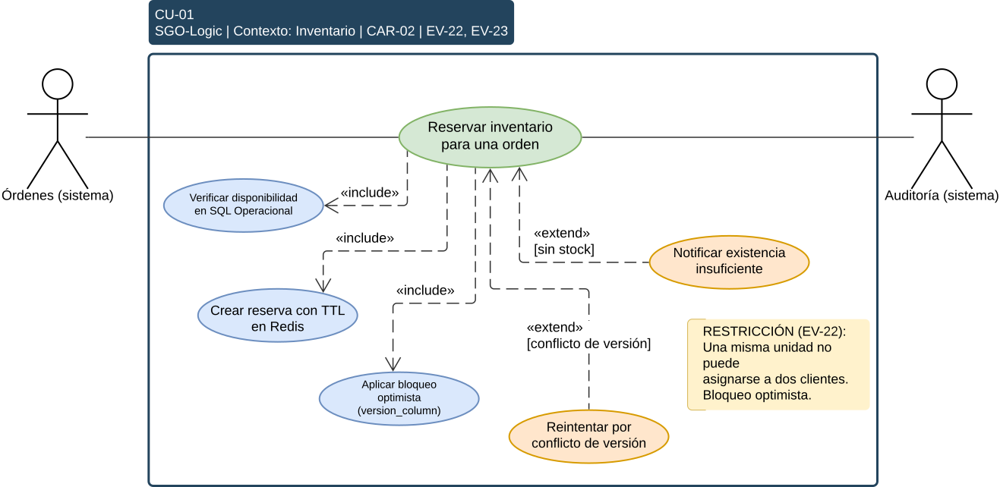

**CU-02**
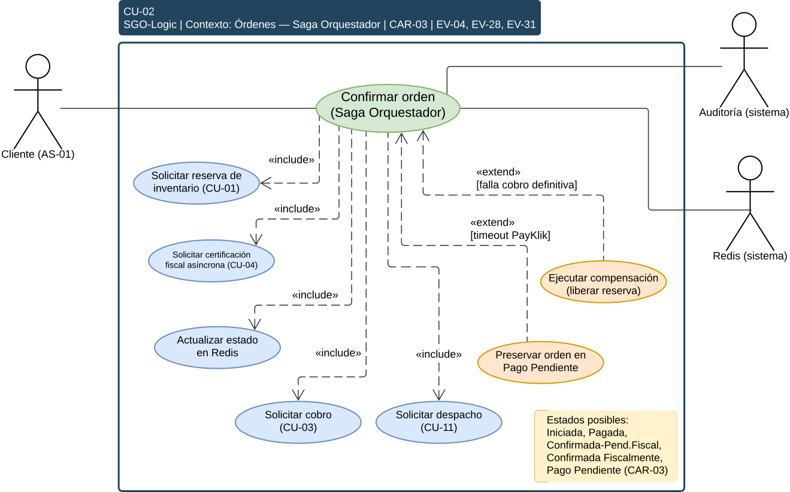

**CU-03**
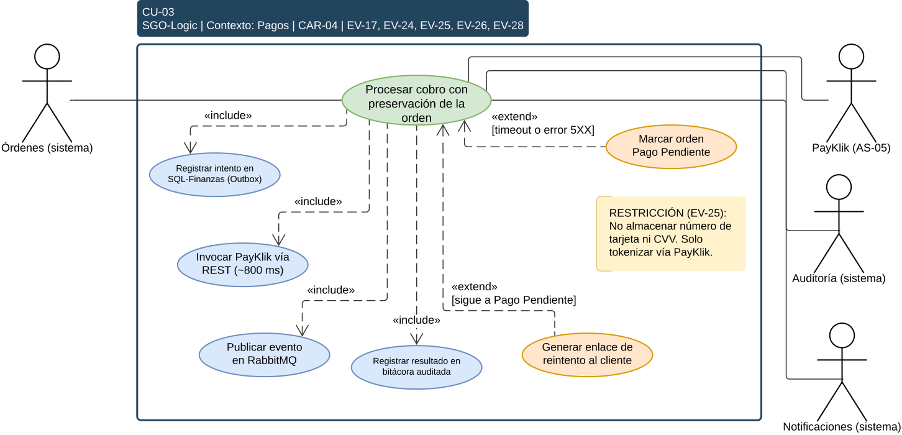

**CU-04**
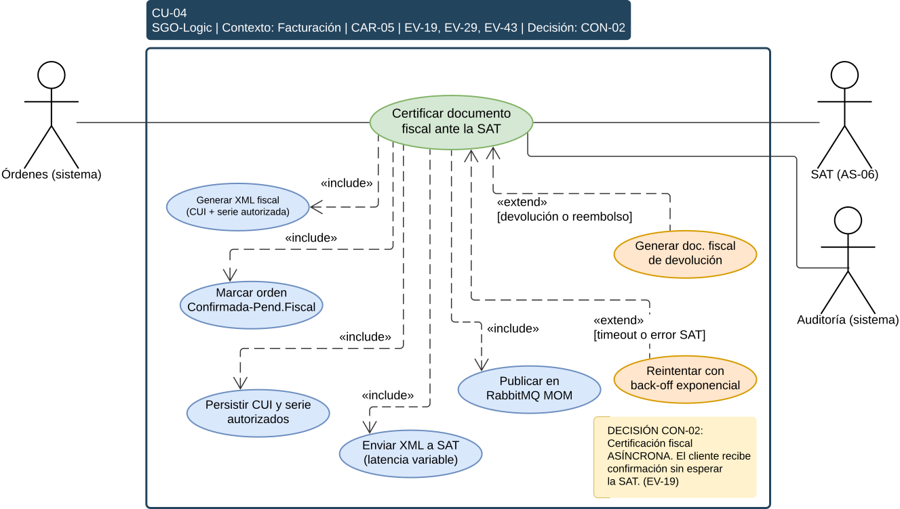

**CU-05**
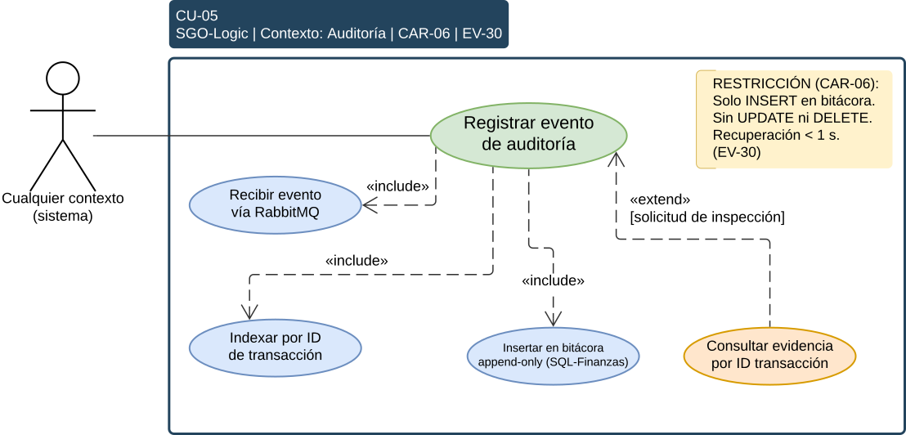

**CU-06**
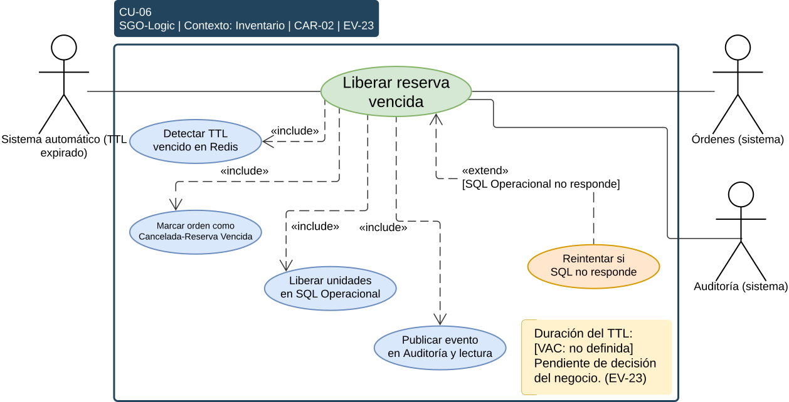

**CU-07**
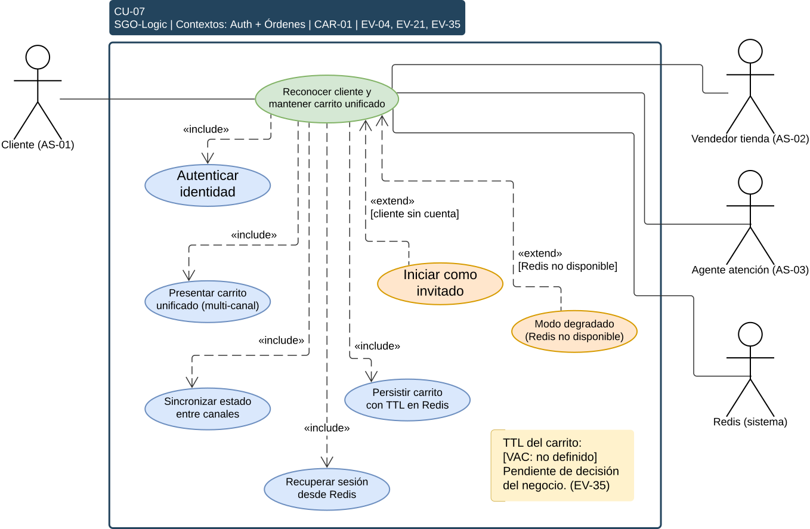

**CU-08**
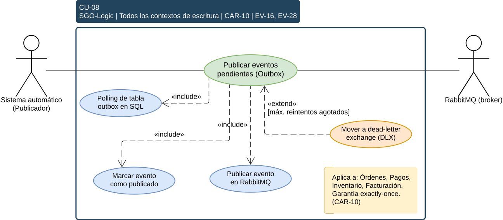

**CU-09**
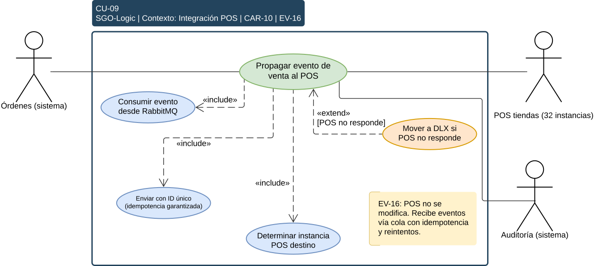

**CU-10**
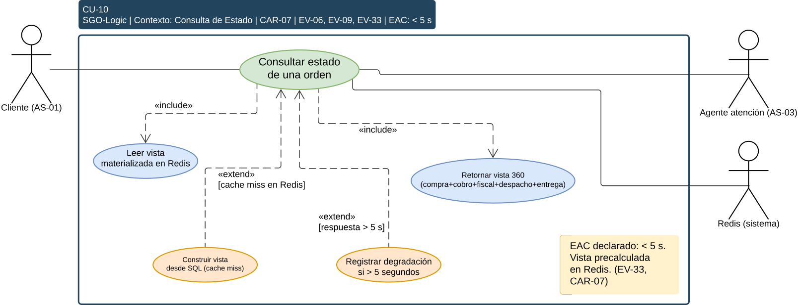

**CU-11**

**CU-12**

**CU-13**

**CU-14**

**CU-15**

El siguiente diagrama presenta el flujo principal del sistema: el recorrido de punta a punta de una compra omnicanal, desde el reconocimiento del cliente hasta la confirmación de la orden.

.svg)

## 11.6 Prototipo de Interfaz de Usuario (Mockups)

Este apartado presenta las interfaces gráficas (mockups no funcionales) de la iniciativa **SGO-Logic** de MegaStore. El diseño adopta un enfoque minimalista y de alta fidelidad, asegurando que la experiencia de usuario y del personal interno sea consistente y moderna en todos los canales.

Estas vistas materializan los requerimientos funcionales documentados en la sección 6, demostrando visualmente el concepto de omnicanalidad (Entregable 4).

### Vista Cliente: Checkout Web Omnicanal
**Asociado a:** CU-01, CU-04 (Procesamiento de cobro y carrito unificado).  
**Propósito:** Demuestra la unificación del carrito y la selección del método de despacho (Recoger en tienda vs Envío a domicilio), indicando claramente que no se almacena información sensible de pago (EV-25).

**Versión Escritorio (Desktop)**

  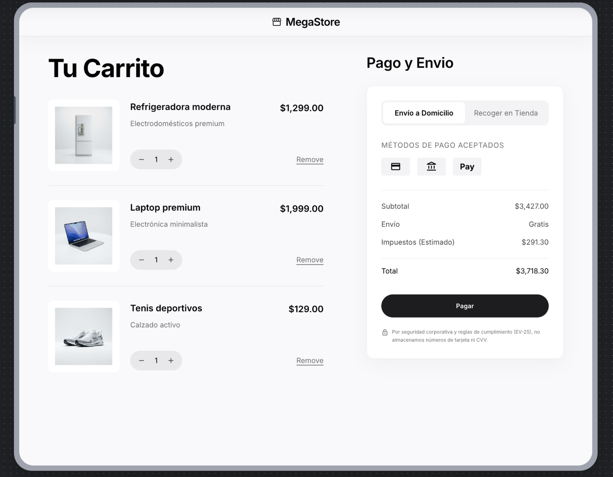

**Versión Móvil**

  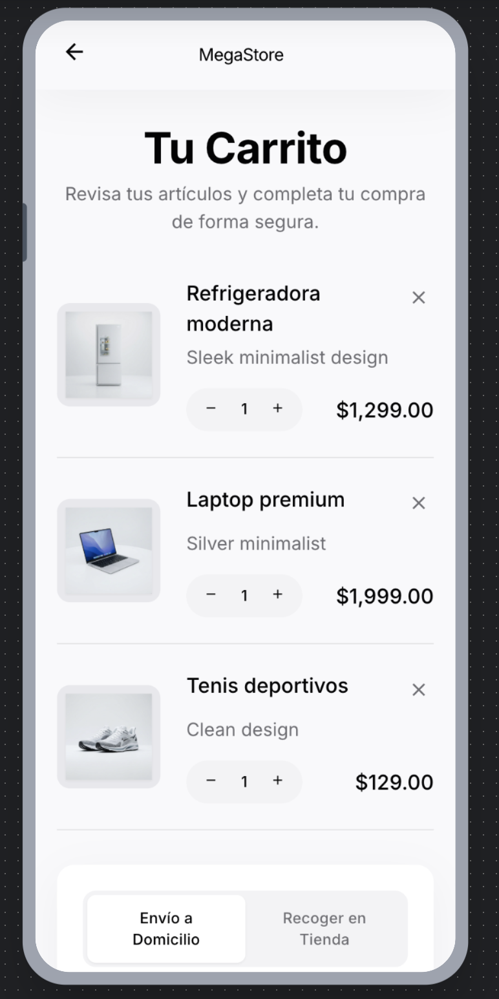

### Vista Tienda Física: Punto de Venta (POS)
**Asociado a:** CU-02, CU-03 (Recuperación de sesión).  
**Propósito:** Demuestra cómo un cajero en cualquiera de las 32 tiendas puede recuperar un carrito iniciado por el cliente en la nube (Redis) y finalizar el proceso físicamente.

**Pantalla de Cajero / Vendedor (iPad / Desktop)**

  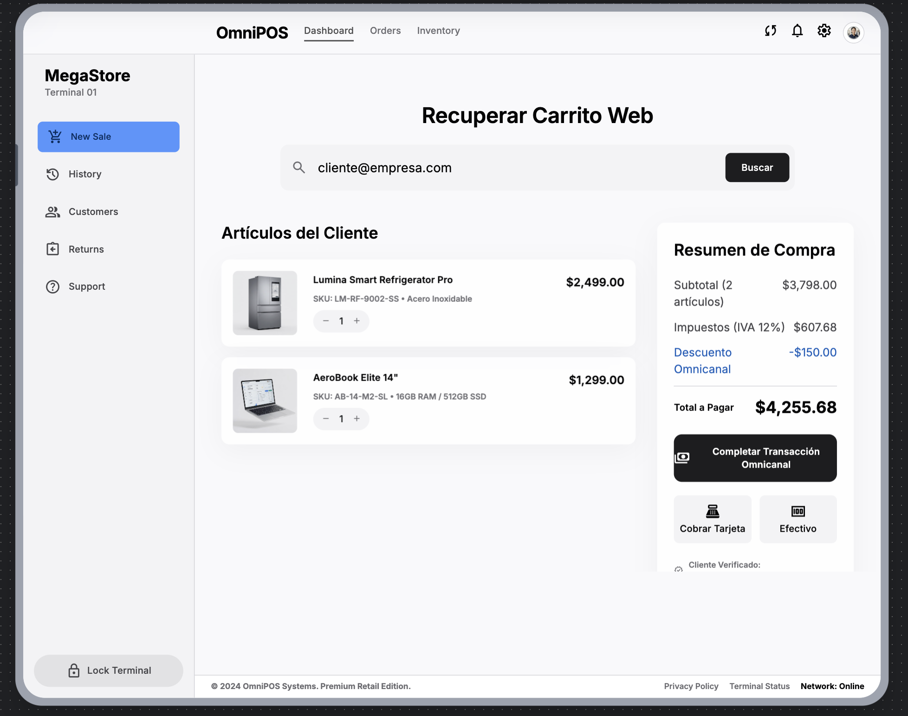

### Vista Postventa: Visión 360 del Cliente (Call Center)
**Asociado a:** CU-13, CAR-07.  
**Propósito:** Resuelve la necesidad de tener todo el historial (compras, despachos, devoluciones) en una sola vista con carga en menos de 5 segundos, reduciendo drásticamente el tiempo de atención al cliente.

**Versión Escritorio (Desktop)**

  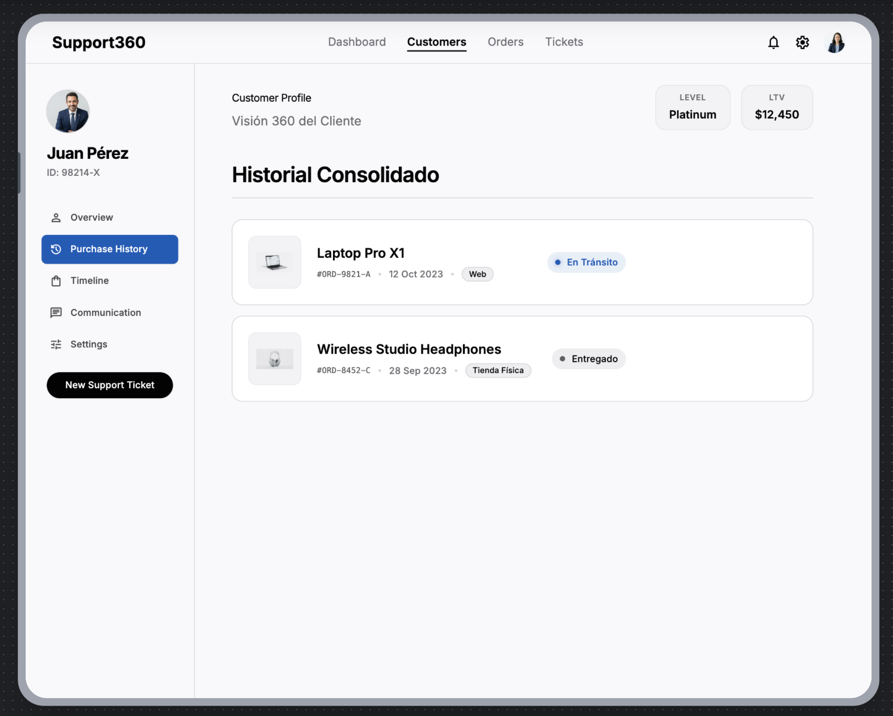

**Versión Móvil**

  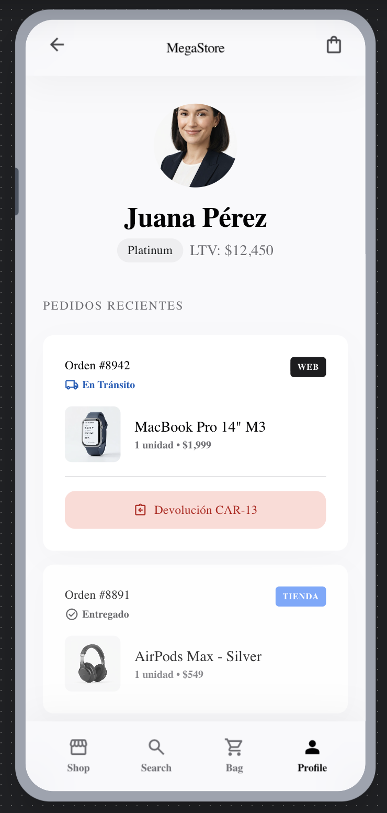

### Vista Logística: Dashboard de Despacho
**Asociado a:** CU-08 (Determinación y ejecución de despacho).  
**Propósito:** Herramienta interna para que el Jefe de Logística y su equipo vean las órdenes pendientes, el origen (Tienda o CD) y gestionen la integración de guías con LogiExpress, apuntando a reducir errores de envío en un 70%.

**Versión Escritorio (Desktop)**

  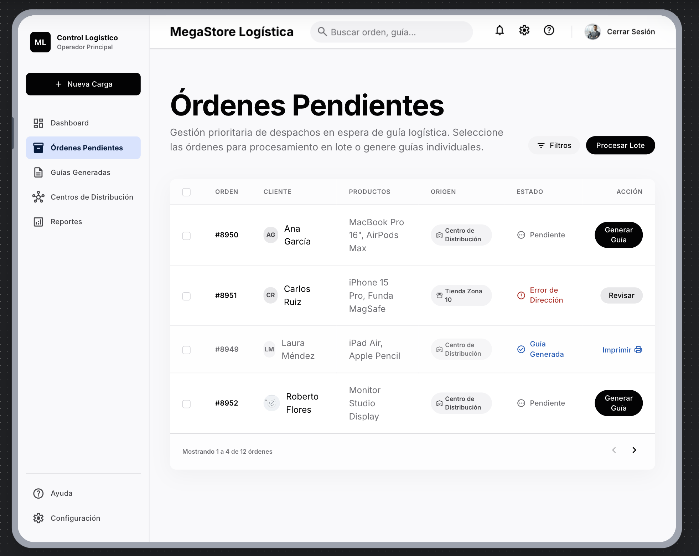

**Versión Móvil**

  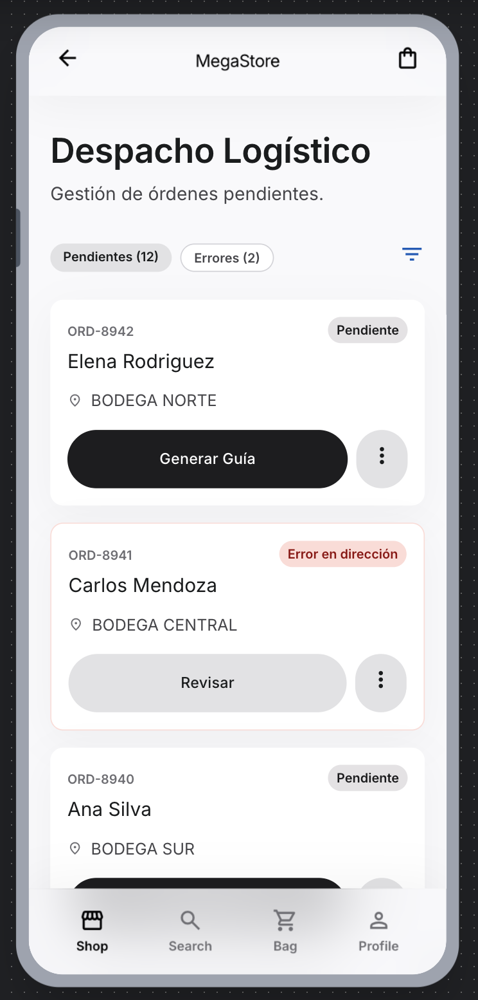

> *Nota: Este prototipo visual fue generado basándose en la especificación de diseño arquitectónico de SGO-Logic.*

---

# 12. Matrices de trazabilidad

Las matrices demuestran que cada decisión responde a una preocupación real del negocio y que ninguna preocupación, escenario o parte interesada quedó sin atender.

## 12.1 Preocupación → Driver

| Preocupación | Drivers que la atienden |
|---|---|
| PRE-01 | EAC-01, EAC-04, CAR-03, CAR-04 |
| PRE-02 | CU-02, CU-03, EAC-01, CAR-03, CAR-04 |
| PRE-03 | CU-15, CAR-14 |
| PRE-04 | CAR-12 |
| PRE-05 | CU-05, EAC-03, CAR-06 |
| PRE-06 | CU-04, CAR-05 |
| PRE-07 | CU-05, EAC-03, CAR-06 |
| PRE-08 | CU-03, RES-08, CAR-04 |
| PRE-09 | CU-01, EAC-05, CAR-02 |
| PRE-10 | CU-06, CAR-02 |
| PRE-11 | CU-09, CU-08, CAR-10 |
| PRE-12 | CU-13, RES-02, CAR-09 |
| PRE-13 | CU-07, CAR-01 |
| PRE-14 | CU-10, EAC-02, CAR-07 |
| PRE-15 | CU-11, CAR-08 |
| PRE-16 | RES-01, RES-03 |
| PRE-17 | RES-12 |
| PRE-18 | RES-10, RES-11 |
| PRE-19 | RES-14, RES-15 |
| PRE-20 | CAR-03, CAR-04, CAR-05 |

## 12.2 Driver → Decisión

| Driver | Decisión que lo resuelve |
|---|---|
| CU-01 / CAR-02 | ADR-005 |
| CU-02 / CAR-03 | ADR-002 |
| CU-03 / CAR-04 | ADR-009, ADR-010 |
| CU-04 / CAR-05 | ADR-011 |
| CU-05 / CAR-06 | ADR-006 |
| CU-07 / CAR-01 | ADR-001, ADR-004 |
| CU-08 | ADR-003 |
| CU-09 / CAR-10 | ADR-012 |
| CU-10 / CAR-07 | ADR-004 |
| CU-13 / CAR-09 | ADR-008 |
| Integración ERP legacy | ADR-007 |
| EAC-01 / PRE-01 | ADR-001 |
| EAC-02 / PRE-14 | ADR-004 |

## 12.3 Decisión → Vista

| Decisión | Bloques | Contexto | Componentes | Despliegue |
|---|---|---|---|---|
| ADR-001 | Sí | Sí | Sí | Sí |
| ADR-002 | Sí | — | Sí | — |
| ADR-003 | — | — | Sí | Sí |
| ADR-004 | Sí | — | Sí | Sí |
| ADR-005 | — | — | Sí | Sí |
| ADR-006 | Sí | — | Sí | Sí |
| ADR-007 | Sí | Sí | Sí | — |
| ADR-008 | — | Sí | Sí | Sí |
| ADR-009 | — | Sí | Sí | — |
| ADR-010 | — | Sí | — | — |
| ADR-011 | Sí | Sí | Sí | — |
| ADR-012 | Sí | Sí | Sí | Sí |

## 12.4 Escenario de calidad → Mecanismo y vista

| Escenario | Mecanismo | Se refleja en |
|---|---|---|
| EAC-01 | Escalado horizontal de Pagos; microservicios independientes | Despliegue |
| EAC-02 | CQRS con Redis materializado | Despliegue |
| EAC-03 | Bitácora append-only en base propia indexada | Despliegue |
| EAC-04 | Escalado horizontal independiente por servicio | Despliegue, Componentes |
| EAC-05 | Bloqueo optimista con versión y expiración | Despliegue, Componentes |

## 12.5 Cobertura de partes interesadas

| Parte interesada | Preocupación principal | Decisiones que la atienden |
|---|---|---|
| STK-01 Junta Directiva | No tocar ERP ni POS | ADR-007, ADR-008, ADR-012 |
| STK-02 Dirección / Gerencia | Omnicanal dentro de presupuesto y a tiempo | ADR-001, ADR-004; RES-10, RES-11 |
| STK-03 Gerencia de TI | Continuidad, mantenibilidad, no tocar legacy | ADR-001, ADR-002, ADR-007; EAC-01 |
| STK-04 Dirección de Finanzas | Trazabilidad y cumplimiento fiscal | ADR-006, ADR-011; EAC-03 |
| STK-05 Jefatura de Logística | Reducir errores de despacho, visibilidad | ADR-012; CU-11, CAR-08 |
| STK-06 Dirección de Comercialización | Experiencia omnicanal sin silos | ADR-001, ADR-004; CU-07 |
| STK-07 Jefatura de Operaciones | No repetir la pérdida por indisponibilidad | ADR-009, ADR-002; EAC-01 |
| STK-14 SAT | Documentación fiscal válida y auditable | ADR-011, ADR-006 |
| STK-18 Reguladores de datos | Cumplimiento en tratamiento de datos | ADR-010; RES-09 |

---

# 13. Vacíos de información y supuestos

Los siguientes puntos no están determinados por la información disponible y se documentan de forma explícita. Los que afectan el diseño se cubren con un supuesto declarado, sujeto a validación.

| ID | Vacío | Afecta a | Estado |
|---|---|---|---|
| VAC-03 | Definición precisa de "finalizar la orden" respecto de la SAT. | ADR-011, RES-07 | Supuesto adoptado: es el cierre fiscal, distinto de la confirmación comercial al cliente. Por validar con el cliente. |
| VAC-06 | Inventario de hardware existente on-premises. | RES-10, RES-14 | Abierto. Afecta el reparto del presupuesto entre inversión inicial y costo operativo. |
| VAC-09 | Fuente definitiva del Catálogo Comercial. | CAR-11, CUN-08 | Abierto. La administración de catálogo, precios y promociones queda fuera del alcance; el sistema la consume como dependencia externa. Por validar con el cliente. |

---

*Fin del documento.*
