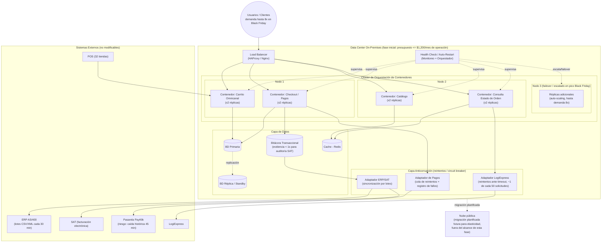

# Diagrama de Despliegue

**Responsables:** Jose Pirir (202300335) — resiliencia en contenedores · Julio Herrera (202300850) — topología de datos/BD
**Entregable:** 2 — Diagramas
**Caso:** SGO-Logic — MegaStore
**Borrador:** punto de partida para revisar con Julio; ajustar nombres de servicios, número de réplicas y nodos según lo que definan juntos.

---

## Diagrama

---

## Justificación de resiliencia (aporte de Jose Pirir)

| Decisión | Relación con EAC / restricción |
|---|---|
| Réplicas ≥2 por servicio crítico (carrito, checkout, catálogo, consulta de estado) | EAC-01 Disponibilidad ≥99.9% con demanda hasta **8x** en Black Friday: si una réplica falla, el load balancer redirige tráfico sin caída total |
| Nodo 3 con auto-scaling / failover | Absorbe el pico 8x de Black Friday sin sobrecargar Nodos 1 y 2 |
| Health Check + Auto-Restart a nivel de orquestador | Detecta contenedores caídos y los reinicia automáticamente sin intervención manual |
| **Adaptador de Pagos con cola de reintentos y registro de fallos** | EAC-02: si PayKlik cae (como ocurrió: 45 min, ~USD 150,000 perdidos), la orden no se pierde y cada intento fallido queda auditado |
| **Adaptador LogiExpress con reintentos** | Cubre la tasa de timeout conocida (~1 de cada 50 solicitudes) sin que la falla externa tumbe el flujo de despacho |
| Cache (Redis) delante de Catálogo y Consulta de Estado | EAC-03: consultas de estado de orden **< 5s**, límite explícito del caso |
| Bitácora Transaccional dedicada, sincronizada por lotes con el ERP | EAC-04: recuperar evidencia de una transacción en **< 1s** para auditorías de la SAT/Finanzas, sin depender de que el ERP procese en tiempo real (lo hace cada 30 min) |
| **Docker Swarm en lugar de Kubernetes** | El equipo solo tiene conocimientos básicos de Docker (dato explícito del caso); Swarm reduce el impacto de adopción/capacitación que el caso pide justificar explícitamente para cualquier alternativa |
| Todo dentro de "On-Premises" con flecha de "migración planificada" hacia la nube | Cumple la restricción de despliegue on-premises inicial y el presupuesto (< $1,200/mes), a la vez que deja explícito el camino de evolución hacia la nube que el caso exige para elasticidad futura en eventos como Black Friday |
| Capa Anticorrupción como única puerta hacia ERP/POS/PayKlik/LogiExpress/SAT | No modifica los sistemas legacy (restricción dura de Francisco); aísla fallos externos para que no tumben el Backbone |
