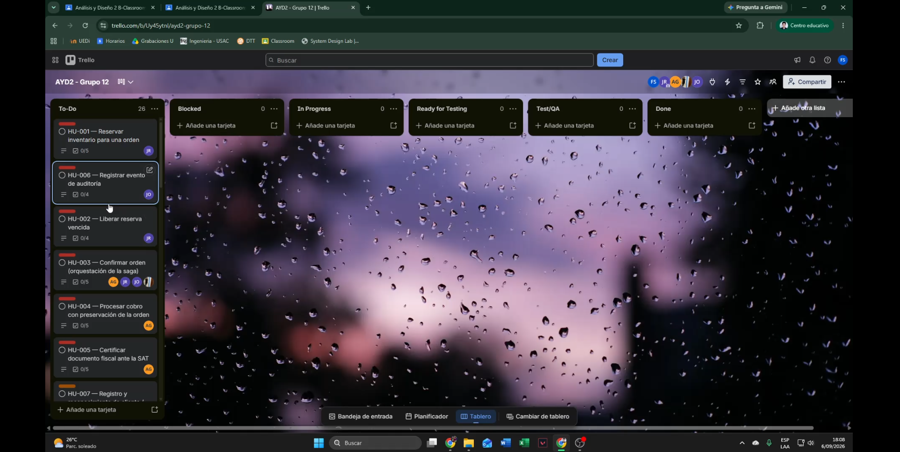
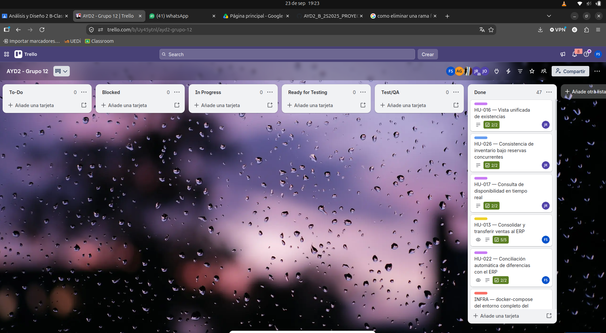

# Plan de Gestión — Tablero Kanban en Trello

**Responsable:** Jose Pirir (202300335) — Administrador del Tablero Kanban
**Herramienta elegida:** Trello

---

## 1. Por qué Trello

El enunciado exige un tablero Kanban con 6 columnas obligatorias que sirva como "radiador de información del progreso técnico" del equipo. Trello cubre esto de forma simple, visual y sin fricción de configuración (a diferencia de GitHub Projects, que requiere más pasos para personalizar estados). Se usará Trello como la única fuente de verdad del avance del proyecto; el repositorio de GitHub sigue siendo la fuente de verdad del contenido (DDA, diagramas, código).

## 2. Qué vamos a hacer

1. Crear un tablero en Trello con el nombre oficial del proyecto: `AYD2_B_2S2025_PROYECTO_G12 - SGO-Logic`.
2. Configurar las 6 listas (columnas) obligatorias, en este orden exacto:
   `To Do` → `Blocked` → `In Progress` → `Ready for Testing` → `Test/QA` → `Done`
3. Cargar como tarjetas en `To Do` las **26 historias de usuario** ya documentadas en [`Backlog_Historias_Usuario.md`](Backlog_Historias_Usuario.md), una tarjeta por historia (HU-001 a HU-026).
4. Cada tarjeta de historia debe contener, en su descripción, el mismo contenido del backlog: estimación (SP), Como/Quiero/Para, criterios de aceptación y tareas técnicas (como checklist de Trello).
5. Priorizar visualmente por Ola del Backbone (Ola 1 arriba de todo en `To Do`), nunca por lo cosmético, tal como exige el enunciado.
6. Agregar a cada integrante del equipo como miembro del tablero e invitarlo por correo/usuario de Trello.

## 3. Convenciones del tablero

### 3.1 Etiquetas (labels)

| Etiqueta | Color sugerido | Uso |
|---|---|---|
| `Ola 1` | Rojo | Núcleo transaccional (HU-001 a HU-006) |
| `Ola 2` | Naranja | HU-007 a HU-010 |
| `Ola 3` | Amarillo | HU-011 a HU-013 |
| `Ola 4` | Verde | HU-014, HU-015 |
| `Gap / sin CDU` | Morado | HU-016 a HU-022 |
| `Calidad (EAC)` | Azul | HU-023 a HU-026 |
| `Bloqueante` | Negro | Cualquier tarjeta que impida avanzar a otra |

### 3.2 Campos por tarjeta

- **Título:** `HU-0XX — Nombre corto` (igual que en el backlog, para trazabilidad).
- **Descripción:** Como/Quiero/Para + referencia (`CU-##`, `EV-##`).
- **Checklist "Criterios de aceptación"**: uno por bullet del backlog.
- **Checklist "Tareas técnicas"**: uno por bullet del backlog.
- **Estimación:** se agrega como número al inicio del título o en un campo personalizado (Power-Up "Custom Fields"), en Story Points.
- **Miembro asignado:** quien esté trabajando la historia.
- **Fecha de vencimiento:** opcional, según el cronograma de la Fase 1.

### 3.3 Reglas de movimiento entre columnas

| Columna | Significado | Quién mueve la tarjeta |
|---|---|---|
| `To Do` | Historia priorizada, no iniciada | Jose (al cargar el backlog) |
| `Blocked` | Depende de una decisión técnica o de otra historia sin resolver | Quien detecta el bloqueo, con comentario explicando por qué |
| `In Progress` | Alguien la está trabajando activamente | El responsable, al iniciar |
| `Ready for Testing` | El artefacto (documento/diagrama/componente) está listo para revisión cruzada | El responsable, al terminar |
| `Test/QA` | Se está validando contra el catálogo de evidencia (`EV-##`) y los criterios de aceptación | El revisor asignado |
| `Done` | Validado, sin pendientes, integrado a `develop` | El revisor, tras aprobar |

Nota para esta fase (documentación, sin código funcional): "Test/QA" significa **revisión cruzada del contenido contra `DDA_00_Catálogo_Evidencia`**, no pruebas automatizadas de software.

## 4. Sincronización con GitHub

- Cada tarjeta de Trello referencia el archivo o carpeta del repositorio donde vive el entregable correspondiente (por ejemplo, HU-004 → `3. Calidad y Despliegue/DDA_06_Despliegue.md`).
- Al mover una tarjeta a `Done`, debe existir el commit correspondiente ya fusionado (o en PR abierto) en `develop`.
- Jose revisa semanalmente que el estado del tablero sea consistente con el estado real del repositorio.

## 5. Tablero actual

