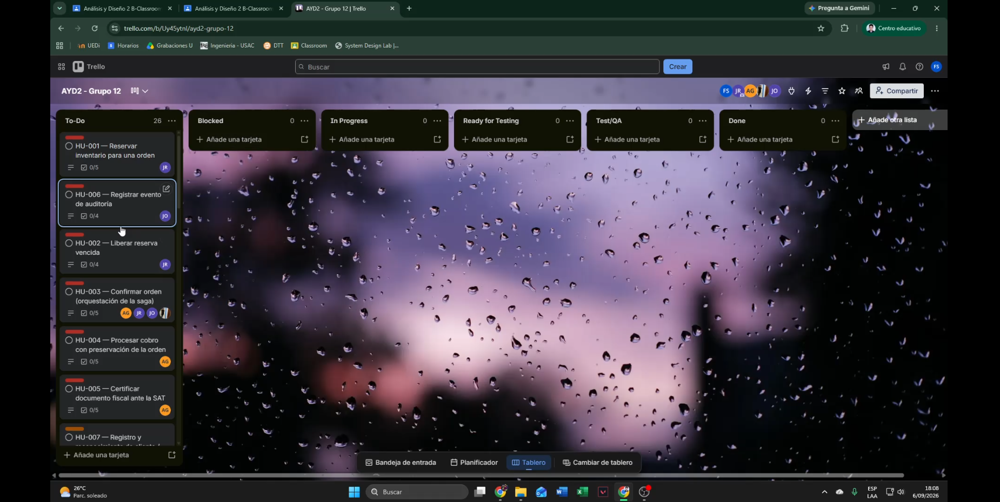
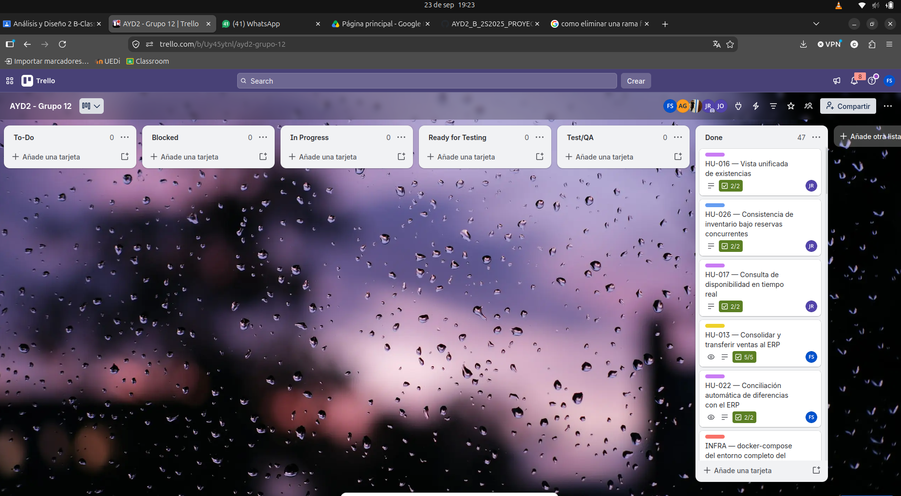
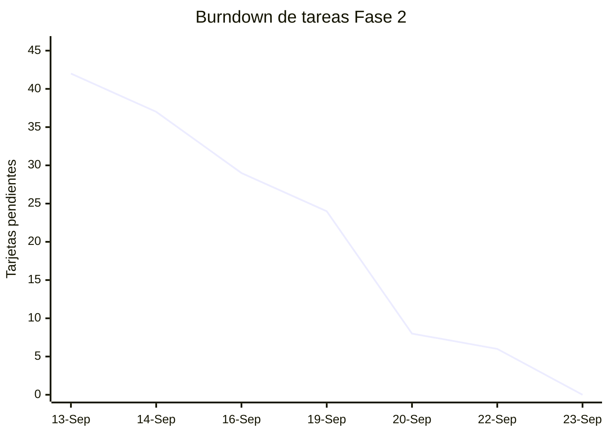

# Bitácora de Trabajo Arquitectónico — Proyecto SGO-Logic

## 0. Identificación de la iteración

| Campo | Registro |
|---|---|
| Proyecto | AYD2_B_2S2025_PROYECTO_G12 — SGO-Logic |
| Tipo de documento | Bitácora de Trabajo Arquitectónico |
| Fase | Fase 2: materialización integral del diseño en código |
| Alcance arquitectónico | Proyecto completo: núcleo transaccional, inventario, pagos, facturación, auditoría, consulta de estado, notificaciones, gateway, web omnicanal, despacho, mocks, mensajería, observabilidad e infraestructura |
| Base de trazabilidad | Historial Git del repositorio privado y estructura `SGO-Logic/` |
| Periodo de la iteración | 2026-09-04 al 2026-09-22; entrega 2026-09-23 |
| Objetivo del sprint | Materializar las refactorizaciones arquitectónicas de Fase 1 y demostrar los EaC, restricciones e infraestructura on-premise mediante código ejecutable y evidencia verificable |

La Fase 2 se inicia sobre la nueva estructura de carpetas que incorpora
`SGO-Logic/` como raíz del prototipo ejecutable, separado de la documentación
arquitectónica, ADR, backlog y evidencias. Esta bitácora registra la ejecución
del proyecto completo.

## 1. Sprint Planning y gestión del backlog

Las tareas seleccionadas responden a las observaciones de la fase previa en
todo el ecosistema: necesidad de desacoplar contextos, completar el núcleo
transaccional, asegurar concurrencia y resiliencia, incorporar infraestructura
on-premise reproducible, proteger datos sensibles, garantizar observabilidad y
evolucionar los esquemas persistentes. La priorización sigue el backbone
técnico definido en el backlog y los EaC del DDA.

| Prioridad | Historia / tarea seleccionada | Observación de fase previa que resuelve | Diseño, EaC o restricción trazable | Entregable esperado |
|---|---|---|---|---|
| P0 | Mocks configurables de ERP y POS | No existía una dependencia externa reproducible para pruebas de integración | ADR-019; pruebas repetibles ante fallas de terceros; EAC-01 | Servicios Docker `mock-erp` y `mock-pos` con endpoints y fallas configurables |
| P0 | Núcleo transaccional de órdenes | La saga, sus compensaciones y la coordinación de estados requerían materialización ejecutable | ADR-002, ADR-003, ADR-016; EAC-01 | Órdenes, saga orquestada, eventos, outbox y transiciones consistentes |
| P0 | Inventario y despacho | La reserva, concurrencia y entrega estaban definidas principalmente en diseño | ADR-005, ADR-017; EAC-05 | Reserva optimista, liberación, reingreso, despacho y consulta de inventario |
| P0 | Pagos y facturación fiscal | La integración con PayKlik/SAT necesitaba aislamiento ante fallos y certificación asíncrona | ADR-009, ADR-010, ADR-011; EAC-01 | Tokenización, circuit breaker, cobro, factura y alerta fiscal |
| P0 | Auditoría y seguridad | La trazabilidad append-only y la protección de información sensible debían probarse en código | ADR-006, ADR-020; EAC-03 | Auditoría inmutable, correlación, autenticación de borde y ausencia de PAN/CVV |
| P1 | Consulta de estado y notificaciones | El cliente necesitaba lectura rápida y avisos desacoplados del flujo principal | ADR-004, ADR-012; EAC-02 | CQRS/Redis, consumidor idempotente, incidencias y mensajería omnicanal |
| P1 | Gateway, web omnicanal y experiencia de actores | El diseño carecía de un punto de entrada y de una demostración integrada | ADR-020; EAC-02, EAC-03 | YARP, checkout, POS web, Visión 360, despacho y consulta |
| P1 | Observabilidad, escalabilidad e infraestructura on-premise | Los EaC de rendimiento y operación requerían mediciones reproducibles | EAC-01 a EAC-05; Prometheus/Grafana; Docker Compose | Métricas, dashboards, pruebas de carga, réplicas y stack ejecutable |
| P0 | Worker de integración POS | El flujo de propagación al POS no estaba materializado como servicio persistente | ADR-012, ADR-018; trazabilidad y entrega al POS | Consumidor, mapeo de tiendas y registro de envíos |
| P0 | Consolidación y conciliación ERP | La integración batch y la conciliación no tenían una implementación operativa completa | ADR-007, ADR-008; trazabilidad financiera y consistencia del batch | Ventas, lotes, registros y conciliaciones persistidas | 
| P0 | Outbox e idempotencia transversal | Riesgo de duplicar o perder eventos en fallos parciales | ADR-003, ADR-014, ADR-018; EAC-01 y trazabilidad | `outbox_messages`, `mensajes_procesados`, publisher y deduplicación |
| P0 | Migraciones EF para POS y ERP | `EnsureCreated()` no permitía evolución versionada ni soportaba correctamente bases persistentes | Restricción de migraciones controladas; integridad operacional | Factories, migraciones iniciales y arranque con `Database.Migrate()` |
| P1 | Evidencias de pruebas y operación | El diseño requería demostrar funcionamiento, rendimiento y resiliencia | EAC-01 a EAC-05; catálogo de evidencia | Capturas, resultados de pruebas, logs y métricas enlazadas | 

### 1.1 Captura del tablero antes de iniciar el desarrollo

*Evidencia de línea base del tablero Kanban previa al inicio de la implementación.*

### 1.2 Criterio de seguimiento

Cada tarjeta debe poder relacionarse con una historia, ADR, EaC o restricción,
un commit o pull request y un archivo de evidencia. Una tarea solo se marca
como completada cuando el código está integrado y la evidencia funcional o
documental correspondiente está disponible.

### 1.3 Formato obligatorio de los dailies

Cada registro responde explícitamente las tres preguntas exigidas por la
iteración: (1) qué componente, servicio o patrón se materializó ayer y cuál
fue su resultado numérico o funcional; (2) qué elemento del diseño o flujo se
codificará hoy y con qué EaC o restricción se relaciona; y (3) qué impedimento
técnico o de infraestructura amenaza esos EaC o el rendimiento. Los apartados
de cada integrante usan esos tres bloques, conservando el resultado como
evidencia separada cuando aporta una medición concreta.

## Daily técnico obligatorio - Gerardo Castillo

### Daily 1 — 2026-09-14 | Mock ERP y POS dockerizados

#### Qué se materializó en código
- Se incorporaron los mocks de ERP y POS como servicios ejecutables en Docker junto con el stack principal del proyecto.
- El punto de materialización clave fue el ajuste del `docker-compose.yml` y la configuración de `Mocks/` con endpoints deterministas para `mock-erp` y `mock-pos`.
- Se logró un entorno reproducible para cerrar el contrato de integración con dependencias externas sin depender de sistemas reales.

#### Resultado numérico o funcional
- ERP quedó expuesto en `http://localhost:4000`.
- POS quedó expuesto en `http://localhost:4001`.
- El entorno quedó listo para pruebas de integración con la red de servicios del proyecto, evitando acoplamientos directos a un ERP y POS reales.

#### Qué se codificará hoy y su trazabilidad
- Se codificó el primer esqueleto funcional de integración con sistemas externos, con trazabilidad directa a la restricción de arquitectura de “mockear los sistemas externos con fallas configurables” y a la necesidad de validar contratos antes de imponer patrones de producción.
- La decisión técnica estaba alineada con la rentabilidad de pruebas sin bloquear el delivery del MVP.

#### Impedimentos técnicos o de infraestructura
- La principal amenaza era el acoplamiento funcional a un contrato estable y no ambiguo de simulación; cualquier cambio de payload o de codificación envejecía inmediatamente las pruebas de integración.
- También existía riesgo de que los mocks no reflejaran la latencia, errores o cambios de estado reales del ERP/POS en producción.

---

### Daily 2 — 2026-09-20 | Integración POS y consolidación ERP

#### Qué se materializó en código
- Se desarrolló la base de integración del worker POS con consumidores, mapeo de tiendas y registro de envíos; además se consolidó la estructura ERP para generar lotes, conciliaciones y reintentos.
- El trabajo se materializó en los workers `SgoLogic.IntegracionPos.Worker` y `SgoLogic.IntegracionErp.Worker`, con persistencia específica para cada contexto y el patrón de outbox/idempotencia compartido.
- La materialización concreta incluyó la lógica de comunicación con sistemas externos, la publicación de eventos y la incorporación de los artefactos transversales de deduplicación.

#### Resultado numérico o funcional
- El worker POS quedó capaz de mapear tiendas origen y permitir el seguimiento de envíos de eventos al POS.
- El worker ERP quedó enfocado en la consolidación de ventas y lotes de exportación con conciliación posterior contra finanzas.
- El flujo de integración se volvió ejecutable sobre PostgreSQL, logrando persistencia transaccional y trazabilidad de envíos.

#### Qué se codificará hoy y su trazabilidad
- El trabajo del día estaba directamente ligado a los EaC de integración con ERPs y POS, así como a la restricción de no perder trazabilidad ni reintentos en caso de fallo parcial de publicación.
- El patrón de outbox e idempotencia era el punto central para asegurar que el flujo transaccional no duplicaba mensajes ni perdía eventos en la integración.

#### Impedimentos técnicos o de infraestructura
- El mayor riesgo fue la inconsistencia entre el modelo de persistencia y la inicialización del esquema, especialmente en la capa de integración, donde no podía asumirse que el motor partía siempre desde una base vacía.
- También existía presión sobre el rendimiento del worker ante colas y polling del outbox y sobre el uso de esquemas compartidos para tablas transversales como `outbox_messages` y `mensajes_procesados`.

---

### Daily 3 — 2026-09-22 | Correcciones ERP/POS y migraciones EF

#### Qué se materializó en código
- Se corrigió el problema de persistencia de la integración POS: faltaba un `DbContextFactory` y la migración inicial; esto se materializó en `IntegracionPosDbContextFactory` y en la carpeta `Infrastructure/Persistencia/Migraciones`.
- Se normalizó el arranque de ERP usando `Database.Migrate()` en lugar de `EnsureCreated()`, con la migración inicial `InicialIntegracionErp`.
- Se documentó la estrategia de baseline para bases persistentes que habían sido creadas con `EnsureCreated()` antes de introducir EF migrations.

#### Resultado numérico o funcional
- La base `sgo_integracion_pos` quedó con las tablas esperadas:
  - `mapeo_tienda_pos`
  - `mensajes_procesados`
  - `outbox_messages`
  - `registro_envio_pos`
- La base `sgo_integracion_erp` quedó con su historial EF y esquema consistente con `Database.Migrate()`.
- La verificación en PostgreSQL confirmó la presencia de `__EFMigrationsHistory` en la base POS y la ausencia de la tabla en la base ERP previa, lo que justificó el baseline documentado.

#### Qué se codificará hoy y su trazabilidad
- Se codificó la solución de un defecto estructural real: la diferencia entre bases nuevas, bases persistentes y el historial de migraciones EF.
- La trazabilidad directa estaba con la restricción de “migraciones reales para la capa de persistencia” y con la necesidad de asegurar que la aplicación no dependa de `EnsureCreated()` cuando la base ya está en uso.

#### Impedimentos técnicos o de infraestructura
- La amenaza principal fue la corrupción de la compatibilidad operacional en entornos persistentes: una base que ya existía sin historial EF podía iniciar con errores de esquema o con tablas duplicadas si se mezclaban mecanismos de creación.
- El problema de infraestructura era menor en cuanto a red o servicios, pero crítico para la integridad del dato y la evolución del sistema.

---

## Daily técnico obligatorio - Jonathan Jerónimo

### Daily 1 — 2026-09-04 | Arquitectura base y contratos de eventos
- **Qué se materializó en código:** se congelaron PostgreSQL 16, Redis 7, RabbitMQ 3.13 y RabbitMQ.Client directo; se inició el contrato Envelope v1 para Auth y Consulta de Estado.
- **Resultado:** se definieron `eventId`, `transactionId`, `sequence`, `aggregateType` y `aggregateId`, junto con la prohibición de transportar PAN/CVV.
- **Qué se codificará y trazabilidad:** interfaces del envelope y correlación, con relación directa a EAC-03 y seguridad de datos.
- **Impedimento:** riesgo de divergencia entre PascalCase/camelCase y formatos de fecha UTC.

### Daily 2 — 2026-09-05 | Contratos de Órdenes y modelo de identidad
- **Qué se materializó en código:** se homologaron los eventos de Órdenes para Consulta de Estado y se acordó el binding exclusivo de Notificaciones a `ordenes.orden.estado-cambiado`.
- **Resultado:** se evitó la duplicidad de alertas y se definió el modelo preliminar `Usuario`/`CodigoVerificacion` con BCrypt.
- **Qué se codificará y trazabilidad:** autenticación previa al checkout, vinculada a HU-007 y seguridad de credenciales.
- **Impedimento:** falta de una plantilla .NET 8 común con logging y métricas.

### Daily 3 — 2026-09-06 | Entorno base y aislamiento por servicio
- **Qué se materializó en código:** se validaron 3 PostgreSQL, RabbitMQ en puertos 5672/15672, Redis y `SgoLogic.BuildingBlocks`; se estructuró `SgoLogic.Auth.Api`.
- **Resultado:** `sgo_auth` quedó aislada en `db-operacional`, sin acoplamiento de esquema.
- **Qué se codificará y trazabilidad:** cadena de conexión y estructura inicial de Auth, con relación a ADR-001.
- **Impedimento:** posible saturación de pools de Npgsql y StackExchange.Redis.

### Daily 4 — 2026-09-07 | Registro y verificación de usuarios
- **Qué se materializó en código:** `AuthController`, `POST /api/auth/registro`, entidad `Usuario`, BCrypt con costo 11 y migración inicial de `sgo_auth`.
- **Resultado:** HTTP 201 en registro correcto y HTTP 400 en email duplicado; BCrypt promedió 68 ms por operación.
- **Qué se codificará y trazabilidad:** código de verificación de 6 dígitos con expiración de 15 minutos y bloqueo HTTP 403 para cuentas no verificadas, HU-007.
- **Impedimento:** consumo de CPU de BCrypt bajo concurrencia alta.

### Daily 5 — 2026-09-08 | JWT y comienzo del carrito unificado
- **Qué se materializó en código:** endpoints de verificación/login y JWT HMAC-SHA256 de 256 bits con TTL de 60 minutos.
- **Resultado:** 10 usuarios simulados obtuvieron token correctamente, con respuesta menor a 25 ms.
- **Qué se codificará y trazabilidad:** `CarritoController`, clave Redis `carrito:{id}` y TTL de 72 horas, HU-007.
- **Impedimento:** payloads complejos podían producir serialización ineficiente en Redis.

### Daily 6 — 2026-09-09 | Carrito omnicanal y diseño CQRS
- **Qué se materializó en código:** endpoints de carrito y fusión atómica del carrito anónimo al usuario autenticado mediante `X-Carrito-Id`.
- **Resultado:** 50 adiciones simultáneas alcanzaron latencia media Redis de 2.1 ms.
- **Qué se codificará y trazabilidad:** `ConsultaEstado.Api`, vista `OrdenVista` y separación CQRS con Redis, HU-010/EAC-02.
- **Impedimento:** pérdida de datos si Redis reiniciaba sin AOF/RDB; se requirió fallback relacional.

### Daily 7 — 2026-09-10 | Consulta de Estado y fuente autoritativa
- **Qué se materializó en código:** `EstadoController`, PostgreSQL como almacenamiento frío, Redis con `orden:vista:{ordenId}` e índices por cliente.
- **Resultado:** lectura directa Redis de 1.4 ms por consulta.
- **Qué se codificará y trazabilidad:** consumidor `ConsultaEstadoOrdenesConsumidor` y regla de que solo `OrdenCreada` y `OrdenEstadoCambiado` mutan el estado.
- **Impedimento:** mensajes duplicados o desordenados podían devolver estados antiguos.

### Daily 8 — 2026-09-11 | Idempotencia e incidencias
- **Qué se materializó en código:** deduplicación por `eventId` y ordenamiento monotónico por `sequence` en `mensajes_procesados`.
- **Resultado:** 50 eventos procesados en 380 ms sin fallas; consulta de estado en 12 ms promedio.
- **Qué se codificará y trazabilidad:** entidad `Incidencia` 0..N por orden para HU-021.
- **Impedimento:** contención de base si no se indexaban `orden_id` y `cliente_id`.

### Daily 9 — 2026-09-12 | Gestión de incidencias e historial
- **Qué se materializó en código:** `IncidenciasController` con POST/PUT, migración EF y actualización de la vista denormalizada Redis.
- **Resultado:** creación y consulta de incidencias en 18 ms.
- **Qué se codificará y trazabilidad:** historial paginado por cliente con DTOs livianos y carga menor a 500 ms.
- **Impedimento:** desfase eventual entre saga, RabbitMQ y materialización de la vista.

### Daily 10 — 2026-09-13 | Integración de la Ola 1 y fallback
- **Qué se materializó en código:** flujo Reserva → Cobro → Factura → Auditoría → Consulta de Estado mediante RabbitMQ.
- **Resultado:** la vista de orden quedó materializada en Redis en 145 ms desde el evento inicial.
- **Qué se codificará y trazabilidad:** fallback de `EstadoController` a PostgreSQL y rehidratación transparente de Redis, EAC-02.
- **Impedimento:** ausencia de un gateway único provocaba dependencia de puertos internos y posibles bloqueos CORS.

### Daily 11 — 2026-09-14 | Gateway YARP y rutas perimetrales
- **Qué se materializó en código:** se corrigió la ruta de Inventario con `PathRemovePrefix` y `PathPrefix`; la suite alcanzó 57/57 pruebas PASS.
- **Resultado:** YARP centralizó Auth, Carrito, Estado, Incidencias, Notificaciones, Mensajes, Órdenes, Pagos, Facturación e Inventario en el puerto 8080.
- **Qué se codificará y trazabilidad:** propagación de `X-Transaction-Id`, EAC-03 y ADR-020.
- **Impedimento:** latencia agregada del proxy por timeouts o pools HTTP mal configurados.

### Daily 12 — 2026-09-15 | Hardening y seguridad de pagos
- **Qué se materializó en código:** se corrigió el parser de códigos desde logs JSON de Serilog y la suite bajó de 45 a 29 segundos.
- **Resultado:** se eliminaron falsos positivos y se verificó que Auth, Carrito y Estado no expusieran PAN/CVV.
- **Qué se codificará y trazabilidad:** auditoría de no persistencia de datos de pago, PCI-DSS y ADR-010.
- **Impedimento:** crecimiento de logs sin rotación podía agotar el disco Docker.

### Daily 13 — 2026-09-16 | Notificaciones y mock de mensajería
- **Qué se materializó en código:** `Notificaciones.Api`, `MockMensajeria` y consumidor con binding único; mock SMS/email/push con fallas configurables.
- **Resultado:** procesamiento normal de notificación en 32 ms y fallas HTTP 503 aisladas con reintentos.
- **Qué se codificará y trazabilidad:** auditoría local y DLQ `sgo.eventos.dlq` tras agotar reintentos, HU-015.
- **Impedimento:** un HttpClient sin timeout podía bloquear RabbitMQ; se fijó timeout de 3 segundos.

### Daily 14 — 2026-09-17 | Web omnicanal y actores de negocio
- **Qué se materializó en código:** checkout, OmniPOS, Visión 360, Despacho, Carrito y Estado en `SgoLogic.Web` con Razor Views.
- **Resultado:** vistas con renderizado menor a 30 ms y llamadas externas centralizadas mediante `GatewayClient`.
- **Qué se codificará y trazabilidad:** camino feliz de 10 pasos, desde registro y carrito hasta despacho e incidencias, con cobertura de AN-01, TN-01, TN-02 y TN-03.
- **Impedimento:** expiración de JWT y FOUT/FOIT; se implementaron redirección al login, preload y fallback tipográfico.

### Daily 15 — 2026-09-18 | Integración extremo a extremo
- **Qué se materializó en código:** camino feliz completo con todos los microservicios en Docker Compose.
- **Resultado:** 1.85 segundos acumulados hasta notificación y Consulta de Estado, con cero pérdidas y cero duplicados aplicados en las métricas.
- **Qué se codificará y trazabilidad:** histogramas Prometheus para latencia de publicación y consultas, EAC-02.
- **Impedimento:** variabilidad de red Docker podía sesgar P99/P100.

### Daily 16 — 2026-09-19 | Pruebas de carga HU-024
- **Qué se materializó en código:** prueba Black Friday con 50 peticiones concurrentes al endpoint de estado.
- **Resultado:** 0% de errores, P50 42 ms, P90 78 ms, P99 88 ms y P100 90 ms, cumpliendo EAC-02 de menos de 5 segundos.
- **Qué se codificará y trazabilidad:** índices y configuración de fallback relacional para menos de 350 ms en 100 consultas concurrentes.
- **Impedimento:** límite de descriptores de archivo; se verificó `ulimit` de 65,535.

### Daily 17 — 2026-09-20 | Auditoría de seguridad y calidad
- **Qué se materializó en código:** inspección de PostgreSQL, Redis y logs; se verificaron cero tarjetas, PAN/CVV o credenciales en texto plano.
- **Resultado:** cumplimiento PCI-DSS y consistencia de auditoría; DTOs inmutables con records de C# 12.
- **Qué se codificará y trazabilidad:** limpieza de warnings y validación de contratos mediante `SgoLogic.Contracts`.
- **Impedimento:** inconsistencia de casing si algún servicio no usaba los tipos compartidos.

### Daily 18 — 2026-09-21 | Cierre documental y demo
- **Qué se materializó en código:** consolidación de pruebas, contratos y documentación de CQRS, Outbox e idempotencia.
- **Resultado:** endpoints perimetrales congelados y demo cronometrada para ejecutarse en menos de 10 minutos.
- **Qué se codificará y trazabilidad:** guion de demostración y evidencia final de arquitectura.
- **Impedimento:** dependencia de Internet; se verificó un entorno offline-ready con imágenes cacheadas.

### Daily 19 — 2026-09-22 | Code freeze y entrega
- **Qué se materializó en código:** code freeze, merge a `develop`/`release` y suite final completa.
- **Resultado:** 57/57 pruebas en 28.4 segundos; demo en 7 minutos 45 segundos, cero errores transaccionales y cero bloqueos de UI.
- **Qué se codificará y trazabilidad:** captura final del tablero y burndown, con 100% del alcance del rol concluido.
- **Impedimento:** ninguno; el sistema quedó empaquetado, verificado y documentado.

---

## Daily técnico obligatorio - Angel David Martínez García

### Daily 1 — 2026-09-07 | Núcleo transaccional de la saga de órdenes

#### Qué se materializó en código
- Se consolidaron los contratos de órdenes y la base del flujo transaccional con eventos, outbox y estado de la orden.
- El trabajo se centró en la saga orquestada y en la preparación del evento del dominio para pagos, facturación y consulta de estado.

#### Resultado numérico o funcional
- El núcleo de la saga quedó preparado para seguir la transición de la orden sin depender de acoplamientos síncronos entre servicios.

#### Qué se codificará hoy y su trazabilidad
- Se definió el flujo de cambios de estados y la topología del bus con trazabilidad directa a ADR-002, ADR-003 y EAC-01.

#### Impedimentos técnicos o de infraestructura
- El riesgo principal era el desacople de servicios y la necesidad de homologar los contratos del bus antes de materializar la lógica funcional.

---

### Daily 2 — 2026-09-16 | Cobro, certificación fiscal y resiliencia externa

#### Qué se materializó en código
- Se avanzó en el flujo de pagos,tokenización y certificación fiscal, reforzando la tolerancia a fallos de proveedores externos.
- Se consolidó la política de reintentos y circuit breaker para que la saga no se detuviera por retrasos del integrador o del SAT.

#### Resultado numérico o funcional
- El flujo de cobro y certificación quedó resiliente y con evidencia de continuidad funcional aunque los proveedores respondieran con errores o latencia.

#### Qué se codificará hoy y su trazabilidad
- Se conectó la integración con pagos y auditoría con la regla de no persistir PAN/CVV y la trazabilidad del comprobante fiscal.

#### Impedimentos técnicos o de infraestructura
- La latencia del proveedor externo y la necesidad de mantener la saga funcional bajo reintentos eran los principales riesgos del día.

---

### Daily 3 — 2026-09-22 | Cierre de la saga y evidencia de entrega

#### Qué se materializó en código
- Se cerró la evidencia de la saga orquestada, de la facturación asociada y de la integración global del negocio transaccional.

#### Resultado numérico o funcional
- La entrega quedó validada con flujo de negocio completo, pruebas de integración y nivel de mantenibilidad suficiente para la defensa académica.

#### Qué se codificará hoy y su trazabilidad
- Se trabajó en la coherencia de la evidencia final con el DDA, los ADR y la documentación del flujo de negocio.

#### Impedimentos técnicos o de infraestructura
- Los bloqueos restantes eran de coordinación y documentación más que de falla funcional del núcleo.

---

## Daily técnico obligatorio - José Sebastián Pirir Romero

### Daily 1 — 2026-09-08 | Inventario y concurrencia optimista

#### Qué se materializó en código
- Se consolidó el contexto de inventario con la semántica de disponibilidad, reserva y control de versiones para el stock físico.
- Se diseñó la lógica para evitar sobreventas y mantener el contrato de la reserva como una operación consistente y no basada en supuestos.

#### Resultado numérico o funcional
- El inventario quedó preparado para soportar la reservación y la compensación sin bloquear el flujo general del negocio.

#### Qué se codificará hoy y su trazabilidad
- Se definió la relación entre `existencia`, `reserva` y `reingreso` con trazabilidad a EAC-05 y ADR-005.

#### Impedimentos técnicos o de infraestructura
- El mayor riesgo era la lógica de reserva y reingreso desalineada con el flujo de cancelación de órdenes.

---

### Daily 2 — 2026-09-20 | Despacho, compensación y flujo logístico

#### Qué se materializó en código
- Se cerró la base del flujo logístico con liberación de reservas y reingreso de stock bajo un modelo de compensación seguro.
- Se consolidó la coordinación con la operación de despacho y seguimiento de órdenes.

#### Resultado numérico o funcional
- La lógica de preparación, entrega y salida de stock quedó robusta para eventos de compensación y recuperación del inventario.

#### Qué se codificará hoy y su trazabilidad
- El trabajo se conectó con las historias del eje logístico y la evidencia de la operación del flujo completo.

#### Impedimentos técnicos o de infraestructura
- La principal amenaza era el acoplamiento entre órdenes, inventario y despachos en un mismo flujo de ejecuciones concurrentes.

---

### Daily 3 — 2026-09-22 | Cierre de compensación y validación final

#### Qué se materializó en código
- Se completó la validación del contexto logístico con el cierre de reservas y el control de reingreso del stock.
- La evidencia quedó coherente con la solución general del MVP y con la operación del sistema en ejecución.

#### Resultado numérico o funcional
- El inventario y el despacho quedaron en un cierre estable y auditable para la entrega final del proyecto.

#### Qué se codificará hoy y su trazabilidad
- Se consolidó la evidencia operativa con trazabilidad a EAC-05, a la logística y a la documentación del flujo del negocio.

#### Impedimentos técnicos o de infraestructura
- El principal riesgo era la divergencia entre diseño e implementación si la evidencia no se mantenía actualizada con cada cambio de gobierno del inventario.

---

## Daily técnico obligatorio - Julio Herrera

### Daily 1 — 2026-09-06 | Fundamentos de arquitectura y estructura de la solución

#### Qué se materializó en código
- Se cerraron las decisiones técnicas base: PostgreSQL 16, RabbitMQ.Client directo y EF Core 8, y se definió un proyecto desplegable por servicio con plantillas separadas para API y Worker.
- Se estructuraron `SgoLogic.sln`, `SgoLogic.BuildingBlocks`, `SgoLogic.Contracts`, las plantillas base y el proyecto de pruebas.

#### Resultado numérico o funcional
- El envelope transversal quedó definido con `eventId`, `eventType`, `eventVersion`, `occurredAt`, `transactionId`, `causationId`, `aggregateType`, `aggregateId`, `source` y `data`.
- Se habilitaron serialización `camelCase`, fechas UTC, correlación, Serilog JSON, health checks, `ProblemDetails`, Dockerfiles multi-stage y el hook de commits.

#### Qué se codificará hoy y su trazabilidad
- Se preparó la base para el Outbox transversal y la comunicación entre contextos, con trazabilidad a ADR-001, ADR-003 y a la restricción de contratos comunes.

#### Impedimentos técnicos o de infraestructura
- El núcleo transaccional no podía avanzar hasta congelar los contratos de eventos, porque varios contextos dependían del mismo envelope.

---

### Daily 2 — 2026-09-08 | Outbox, idempotencia y topología RabbitMQ

#### Qué se materializó en código
- Se implementó HU-008 con `OutboxMessage`, `IOutboxWriter`, `OutboxPublisher`, selección concurrente con `FOR UPDATE SKIP LOCKED`, confirmación del broker, backoff y dead-letter.
- Se agregó `MensajeProcesado` con `EventConsumerBase` para consumidores idempotentes y se configuraron los exchanges `sgo.eventos`, `sgo.sat`, `sgo.erp` y `sgo.eventos.dlx`.

#### Resultado numérico o funcional
- Un slice vertical confirmó el flujo POST → outbox transaccional → publicación → consumo → evento derivado con el mismo `transactionId`.
- Las entregas duplicadas se procesaron una sola vez y, con RabbitMQ detenido, las filas permanecieron pendientes hasta la recuperación del broker.

#### Qué se codificará hoy y su trazabilidad
- Se consolidó el patrón de publicación confiable e idempotencia para todos los contextos, directamente relacionado con ADR-003, ADR-014, ADR-018 y EAC-01.

#### Impedimentos técnicos o de infraestructura
- El principal riesgo era publicar antes del commit o reintentar indefinidamente, provocando duplicados, pérdida de eventos o saturación del broker.

---

### Daily 3 — 2026-09-12 | Auditoría append-only

#### Qué se materializó en código
- Se construyó el contexto de Auditoría con permisos PostgreSQL restringidos a `INSERT` y `SELECT`, trigger contra `UPDATE`/`DELETE`, binding global de eventos y consultas por transacción y agregado.

#### Resultado numérico o funcional
- Se obtuvieron 9/9 pruebas de integración exitosas, incluyendo idempotencia, evento desconocido, permisos y consulta de aproximadamente 1,000 filas en menos de un segundo.
- Se corrigió el acceso faltante del rol restringido a `mensajes_procesados`.

#### Qué se codificará hoy y su trazabilidad
- Se aseguró la inmutabilidad real en el motor y la trazabilidad completa de eventos con relación directa a ADR-006 y EAC-03.

#### Impedimentos técnicos o de infraestructura
- Un permiso faltante podía romper silenciosamente el consumidor, por lo que la validación debía cubrir tanto el código como la configuración efectiva de la base.

---

### Daily 4 — 2026-09-14 | Observabilidad y métricas de operación

#### Qué se materializó en código
- Se configuró Prometheus con 13 targets cada 5 segundos y Grafana con dashboards versionados para salud del sistema y mensajería/resiliencia.
- Se instrumentaron latencias HTTP, errores, pendientes, publicaciones, fallos, consumos y duplicados.

#### Resultado numérico o funcional
- Con RabbitMQ detenido, el outbox llegó a aproximadamente 230 pendientes con cero fallos y drenó a cero al recuperarse el broker a aproximadamente 8 operaciones por segundo.
- Se corrigió el etiquetado de endpoints en minimal APIs para evitar paneles de latencia vacíos.

#### Qué se codificará hoy y su trazabilidad
- Se preparó la medición continua de EAC-01, EAC-02 y EAC-03 y la evidencia operativa para la demostración.

#### Impedimentos técnicos o de infraestructura
- Las variables del outbox se aplicaban al iniciar cada contenedor; cambiar el `.env` con el stack activo no actualizaba la configuración.

---

### Daily 5 — 2026-09-17 | Primera prueba de escalabilidad

#### Qué se materializó en código
- Se creó un override de Compose para escalar Órdenes y Auditoría, liberar puertos host y descubrir cada réplica como target independiente en Prometheus.

#### Resultado numérico o funcional
- Se validaron 3 réplicas por servicio, 6 targets nuevos saludables y una carga k6 de 20 VUs durante 2 minutos 20 segundos con 42,263 peticiones, 21,131 órdenes creadas/confirmadas y cero fallos.

#### Qué se codificará hoy y su trazabilidad
- Se preparó el ajuste de throughput del Outbox para HU-025 y EAC-04, preservando la arquitectura mientras se optimizaban variables operativas.

#### Impedimentos técnicos o de infraestructura
- Con `OUTBOX_BATCH_SIZE=20` y `OUTBOX_POLLING_MS=2000`, la capacidad era de aproximadamente 10 eventos por segundo por réplica frente a una entrada cercana a 450 por segundo; quedaron 63K eventos pendientes.

---

### Daily 6 — 2026-09-19 | Optimización y segunda corrida de escalabilidad

#### Qué se materializó en código
- Se ajustó el procesamiento a `OUTBOX_BATCH_SIZE=200` y `OUTBOX_POLLING_MS=500`, sin modificar la arquitectura ni el código de dominio.

#### Resultado numérico o funcional
- Se procesaron 35,635 peticiones y 17,817 órdenes creadas/confirmadas sin fallos.
- Un pico de 32.9K eventos pendientes drenó completamente en aproximadamente 2.5 minutos, con una tasa sostenida cercana a 220 eventos por segundo; se verificaron 124,719 eventos publicados, cero duplicados y cero eventos ausentes en Auditoría.

#### Qué se codificará hoy y su trazabilidad
- Se consolidó la evidencia de HU-025 y EAC-04, demostrando que la configuración operativa podía cambiar el throughput en un orden de magnitud sin alterar la arquitectura.

#### Impedimentos técnicos o de infraestructura
- Compose no recreaba servicios cuya configuración no cambiaba, por lo que algunas réplicas conservaron variables anteriores y afectaron la comparación inicial.

---

### Daily 7 — 2026-09-20 | Auditoría de rendimiento y gateway

#### Qué se materializó en código
- Se documentó la evidencia de escalabilidad y se midió EAC-03 sobre 167,895 filas de auditoría; además se agregó la ruta `/auditoria/*` al gateway con su transformación de prefijo.

#### Resultado numérico o funcional
- La consulta por `transaction_id` obtuvo 0.845 ms mediante Bitmap Index Scan; la latencia HTTP fue de 13 ms en frío y 4–5 ms estabilizada.
- A través del gateway fue de 126 ms en frío y aproximadamente 31 ms estabilizada, aún muy por debajo del umbral de 1,000 ms.

#### Qué se codificará hoy y su trazabilidad
- Se cerró la evidencia de auditoría, gateway y rendimiento con trazabilidad a EAC-03, ADR-006 y la operación observable del sistema.

#### Impedimentos técnicos o de infraestructura
- La ruta faltante del gateway hacía que una evidencia funcional solo fuera accesible por el puerto interno del worker.

---

### Daily 8 — 2026-09-21/22 | Cierre de infraestructura, seguridad y arranque limpio

#### Qué se materializó en código
- Se incorporaron a Prometheus despacho, integración POS e integración ERP, pasando de 13 a 16 targets; se aislaron los mocks en puertos 4100/4101 y se corrigieron dependencias, documentación y variables de entorno.
- Se validó `down -v + up --build` desde cero y se corrigió una migración faltante en Consulta de Estado que impedía crear `despacho_id` y otras columnas.

#### Resultado numérico o funcional
- El entorno completo quedó con 28 contenedores sanos y 16 targets de Prometheus en estado UP.
- La validación de seguridad fue aprobada: sin PAN/CVV almacenados, sin secretos en logs, JWT inválidos rechazados, token de orden nulo tras el cobro y controles de Auditoría bloqueando modificaciones.

#### Qué se codificará hoy y su trazabilidad
- Se cerraron los huecos de infraestructura, seguridad y documentación para la entrega, con trazabilidad a EAC-01, EAC-03, EAC-04, ADR-006, ADR-008 y ADR-020.

#### Impedimentos técnicos o de infraestructura
- Se detectó como pendiente fuera de alcance la autenticación efectiva del API Gateway: ADR-020 define `Gateway:ExigirJwt`, pero la bandera todavía no está implementada.

---

## Sprint Retrospective de impacto estructural

### Análisis individual — Gerardo Castillo

- **Decisiones y patrones consolidados con éxito:** separación de mocks ERP/POS, workers por contexto y persistencia con outbox e idempotencia; se materializó en `Mocks/` y los workers de integración.
- **Supuestos o diagramas de Fase 1 que fallaron:** se asumía que una base persistente podía inicializarse siempre desde cero; esa suposición falló cuando el esquema ya existía sin historial de migraciones.
- **Refactorización de emergencia realizada:** incorporación de factories de diseño, migraciones EF y cambio a `Database.Migrate()` para POS y ERP, respaldado por la verificación en PostgreSQL.
- **Mejora técnica para mantenibilidad futura:** automatizar en CI la validación de migraciones, tablas esperadas e historial `__EFMigrationsHistory` antes de desplegar.

### Análisis individual — Jonathan Jerónimo

- **Decisiones y patrones consolidados con éxito:** CQRS con vista materializada en Redis, carrito unificado con TTL de 72 horas, consumo idempotente por `eventId`/`sequence`, notificaciones desacopladas con DLQ y gateway YARP como perímetro único.
- **Supuestos o diagramas de Fase 1 que fallaron:** se asumió que las rutas del gateway y los servicios internos serían simétricas; el prefijo duplicado en Inventario provocó respuestas 404. También se detectó que escuchar múltiples routing keys generaba notificaciones duplicadas.
- **Refactorización de emergencia realizada:** aplicación de `PathRemovePrefix`/`PathPrefix`, binding único a `ordenes.orden.estado-cambiado`, fallback PostgreSQL para cache miss y ajuste del parser de logs de autenticación.
- **Mejora técnica para mantenibilidad futura:** incorporar pruebas de contrato consumer-driven con Pact, OpenTelemetry para HTTP/AMQP, rotación de logs y validación automatizada de las diez rutas del gateway.

### Análisis individual — Angel David Martínez García

- **Decisiones y patrones consolidados con éxito:** saga orquestada, outbox transaccional, tokenización delegada y circuit breaker para Pagos y Facturación.
- **Supuestos o diagramas de Fase 1 que fallaron:** el flujo teórico subestimaba la latencia y los fallos parciales de proveedores externos, especialmente en cobro y certificación fiscal.
- **Refactorización de emergencia realizada:** reintentos con backoff, circuit breaker y compensación para mantener la saga operativa sin persistir PAN/CVV.
- **Mejora técnica para mantenibilidad futura:** centralizar políticas de resiliencia en Polly v8 y agregar métricas de éxito, reintento, apertura de circuito y compensación.

### Análisis individual — José Sebastián Pirir Romero

- **Decisiones y patrones consolidados con éxito:** concurrencia optimista para reservas, separación entre existencia y cantidad reservada, y compensación explícita de inventario.
- **Supuestos o diagramas de Fase 1 que fallaron:** se había considerado Redis Keyspace Notifications como fuente suficiente para expiraciones críticas, aunque Pub/Sub no garantiza entrega.
- **Refactorización de emergencia realizada:** sustitución de la expiración crítica por barrido persistente en PostgreSQL y uso de TTL únicamente para carritos.
- **Mejora técnica para mantenibilidad futura:** pruebas de concurrencia y reconciliación periódica de stock como controles automatizados de EAC-05.

### Análisis individual — Julio Herrera

- **Decisiones y patrones consolidados con éxito:** se consolidaron los contratos compartidos, BuildingBlocks, Outbox, consumidores idempotentes, auditoría append-only, observabilidad Prometheus/Grafana y escalabilidad configurable por variables de entorno.
- **Supuestos o diagramas de Fase 1 que fallaron:** se asumió inicialmente que el throughput del Outbox y el scrape de métricas serían suficientes con valores base, y que el gateway expondría todos los contextos necesarios desde el inicio.
- **Refactorización de emergencia realizada:** se ajustaron `OUTBOX_BATCH_SIZE`/`OUTBOX_POLLING_MS`, se agregaron rutas y targets faltantes, se aislaron los mocks, se corrigió una migración faltante de Consulta de Estado y se resolvieron permisos de Auditoría.
- **Mejora técnica para mantenibilidad futura:** incorporar pruebas de arranque limpio, recreación explícita de servicios al cambiar configuración, contratos de métricas y una política automatizada que impida cerrar una entrega con rutas, migraciones o targets sin registrar.

## Cierre de evidencias de tablero y avance

### Captura del tablero Kanban al finalizar

*Evidencia visual del estado final del tablero al cierre de la iteración.*

El estado real del tablero exportado el `2026-09-23` es:
- 47 tarjetas en `Done`
- 0 tarjetas en `In Progress`
- 0 tarjetas en `To-Do`
- 0 tarjetas en `Test/QA`
- 0 tarjetas en `Ready for Testing`
- 0 tarjetas en `Blocked`

### Burndown / resumen consolidado

El resumen final se calcula a partir del historial real de movimiento del
board, evitando sobreinterpretar el significado de archivos de captura no
disponibles en el repositorio. La evidencia disponible se basa en la exportación
real del tablero y el historial Git del proyecto.

| Estado | Tareas | Justificación |
|---|---:|---|
| En `Done` en el tablero exportado | 47 | El export final del `2026-09-23` registra 47 tarjetas culminadas en `Done`. |
| En `In Progress` | 0 | No quedan tarjetas activas en la instantánea final. |
| En `To-Do` | 0 | No quedan tarjetas pendientes en la instantánea final. |

**Fórmula usada para el Burndown real:** se contabilizan las transiciones únicas a
`Done` por tarjeta, se descartan duplicados por movimiento repetido y se toma la
fecha de la primera transición válida a `Done` como la fecha efectiva de
completitud. Este método evita inflar artificialmente el progreso.

### Burndown Chart desde tarjetas de Trello

El export no contiene un campo uniforme de Story Points, por lo que la gráfica
usa **cantidad de tarjetas pendientes**. Se excluyen duplicados cuando una
tarjeta entra a `Done` más de una vez. Las seis tarjetas creadas directamente
en `Done` el 2026-09-13 se consideran trabajo completado antes del primer día
de ejecución registrado; por eso el punto inicial del ciclo es 42 tareas
pendientes, no 48.

| Fecha | Completadas nuevas | Pendientes | Evidencia |
|---|---:|---:|---|
| 2026-09-13 | 6 | 42 | 6 tarjetas creadas directamente en `Done` |
| 2026-09-14 | 5 | 37 | Primeras transiciones únicas a `Done` |
| 2026-09-16 | 8 | 29 | Transiciones únicas a `Done` |
| 2026-09-19 | 5 | 24 | Transiciones únicas a `Done` |
| 2026-09-20 | 16 | 8 | 16 tarjetas completadas; se ignora una transición repetida |
| 2026-09-22 | 2 | 6 | HU-013 y HU-022 |
| 2026-09-23 | 6 | 0 | Cierre del tablero y transición final de las tarjetas restantes |

