# Manual Técnico de SGO-Logic

**Proyecto:** SGO-Logic, Sistema de Gestión de Órdenes y Logística Omnicanal de MegaStore
**Fase:** 3 (cierre)
**Fecha:** 14/10/2026

Este manual explica cómo está construido SGO-Logic, cómo levantarlo, probarlo, desplegarlo y operarlo. No repite las decisiones de arquitectura: para eso enlaza al Documento de Definición de Arquitectura (DDA) y a los ADR. Las rutas de archivos se expresan desde la raíz del repositorio.

---

## Índice

1. Introducción y alcance
2. Arquitectura general
3. Catálogo de servicios
4. Tecnologías y versiones
5. Requisitos e instalación local con Docker Compose
6. Contexto de Crédito
7. Integración con el mock ERP
8. Microkernel de notificaciones
9. Pruebas
10. CI/CD
11. Despliegue en AWS EC2
12. Observabilidad y operación
13. Estructura del repositorio

---

## 1. Introducción y alcance

SGO-Logic es el sistema de registro de órdenes de MegaStore. Permite que un cliente compre por la web o en tienda (POS) sobre una sola visión de inventario, cobro, facturación electrónica ante la SAT y despacho, sin modificar el ERP AS/400 ni los POS existentes, que se integran por lotes y por eventos.

La Fase 1 definió la arquitectura ([DDA](../docs/DDA_SGOLogic.md), secciones 1 a 13). La Fase 2 construyó el MVP en contenedores (DDA, sección 14). La Fase 3, que cierra este manual, agrega:

- **Crédito propio "Compra ahora, paga en 30 días"**: nuevo contexto `credito-api`, historial comercial importado del ERP por lotes, bifurcación de la saga de Órdenes, cobranza con abonos, vencimientos con bloqueo de línea y reversos por cancelación o devolución ([ADR-023](../ADR/ADR-023-historial-crediticio-desde-mock-erp.md)).
- **Un estilo arquitectónico nuevo para Notificaciones**: microkernel con plugins por canal ([ADR-024](../ADR/ADR-024-arquitectura-microkernel-plugins-notificaciones.md)).
- **CI/CD y despliegue en la nube**: GitHub Actions, imágenes en GitHub Container Registry (GHCR) y una instancia AWS EC2 con Docker Compose ([ADR-025](../ADR/ADR-025-cicd-github-actions-y-despliegue-ec2-con-compose.md)).
- **Pruebas formales** de cinco tipos: unitarias, integración, end-to-end, carga y estrés.

El resumen de estos cambios para la arquitectura está en la sección 15 del DDA.

---

## 2. Arquitectura general

SGO-Logic combina varios estilos. Cada uno está justificado en su ADR; aquí solo se indica dónde se aplica.

| Estilo o patrón | Dónde se aplica | Referencia |
|---|---|---|
| Microservicios por contexto delimitado | 13 contextos, cada uno dueño de su base de datos | DDA 6.1, [ADR-001](../ADR/ADR-001-estilo-microservicios-por-contexto-delimitado.md) |
| Saga orquestada | `ordenes-api` coordina reserva, cobro o crédito, certificación fiscal y despacho, y avanza por eventos de resultado | [ADR-002](../ADR/ADR-002-saga-orquestada-centralizada.md), [ADR-016](../ADR/ADR-016-saga-dirigida-por-eventos-de-resultado.md) |
| Outbox con polling publisher | Cada servicio de escritura guarda sus eventos en una tabla outbox en la misma transacción y un publicador los envía a RabbitMQ | [ADR-003](../ADR/ADR-003-patron-outbox-polling-publisher.md), [ADR-014](../ADR/ADR-014-desacople-outbox-y-disyuntor.md), [ADR-018](../ADR/ADR-018-contrato-comun-de-mensajeria.md) |
| CQRS con Redis | `consulta-estado-api` mantiene el modelo de lectura de las órdenes en Redis, con respaldo en PostgreSQL | [ADR-004](../ADR/ADR-004-cqrs-redis-modelo-lectura.md) |
| Bloqueo optimista con expiración | Reservas de inventario y línea de crédito | [ADR-005](../ADR/ADR-005-bloqueo-optimista-reserva-inventario.md), [ADR-022](../ADR/ADR-022-compensacion-explicita-de-stock.md) |
| Capa anticorrupción y lotes | `integracion-erp-worker` traduce entre el ERP AS/400 y los contratos de SGO-Logic | [ADR-007](../ADR/ADR-007-capa-anticorrupcion-erp-as400.md), [ADR-008](../ADR/ADR-008-integracion-batch-erp-30-minutos.md), [ADR-023](../ADR/ADR-023-historial-crediticio-desde-mock-erp.md) |
| Microkernel con plugins | Interior de `notificaciones-api` | [ADR-024](../ADR/ADR-024-arquitectura-microkernel-plugins-notificaciones.md), DDA 6.1 y 11.3.1 |
| Autenticación en el borde | `api-gateway` (YARP) valida el JWT de Auth cuando `GATEWAY_EXIGIR_JWT=true` | [ADR-020](../ADR/ADR-020-autenticacion-en-el-borde.md) |

Los contratos de eventos están en [documentacion/docs/contratos/](../docs/contratos/) y la topología del broker (exchange `sgo.eventos`, colas quorum, dead letter y reintentos) en [TOPOLOGIA-MENSAJERIA.md](../docs/TOPOLOGIA-MENSAJERIA.md). Las vistas de contexto, bloques, componentes y despliegue están en la sección 11 del DDA.

---

## 3. Catálogo de servicios

Los puertos son los que publica `SGO-Logic/docker-compose.yml` en el host. Dentro de la red de Docker, los servicios .NET escuchan en el 8080. Las tres instancias de PostgreSQL son `db-operacional`, `db-finanzas` y `db-auditoria`; cada servicio tiene su propia base.

**Servicios de aplicación**

| Servicio | Responsabilidad | Puerto | Base de datos / esquema | Dockerfile |
|---|---|---|---|---|
| `api-gateway` | Punto único de entrada; enruta por prefijo con YARP y valida el JWT si se activa | 8080 | Ninguna | `SGO-Logic/src/Services/SgoLogic.ApiGateway/Dockerfile` |
| `web` | Aplicación ASP.NET Core MVC para clientes y personal; consume el gateway | 8092 | Ninguna | `SGO-Logic/src/Services/SgoLogic.Web/Dockerfile` |
| `auth-api` | Registro, verificación, inicio de sesión, JWT, roles y carrito unificado | 8088 | `sgo_auth` / `auth` (operacional) y Redis | `SGO-Logic/src/Services/SgoLogic.Auth.Api/Dockerfile` |
| `ordenes-api` | Ciclo de vida de la orden, orquestación de la saga, devoluciones y timeout de crédito | 8083 | `sgo_ordenes` / `ordenes` (operacional) | `SGO-Logic/src/Services/SgoLogic.Ordenes.Api/Dockerfile` |
| `inventario-api` | Catálogo de productos, existencias por ubicación, reservas con TTL, retención del carrito y sucursal más cercana | 8094 | `sgo_inventario` / `inventario` (operacional) | `SGO-Logic/src/Services/SgoLogic.Inventario.Api/Dockerfile` |
| `pagos-api` | Tokenización y bóveda transitoria de tarjetas, cobro con PayKlik con disyuntor, abonos de crédito y reembolsos | 8085 | `sgo_pagos` / `pagos` (finanzas) | `SGO-Logic/src/Services/SgoLogic.Pagos.Api/Dockerfile` |
| `credito-api` | Perfil crediticio, elegibilidad, línea, cuentas por cobrar, abonos, vencimientos y reversos | 8099 | `sgo_credito` / `credito` (finanzas) | `SGO-Logic/src/Services/SgoLogic.Credito.Api/Dockerfile` |
| `facturacion-api` | Documento fiscal, certificación asíncrona ante la SAT y notas de crédito | 8087 | `sgo_facturacion` / `facturacion` (finanzas) | `SGO-Logic/src/Services/SgoLogic.Facturacion.Api/Dockerfile` |
| `despacho-api` | Origen del despacho, guía con LogiExpress y estados de entrega | 8097 | `sgo_despacho` / `despacho` (operacional) | `SGO-Logic/src/Services/SgoLogic.Despacho.Api/Dockerfile` |
| `consulta-estado-api` | Modelo de lectura del estado de las órdenes e incidencias | 8091 | `sgo_consulta_estado` / `consulta_estado` (operacional) y Redis | `SGO-Logic/src/Services/SgoLogic.ConsultaEstado.Api/Dockerfile` |
| `notificaciones-api` | Avisos al cliente con el microkernel de plugins y reintentos por canal | 8090 | `sgo_notificaciones` / `notificaciones` (operacional) | `SGO-Logic/src/Services/SgoLogic.Notificaciones.Api/Dockerfile` |
| `auditoria-worker` | Bitácora append-only de todos los eventos del bus | 8093 | `sgo_auditoria` (instancia de auditoría, usuario restringido a INSERT y SELECT) | `SGO-Logic/src/Services/SgoLogic.Auditoria.Worker/Dockerfile` |
| `integracion-erp-worker` | Lotes de ventas al ERP, importación del historial de clientes, envío de pagos de crédito y conciliación | 8096 | `sgo_integracion_erp` (operacional) | `SGO-Logic/src/Services/SgoLogic.IntegracionErp.Worker/Dockerfile` |
| `integracion-pos-worker` | Propagación confiable de eventos de venta a las 32 instancias de POS | 8095 | `sgo_integracion_pos` (operacional) | `SGO-Logic/src/Services/SgoLogic.IntegracionPos.Worker/Dockerfile` |

**Mocks de sistemas externos** ([ADR-019](../ADR/ADR-019-mocks-de-sistemas-externos-con-fallas-configurables.md))

| Servicio | Simula | Puerto | Dockerfile |
|---|---|---|---|
| `payklik-mock` | Pasarela de pagos PayKlik y bóveda de tarjetas guardadas | 8084 | `SGO-Logic/src/Services/SgoLogic.Mocks.PayKlik/Dockerfile` |
| `sat-mock` | Certificación fiscal de la SAT | 8086 | `SGO-Logic/src/Services/SgoLogic.Mocks.SAT/Dockerfile` |
| `logiexpress-mock` | Transportista LogiExpress | 8098 | `SGO-Logic/src/Services/SgoLogic.Mocks.LogiExpress/Dockerfile` |
| `mock-mensajeria` | Proveedor de correo, SMS, push y webhook; envía correo real si se configura SMTP | 8089 | `SGO-Logic/src/Services/SgoLogic.MockMensajeria/Dockerfile` |
| `mock-erp` | ERP-Core AS/400 (Node) | 4000 | `Mocks/mock-erp/Dockerfile` |
| `mock-pos` | 32 instancias de POS, `T01` a `T32` (Node) | 4001 | `Mocks/mock-pos/Dockerfile` |

**Infraestructura y tareas de una sola ejecución**

| Servicio | Función | Puerto |
|---|---|---|
| `db-operacional`, `db-finanzas`, `db-auditoria` | PostgreSQL 16 (`postgres:16-alpine`) | No se publican |
| `rabbitmq` | Broker de eventos y consola de administración | 5672 y 15672 |
| `redis` | Carrito de Auth y modelo de lectura de Consulta de Estado | 6379 |
| `prometheus` | Recolección de métricas | 9090 |
| `grafana` | Tableros | 3000 |
| `seed-datos` | Siembra usuarios, inventario, órdenes, despachos, pagos y facturas de demo en bases vacías (`SGO-Logic/scripts/seed/sembrar.sh`) | No aplica |
| `seed-demo` | Registra y verifica usuarios de demo por el gateway y carga existencias (`SGO-Logic/scripts/demo/sembrar-demo.sh`) | No aplica |

El repositorio también contiene `SgoLogic.Sample.Api` y `SgoLogic.Sample.Worker`, plantillas para crear servicios nuevos ([PLANTILLA-SERVICIO.md](../docs/contratos/PLANTILLA-SERVICIO.md)). No forman parte de `docker-compose.yml`.

---

## 4. Tecnologías y versiones

| Tecnología | Versión | Dónde se fija |
|---|---|---|
| .NET (servicios, Web y mocks .NET) | 8.0 | `TargetFramework net8.0`; imágenes `mcr.microsoft.com/dotnet/sdk:8.0-alpine` y `aspnet:8.0-alpine` |
| Entity Framework Core con Npgsql | 8.0.11 | `Npgsql.EntityFrameworkCore.PostgreSQL` en los `.csproj` |
| dotnet-ef | 8.0.11 | `SGO-Logic/.config/dotnet-tools.json` |
| YARP | 2.1.0 | `Yarp.ReverseProxy` en `SgoLogic.ApiGateway` |
| RabbitMQ.Client | 6.8.1 | BuildingBlocks |
| StackExchange.Redis | 2.8.41 | Auth y Consulta de Estado |
| prometheus-net.AspNetCore | 8.2.1 | BuildingBlocks |
| BCrypt.Net-Next | 4.0.3 | Auth |
| PostgreSQL | 16 | `postgres:16-alpine` |
| RabbitMQ | 3.13 | `rabbitmq:3.13-management-alpine` |
| Redis | 7 | `redis:7-alpine` |
| Prometheus | 2.55.1 | `prom/prometheus:v2.55.1` |
| Grafana | 11.3.1 | `grafana/grafana:11.3.1` |
| Node.js (solo `mock-erp` y `mock-pos`) | 20 | `node:20-alpine` en `Mocks/*/Dockerfile`; Express 5 |
| xUnit | 2.5.3 | Proyectos de `SGO-Logic/tests/` |
| Testcontainers | 4.15.0 | `Testcontainers.PostgreSql` y `Testcontainers.RabbitMq` |
| Playwright | `@playwright/test` ^1.48.0 | `SGO-Logic/tests/SgoLogic.Web.E2E/package.json` |
| k6 | Imagen `grafana/k6` | Scripts de `SGO-Logic/scripts/pruebas-carga/` |
| GitHub Actions | `actions/checkout@v4`, `setup-dotnet@v4`, `setup-node@v4`, `docker/build-push-action@v6` | `.github/workflows/` |

La compilación trata las advertencias como errores (`TreatWarningsAsErrors` en `SGO-Logic/Directory.Build.props`).

---

## 5. Requisitos e instalación local con Docker Compose

### 5.1 Requisitos

- Docker con Docker Compose v2 (comando `docker compose`). En Windows, Docker Desktop.
- Memoria: el stack completo corre con poco margen en 8 GiB.
- Bash para los scripts `.sh` (en Windows, Git Bash o WSL).
- SDK de .NET 8 en el host solo para correr las pruebas de forma nativa (sección 9). Para levantar el sistema no hace falta.
- Node.js 18 o superior solo para las pruebas E2E. k6 no se instala: corre en contenedor.
- El repositorio completo: `docker-compose.yml` construye `mock-erp` y `mock-pos` desde `../Mocks/`.

### 5.2 Variables de entorno

Todos los comandos se ejecutan desde `SGO-Logic/`. El archivo `.env` no se versiona; se crea a partir de `.env.example`:

```bash
cp .env.example .env
```

Las variables de `.env.example`, sin sus valores secretos:

| Variable | Para qué sirve |
|---|---|
| `ASPNETCORE_ENVIRONMENT` | Entorno de los servicios .NET |
| `POSTGRES_USER`, `POSTGRES_PASSWORD` | Usuario de las tres instancias de PostgreSQL |
| `POSTGRES_OPERACIONAL_DB`, `POSTGRES_OPERACIONAL_MULTIPLE_DATABASES` | Base de mantenimiento y bases por servicio de la instancia operacional |
| `POSTGRES_FINANZAS_DB`, `POSTGRES_FINANZAS_MULTIPLE_DATABASES` | Igual para la instancia de finanzas (`sgo_pagos`, `sgo_facturacion`, `sgo_credito`) |
| `POSTGRES_AUDITORIA_DB` | Base de auditoría |
| `PG_AUDIT_USER`, `PG_AUDIT_PASS` | Usuario restringido (INSERT y SELECT) de la base de auditoría |
| `RABBITMQ_USER`, `RABBITMQ_PASSWORD` | Credenciales del broker y de su consola |
| `REDIS_PASSWORD` | Contraseña de Redis |
| `OUTBOX_POLLING_MS`, `OUTBOX_MAX_REINTENTOS`, `OUTBOX_BATCH_SIZE` | Intervalo, reintentos y tamaño de lote del publicador Outbox |
| `JWT_SECRET`, `AUTH_JWT_EXPIRACION_MINUTOS`, `AUTH_CARRITO_TTL_SEGUNDOS` | Firma y vigencia del JWT; vigencia del carrito |
| `PAGOS_CLAVE_CIFRADO`, `PAGOS_TOKEN_TTL_MINUTOS` | Clave AES-256 en base64 (32 bytes) de la bóveda de tokens de Pagos y vigencia del token. Sin una clave válida `pagos-api` no arranca |
| `INVENTARIO_CARRITO_TTL_SEGUNDOS` | Tiempo que el carrito retiene el stock (900 por defecto; se acota entre 60 y 3600) |
| `GATEWAY_EXIGIR_JWT` | `true` hace que el gateway exija el JWT ([ADR-020](../ADR/ADR-020-autenticacion-en-el-borde.md)) |
| `SEED_HABILITADO` | `false` desactiva el servicio `seed-datos` |
| `MOCK_MENSAJERIA_FORZAR_FALLA` | `true` hace que `mock-mensajeria` responda 500 a todo envío |
| `SMTP_HOST`, `SMTP_PORT`, `SMTP_USER`, `SMTP_PASSWORD`, `SMTP_ENABLE_SSL`, `SMTP_FROM` | Proveedor SMTP para envío real de correos desde `mock-mensajeria` |
| `ERP_FORMATO`, `ERP_TIMEOUT_MS`, `ERP_MAX_REINTENTOS`, `ERP_MAX_INTENTOS_LOTE`, `ERP_INTERVALO_MINUTOS`, `ERP_INTERVALO_HISTORIAL_MINUTOS` (opcional), `ERP_INTERVALO_CONCILIACION_HORAS` | Comportamiento de `integracion-erp-worker` |
| `GRAFANA_ADMIN_USER`, `GRAFANA_ADMIN_PASSWORD` | Credenciales de Grafana |

`docker-compose.yml` acepta además `CREDITO_PUNTAJE_MINIMO` (50 por defecto) y `CREDITO_ANTIGUEDAD_MINIMA_DIAS` (0 por defecto), que bajan los umbrales de la política de crédito para el entorno de demostración (sección 6.2), y `DEMO_EMAIL`, `DEMO_PASSWORD` y `DEMO_NOMBRE` para `seed-demo`.

### 5.3 Levantar el sistema

```bash
docker compose up -d --build
```

La primera construcción compila 18 imágenes .NET y 2 de Node. Las migraciones de cada base se aplican solas al arrancar cada servicio. Para verificar el estado:

```bash
docker compose ps
```

Todos los servicios de larga duración deben quedar `healthy`; `seed-datos` y `seed-demo` terminan con código 0. La captura siguiente muestra el stack local levantado.

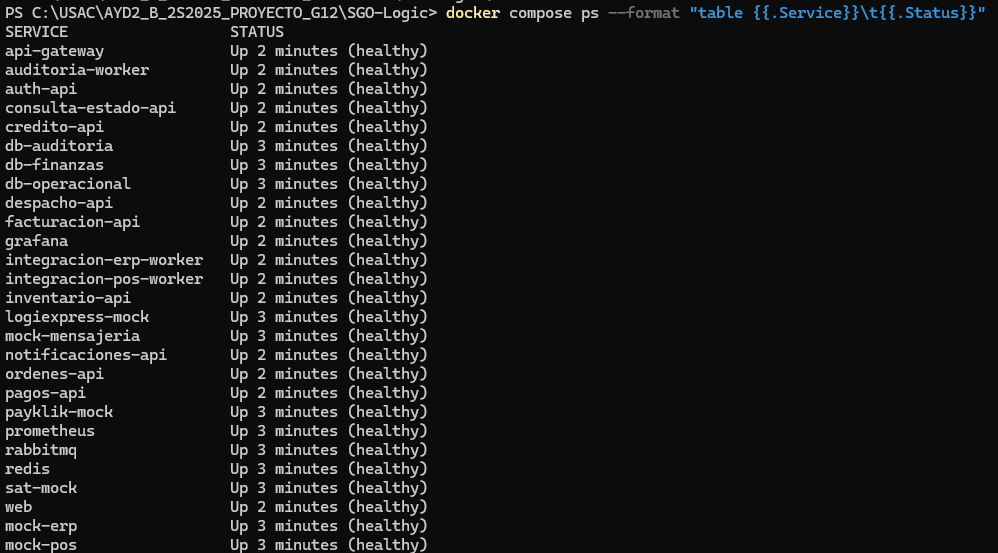

Comprobaciones rápidas:

```bash
curl http://localhost:8080/health/live
curl http://localhost:8092/health/live
```

Abra la Web en `http://localhost:8092`.

### 5.4 Sembrar datos

La siembra corre sola al levantar el stack, en dos servicios del compose:

1. **`seed-datos`** ejecuta `SGO-Logic/scripts/seed/sembrar.sh` con los archivos `SGO-Logic/scripts/seed/sql/01-auth.sql` a `07-facturacion.sql`. Asegura los usuarios (sin duplicar por correo) y solo siembra las demás bases si su tabla principal está vacía. Los usuarios sembrados usan la contraseña `1234`: `admin@sgo.local` y `admin2@sgo.local` (ADMIN), `operador@sgo.local` (OPERADOR) y `cliente1@sgo.local` a `cliente6@sgo.local` (CLIENTE).
2. **`seed-demo`** ejecuta `SGO-Logic/scripts/demo/sembrar-demo.sh` contra el gateway: registra y verifica `demo@sgo.local` y otros usuarios de demo con la contraseña `Demo1234!` (variable `DEMO_PASSWORD`), lee el código de verificación desde `mock-mensajeria`, asigna los roles ADMIN y OPERADOR por prefijo de correo y carga existencias de `SKU-DEMO-001` a `SKU-DEMO-003`, `PROD-001` a `PROD-008` y `PROD-101` a `PROD-105` (productos con stock bajo para probar la retención del carrito y la sucursal más cercana). Un usuario que ya existe responde 409 y conserva su contraseña.

Crédito siembra además el historial de `cliente1` a `cliente6` al arrancar con la base vacía (`Credito__SembrarDemo=true`, archivo `Datos/historial-demo.json` del proyecto `SgoLogic.Credito.Api`), y `integracion-erp-worker` lo reemplaza con el snapshot del mock ERP en su ciclo batch.

Para ver el resultado de la siembra:

```bash
docker compose logs seed-datos
docker compose logs seed-demo
```

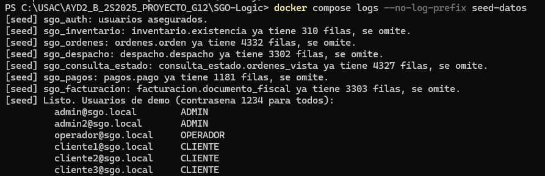

Para volver a sembrar desde cero, borre los volúmenes y levante otra vez:

```bash
docker compose down -v
docker compose up -d
```

---

## 6. Contexto de Crédito

El contexto de Crédito implementa "Compra ahora, paga en 30 días". El contrato completo es [credito-eventos-v1.md](../docs/contratos/credito-eventos-v1.md); los casos de uso son CU-16 a CU-19 del DDA. El código está en `SGO-Logic/src/Services/SgoLogic.Credito.Api/`.

### 6.1 Reglas de elegibilidad

La política `2026.10-v2` (`Domain/PoliticaCredito.cs`) se aplica sobre el historial del cliente y su comportamiento con el propio crédito. Primero revisa descartes, en este orden; el primero que aplica define el motivo y deja al cliente sin crédito (límite 0):

1. `SIN_HISTORIAL`: no hay historial del cliente.
2. `DEUDA_VENCIDA`: tiene una compra a crédito vencida con saldo.
3. `INCIDENTE_GRAVE`: el historial tiene al menos un incidente grave.
4. `ANTIGUEDAD_INSUFICIENTE`: menos días como cliente que el mínimo (90 por defecto).
5. `DEVOLUCIONES_EXCESIVAS`: devoluciones entre compras de los últimos 12 meses mayor que 0.30.
6. `PUNTAJE_INSUFICIENTE`: puntaje menor que el mínimo (60 por defecto).

El puntaje va de 0 a 100 y suma seis factores:

| Factor | Máximo | Cálculo |
|---|---|---|
| Puntualidad | 40 | 40 por la proporción de pagos puntuales (20 si no hay pagos) |
| Monto | 30 | 30 por monto de 12 meses entre Q12,000, hasta 1 |
| Antigüedad | 8 | 8 por días como cliente entre 730, hasta 1 |
| Frecuencia | 7 | 7 por compras de 12 meses entre 12, hasta 1 |
| Devoluciones | 10 | 10 por (1 menos tasa de devolución entre 0.30) |
| Incidentes | 5 | 5 sin incidentes menores, 2.5 con uno, 0 con dos o más |

### 6.2 Niveles de perfil y límites

| Puntaje | Nivel | Límite |
|---|---|---|
| 90 o más | Excelente | Q7,500 |
| 75 a 89 | Bueno | Q3,500 |
| Del mínimo a 74 | Regular | Q1,500 |
| Menos del mínimo o con descarte | Sin crédito por ahora | Q0 |

Los valores por defecto están en `appsettings.json` (`Credito:Politica`). En `docker-compose.yml` el entorno de demostración baja el puntaje mínimo a 50 (`CREDITO_PUNTAJE_MINIMO`) y la antigüedad mínima a 0 días (`CREDITO_ANTIGUEDAD_MINIMA_DIAS`). El disponible es el límite menos el saldo utilizado, nunca menor que cero. El plazo es de 30 días, sin intereses ni recargos.

### 6.3 Flujo en la saga

1. **Oferta en el checkout.** La Web consulta `GET /api/credito/elegibilidad?monto=` por el gateway con un límite de 1 segundo (`GatewayClient`, `LimiteOfertaCredito`). Crédito responde leyendo solo su perfil precalculado, sin llamar al ERP. Si no responde a tiempo, la opción se muestra deshabilitada con el mensaje "En este momento no contamos con la opción de crédito..." y el resto del checkout sigue igual.
2. **Creación de la orden.** El cliente elige crédito; Órdenes exige sesión y que el correo del JWT coincida con el cliente de la orden.
3. **Reserva.** La saga reserva el inventario igual que con tarjeta.
4. **Evaluación.** Con `INVENTARIO_RESERVADO`, Órdenes publica `EvaluacionCreditoSolicitada`. Crédito evalúa con bloqueo optimista sobre la línea (hasta 5 reintentos ante choque de versión), es idempotente por orden y responde:
   - `CreditoAprobado`: aparta el monto, crea la cuenta por cobrar `VIGENTE` con vencimiento a 30 días y la orden sigue a `CONFIRMADA_PENDIENTE_FISCAL`, facturación y despacho.
   - `CreditoRechazado`: la orden pasa a `RECHAZADA`, Órdenes pide liberar la reserva y la Web muestra el motivo con un botón "Pagar con tarjeta".
5. **Timeout.** Si no llega respuesta en 30 segundos (`Credito__TimeoutEvaluacionSegundos`), `TimeoutEvaluacionCreditoWorker` rechaza la orden con `CREDITO_SIN_RESPUESTA`, publica `OrdenCancelada` y libera la reserva. Si Crédito aprobó tarde, al consumir `OrdenCancelada` anula el cargo y devuelve el cupo.

El siguiente diagrama resume el checkout a crédito.

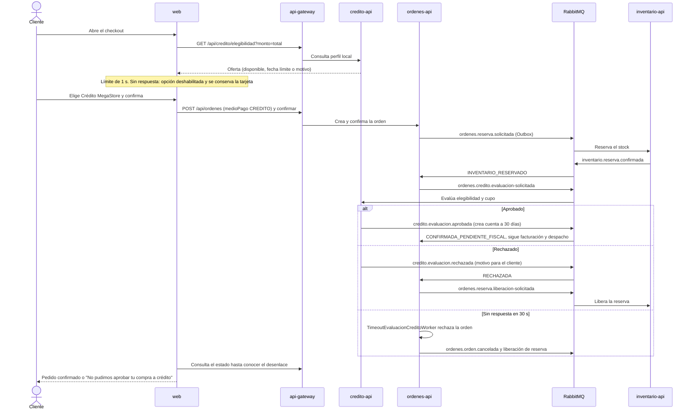

### 6.4 Cobranza

- **Abonos.** Desde "Mi crédito" el cliente paga el total o una parte de cada compra (`POST /api/credito/abonos`). El monto mínimo es Q10 (`Credito:Cobranza:MontoMinimoAbono`); si el saldo es menor, se paga completo. Crédito registra el abono y publica `CobroAbonoCreditoSolicitado`; Pagos cobra con la tarjeta tokenizada y responde `AbonoCreditoCobrado`, `AbonoCreditoRechazado` o `AbonoCreditoPendiente`. Un abono aplicado reduce el saldo y libera cupo; si el saldo llega a 0 la cuenta queda `PAGADA` y se publica `CuentaCreditoPagada`, que Integración ERP envía al mock ERP como pago puntual o tardío. Solo puede haber un abono en curso por compra; uno pendiente se reintenta con `POST /api/credito/abonos/{id}/reintentar`.
- **Recordatorios y vencimientos.** `VencimientosCreditoWorker` corre cada 60 segundos. Una compra vigente con saldo que vence en 3 días o menos recibe un recordatorio (`CuentaCreditoPorVencer`, una sola vez). Una compra con la fecha límite pasada pasa a `VENCIDA`, la línea del cliente pasa a `BLOQUEADA` ("Tu crédito está en pausa"), el perfil se recalcula con `DEUDA_VENCIDA` y se publica `CuentaCreditoVencida`.
- **Mora.** Mientras haya compras vencidas con saldo, el cliente no puede usar crédito en compras nuevas; sus compras con tarjeta funcionan con normalidad. Al pagar todas las vencidas, la línea vuelve a `ACTIVA` y el pago cuenta como tardío.

### 6.5 Reversos

- **Cancelación de una orden a crédito.** Al consumir `OrdenCancelada`, Crédito anula la cuenta (`ANULADA`), devuelve el saldo pendiente al disponible y publica `CargoCreditoAnulado`. Los abonos ya aplicados pasan a `REEMBOLSO_PENDIENTE` y se pide su reembolso a la tarjeta (`ReembolsoAbonoCreditoSolicitado`).
- **Devolución.** Al consumir `DevolucionRegistrada` de una orden a crédito, Crédito descuenta lo devuelto del saldo; si lo devuelto supera el saldo, reembolsa el excedente ya pagado. La operación es idempotente por `devolucionId` y publica `DevolucionCreditoAplicada`.
- `ReembolsosAbonoCreditoWorker` reintenta cada 60 segundos las solicitudes de reembolso pendientes.

### 6.6 Endpoints

| Endpoint | Uso | Expuesto por el gateway |
|---|---|---|
| `GET /api/credito/elegibilidad?monto=` | Oferta del checkout | Sí |
| `GET /api/credito/mi-credito` | Vista "Mi crédito" | Sí |
| `POST /api/credito/abonos`, `GET /api/credito/abonos/{id}`, `POST /api/credito/abonos/{id}/reintentar` | Abonos | Sí |
| `POST /interno/credito/historiales` | Carga directa de historial para pruebas aisladas | No (solo puerto 8099, con `Credito__EndpointsInternos=true`) |
| `POST /interno/credito/demo/reiniciar` | Reinicia los datos de demo de crédito | No |
| `POST /interno/credito/demo/cuentas/{ordenId}/vencimiento` y `POST /interno/credito/demo/procesar-vencimientos` | Fuerzan un vencimiento para demostrar la mora | No |

---

## 7. Integración con el mock ERP

### 7.1 Contrato del historial de clientes

`mock-erp` (`Mocks/mock-erp/server.js`, puerto 4000) simula la exportación del historial comercial del ERP. `integracion-erp-worker` lo lee en su ciclo batch con `GET /erp/clientes/historial?modificadosDesde=<fecha ISO>`; sin el parámetro devuelve todos los clientes. La respuesta es:

```json
{
  "fechaCorte": "2026-10-02T06:00:00.000Z",
  "total": 6,
  "clientes": [
    {
      "codigoCliente": "ERP-CLI-0001",
      "email": "cliente1@sgo.local",
      "clienteDesde": "2023-09-28T00:00:00.000Z",
      "comprasUltimos12Meses": 18,
      "montoCompradoUltimos12Meses": 14500,
      "moneda": "GTQ",
      "pagosPuntuales": 18,
      "pagosTardios": 0,
      "maxDiasAtraso": 0,
      "devoluciones": 1,
      "incidentesGraves": 0,
      "otrosIncidentes": 0,
      "actualizadoEn": "2026-10-02T06:00:00.000Z",
      "fechaCorte": "2026-10-02T06:00:00.000Z",
      "loteOrigen": "LOTE-HIST-CLI-0001"
    }
  ]
}
```

Otros endpoints del mock relacionados con crédito:

| Endpoint | Para qué |
|---|---|
| `POST /erp/clientes/pagos` | Integración ERP envía las cuentas de crédito pagadas (`eventId`, `clienteId`, `cuentaId`, `ordenId`, `pagadaEn`, `puntual`). El mock deduplica por `eventId` e incrementa pagos puntuales o tardíos. |
| `POST /erp/lotes` | Lotes de ventas; al aceptar uno con `clienteId`, el mock incrementa compras y monto del cliente. |
| `PUT /erp/admin/clientes/{email}/historial` | Crea o reemplaza el historial de un cliente (solo pruebas). |
| `POST /erp/admin/caida` | Simula caída con `tipo` `timeout`, `error500` o `no_disponible`. |
| `POST /erp/admin/reset` | Restaura los fixtures iniciales. |

El historial se transforma en la capa anticorrupción de `integracion-erp-worker` (`Workers/ErpHistorialClientesWorker.cs`, `Infrastructure/ClienteErpHttp.cs`) al evento `HistorialClienteErpActualizado` (`integracion-erp.cliente.historial-actualizado`), que se publica por Outbox con el correo normalizado, la fecha de corte y el lote de origen. Crédito lo consume en la cola `credito.erp`, guarda el snapshot y recalcula el perfil en una sola transacción; un corte igual o anterior no retrocede el perfil. El intervalo es `ERP_INTERVALO_HISTORIAL_MINUTOS`, que por defecto hereda `ERP_INTERVALO_MINUTOS` (30).

La captura muestra la respuesta del endpoint de historial del mock. Un administrador también puede consultar el snapshot de un cliente en la Web, en "Centro de Control y Monitoreo", panel "Snapshot de historial del ERP".

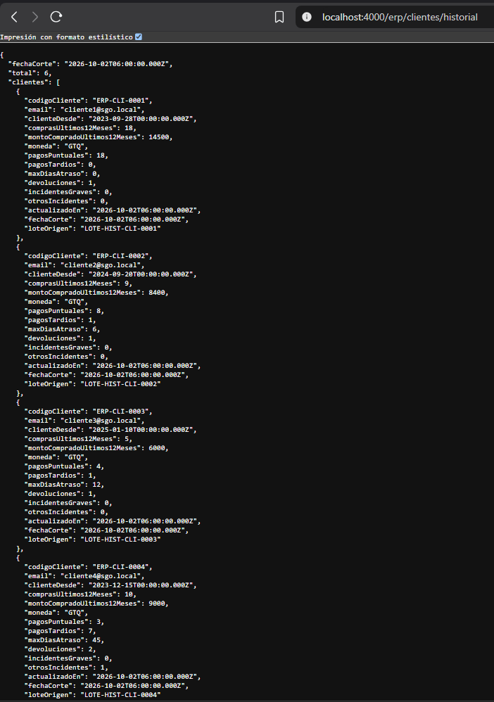

### 7.2 Perfiles de cliente1 a cliente6

El cálculo sigue la política de la sección 6.1 con los fixtures de `server.js` (y los mismos datos de `historial-demo.json`). Los puntajes son aproximados porque la antigüedad depende de la fecha en que se evalúa.

| Cliente | Rasgos del historial | Resultado con la configuración del compose (mínimo 50, antigüedad 0) |
|---|---|---|
| `cliente1` | 18 compras, Q14,500, todos los pagos puntuales, 1 devolución | Excelente (puntaje cercano a 98), límite Q7,500 |
| `cliente2` | 9 compras, Q8,400, 1 pago tardío | Bueno (cercano a 79), límite Q3,500 |
| `cliente3` | 5 compras, Q6,000, 1 pago tardío, 1 devolución | Regular (cercano a 62), límite Q1,500 |
| `cliente4` | 3 pagos puntuales y 7 tardíos, 2 devoluciones, 1 incidente menor | Puntaje cercano a 54: Regular con el mínimo de 50 del compose; con el mínimo por defecto de 60 no califica por puntaje, con el mensaje de pagos atrasados |
| `cliente5` | Cliente reciente, 2 compras por Q900 | Puntaje cercano a 59: Regular con la configuración del compose; con los valores por defecto se descarta por antigüedad insuficiente |
| `cliente6` | Buen pagador, pero con 1 incidente grave | No califica (`INCIDENTE_GRAVE`): "Necesitamos revisar tu cuenta" |

---

## 8. Microkernel de notificaciones

### 8.1 Cómo funciona

`notificaciones-api` recibe eventos por tres colas de RabbitMQ (`notificaciones.ordenes`, `notificaciones.despacho` y `notificaciones.pagos`). Cada consumidor llama a `ServicioNotificaciones`, que arma una `SolicitudNotificacion` (canal, destinatario, asunto y cuerpo) y la entrega a `NotificacionesKernel`. El kernel pide a `PluginRegistry` los plugins habilitados para ese canal, ordenados por prioridad, y ejecuta cada uno aislando sus fallas: si un plugin falla, guarda la notificación en `notificacion_pendiente` con su canal y sigue con los demás. `ReintentoNotificacionesWorker` revisa los pendientes cada 5 segundos y reintenta solo el canal que falló, con backoff exponencial desde 10 segundos y un máximo de 6 intentos. La decisión y sus alternativas están en [ADR-024](../ADR/ADR-024-arquitectura-microkernel-plugins-notificaciones.md); el diagrama de componentes, en la sección 11.3.1 del DDA.

| Plugin | Id | Canal | Prioridad |
|---|---|---|---|
| `EmailNotificacionPlugin` | `plugin.email` | `EMAIL` | 100 |
| `SmsNotificacionPlugin` | `plugin.sms` | `SMS` | 80 |
| `PushNotificacionPlugin` | `plugin.push` | `PUSH` | 70 |
| `WebhookNotificacionPlugin` | `plugin.webhook` | `WEBHOOK` | 50 |

Para inspeccionar y operar el kernel (puerto 8090, no publicado en el gateway):

```bash
curl http://localhost:8090/api/kernel/plugins
curl -X POST "http://localhost:8090/api/kernel/plugins/plugin.sms/toggle?habilitado=false"
curl -X POST http://localhost:8090/api/kernel/despachar -H "Content-Type: application/json" \
  -d '{"destinatario":"cliente1@sgo.local","asunto":"Prueba","cuerpo":"Mensaje de prueba","canal":"EMAIL"}'
```

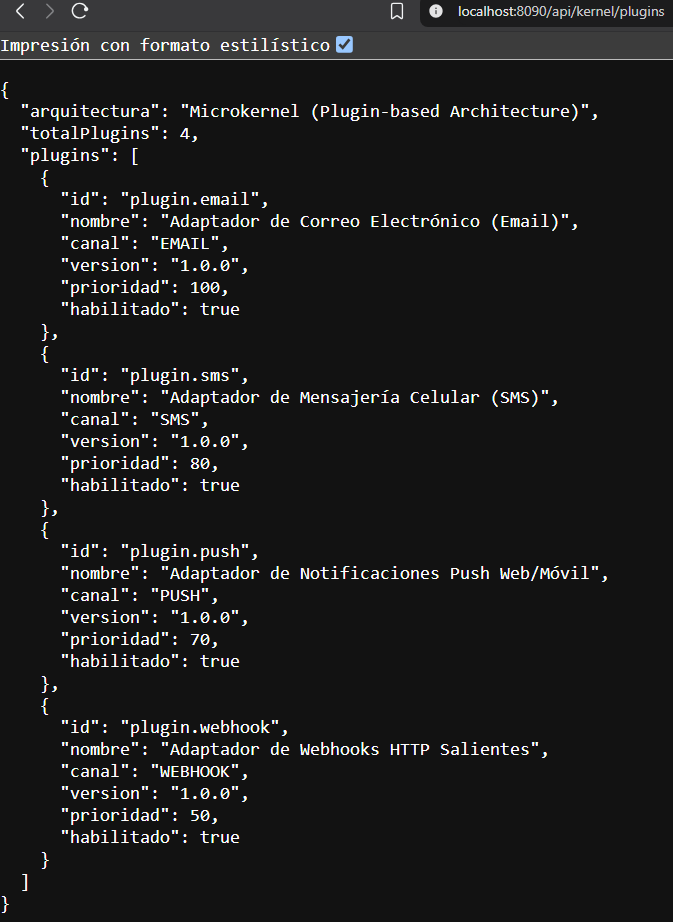

### 8.2 Cómo agregar un plugin nuevo

El ejemplo agrega un canal `WHATSAPP`. Las rutas son relativas a `SGO-Logic/src/Services/SgoLogic.Notificaciones.Api/`.

1. **Cree la clase del plugin** en `Kernel/Plugins/WhatsAppNotificacionPlugin.cs` implementando `INotificacionPlugin` (`Kernel/Abstractions/INotificacionPlugin.cs`). Tome como modelo `SmsNotificacionPlugin.cs`:
   - `Metadata`: un `PluginMetadata` con `Id` único (por ejemplo `plugin.whatsapp`), `Nombre`, `Canal` (`WHATSAPP`), `Version`, `Prioridad` y `HabilitadoPorDefecto`.
   - `EstaHabilitado` y `ConfigurarHabilitado(bool)`: un campo privado que guarda el estado.
   - `SoportaCanal(string canal)`: compara sin distinguir mayúsculas con `WHATSAPP`.
   - `DespacharAsync(SolicitudNotificacion, CancellationToken)`: envía el mensaje y devuelve un `ResultadoDespachoPlugin`. Capture las excepciones del proveedor y devuelva `Exitoso: false` con el error; no las deje escapar, salvo la cancelación.
2. **Agregue el cliente del proveedor.** Si el canal sale por el proveedor de mensajería, agregue el método correspondiente en `Application/MockMensajeriaClient.cs` (interfaz `IMockMensajeriaClient`) y su endpoint en `SgoLogic.MockMensajeria`. Si sale por otro proveedor, cree un cliente HTTP propio y regístrelo en `Program.cs`. Las credenciales van por variables de entorno en `docker-compose.yml` y `.env.example`, nunca en el código.
3. **Registre el plugin** en `Program.cs`, dentro del bloque que construye el `PluginRegistry`:

   ```csharp
   var whatsappPlugin = ActivatorUtilities.CreateInstance<WhatsAppNotificacionPlugin>(sp);
   registry.Registrar(whatsappPlugin);
   ```

4. **Agregue la constante del canal** en `ServicioNotificaciones` (junto a `CanalEmail`, `CanalSms`, `CanalPush` y `CanalWebhook`) y úsela en el aviso que deba salir por ese canal (`NotificacionSaliente` recibe el canal como último parámetro; por defecto es `EMAIL`). El kernel, los consumidores y el worker de reintentos no cambian.
5. **Pruebe el plugin** en `SGO-Logic/tests/SgoLogic.Notificaciones.Tests/`: un caso de éxito, uno de falla que deje la notificación pendiente con el canal `WHATSAPP` y uno con el plugin deshabilitado.
6. **Verifique en ejecución.** Reconstruya el servicio (`docker compose up -d --build notificaciones-api`), confirme que `GET /api/kernel/plugins` lista `plugin.whatsapp` y envíe una prueba con `POST /api/kernel/despachar` y `"canal":"WHATSAPP"`.

---

## 9. Pruebas

El resumen de la estrategia (tipos, cantidades y si corren en el pipeline) está en la sección 15.4 del DDA. Aquí se explica cómo ejecutar cada tipo.

### 9.1 Pruebas unitarias

**Dónde:** los 13 proyectos de `SGO-Logic/tests/` cuyo nombre no termina en `IntegrationTests` (697 métodos `[Fact]` o `[Theory]`). **Qué validan:** reglas de dominio y casos de aplicación con dobles de prueba: la máquina de estados de la orden y la saga, la política y la evaluación de crédito, cobros y reembolsos, reservas y expiración, facturación, despacho, notificaciones y el kernel de plugins, autenticación, el consumidor idempotente y el Outbox.

Con el SDK de .NET 8 en el host, desde `SGO-Logic/`:

```bash
dotnet test tests/SgoLogic.Credito.Tests -c Release
```

Para correrlas todas como lo hace el pipeline (Bash):

```bash
for p in $(find tests -name '*.csproj' ! -name '*IntegrationTests*' | sort); do dotnet test "$p" -c Release; done
```

Sin el SDK en el host, `scripts/dev/dn.ps1` ejecuta `dotnet` dentro de un contenedor `mcr.microsoft.com/dotnet/sdk:8.0` conectado a la red del stack (el stack debe estar levantado):

```powershell
.\scripts\dev\dn.ps1 test tests/SgoLogic.Ordenes.Tests
```

`SgoLogic.Auditoria.Tests` necesita Docker en el host porque usa Testcontainers; dentro de `dn.ps1` falla por no encontrar el daemon.

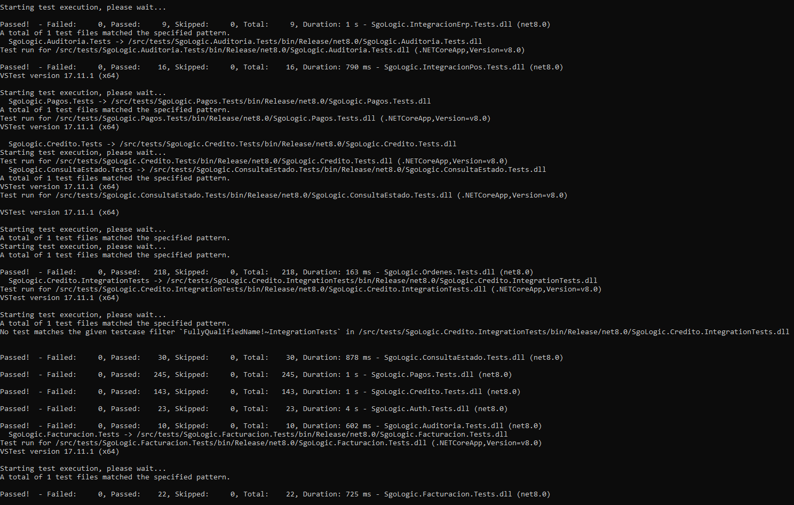

En el pipeline, el job `test-unitarias` agrupa la salida por proyecto y publica los `.trx` en el artefacto `resultados-unitarias`.

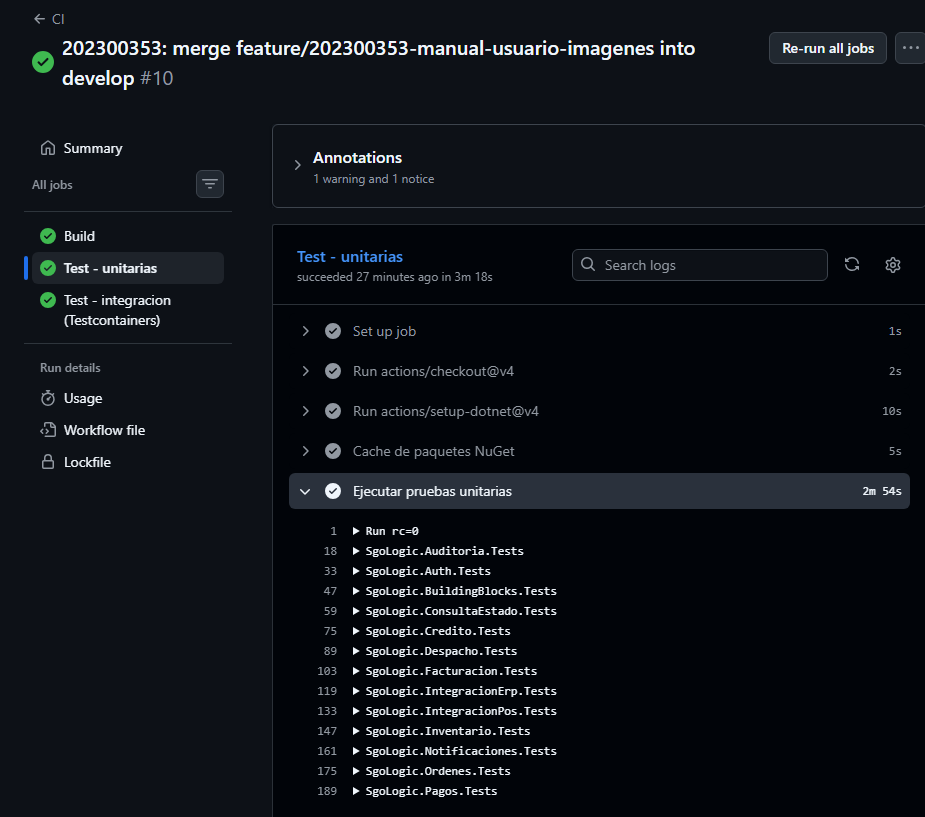

### 9.2 Pruebas de integración

**Dónde:** `SgoLogic.BuildingBlocks.IntegrationTests` (5), `SgoLogic.Credito.IntegrationTests` (22) y `SgoLogic.Inventario.IntegrationTests` (10). **Qué validan:** contra PostgreSQL y RabbitMQ reales levantados con Testcontainers:

- BuildingBlocks: rollback del Outbox, broker caído, consumo duplicado, propagación de correlación y `SKIP LOCKED` entre publicadores.
- Crédito: persistencia del perfil crediticio, de la opción de crédito, de la evaluación, de la cobranza y de las devoluciones.
- Inventario: reservas concurrentes sin sobreventa (EAC-05) y disponibilidad en tiempo real.

Requieren el SDK de .NET 8 y Docker encendido en el host:

```bash
dotnet test tests/SgoLogic.BuildingBlocks.IntegrationTests -c Release
dotnet test tests/SgoLogic.Credito.IntegrationTests -c Release
dotnet test tests/SgoLogic.Inventario.IntegrationTests -c Release
```

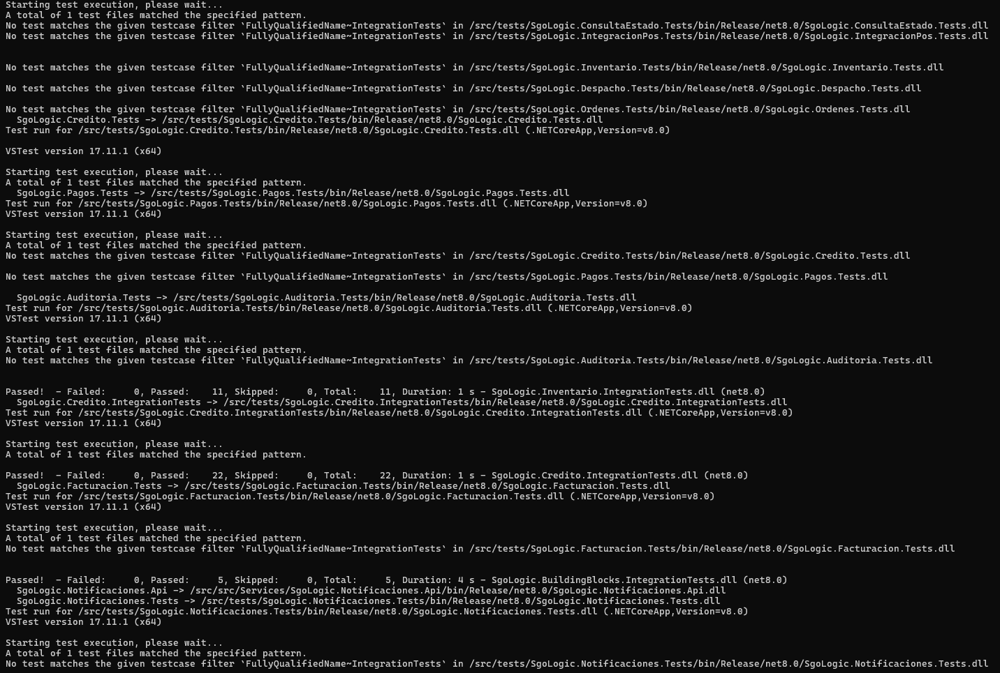

En el pipeline corren en el job `test-integracion` sobre el Docker del runner `ubuntu-latest` y publican el artefacto `resultados-integracion`.

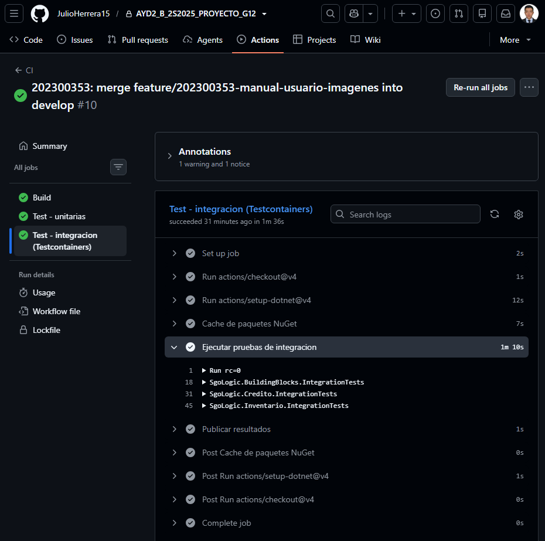

### 9.3 Pruebas end-to-end

**Dónde:** `SGO-Logic/tests/SgoLogic.Web.E2E/` (Playwright con Chromium). Documento: [PRUEBAS-E2E.md](../docs/PRUEBAS-E2E.md).

| Prueba | Archivo | Qué valida |
|---|---|---|
| E2E-01 | `specs/e2e-01-compra-payklik.spec.js` | Compra completa con tarjeta (PayKlik) |
| E2E-02 | `specs/e2e-02-compra-credito.spec.js` | Compra con crédito propio y registro en "Mi crédito" |
| E2E-03 | `specs/e2e-03-credito-no-elegible.spec.js` | La opción de crédito se deshabilita con un motivo y la tarjeta sigue disponible |
| E2E-04 | `specs/e2e-04-reserva-stock-carrito.spec.js` | Reserva de stock en el carrito y bloqueo de un producto sin existencias |
| E2E-05 | `specs/e2e-05-rastreo-factura-incidencia.spec.js` | Rastreo, factura e incidencias |
| E2E-06 | `specs/e2e-06-opcion-credito.spec.js` (5 pruebas en serie) | Oferta con cupo y fecha, compra que excede el límite, compra a crédito, abono y cliente que no califica |

Con el stack levantado y la Web en `http://localhost:8092`:

```bash
cd SGO-Logic/tests/SgoLogic.Web.E2E
npm install
npx playwright install chromium
npm test
```

También existe `./ejecutar-e2e.sh`. Para apuntar a otra URL, defina `WEB_BASE_URL`. El reporte HTML queda en `playwright-report/` y se abre con `npm run report`.

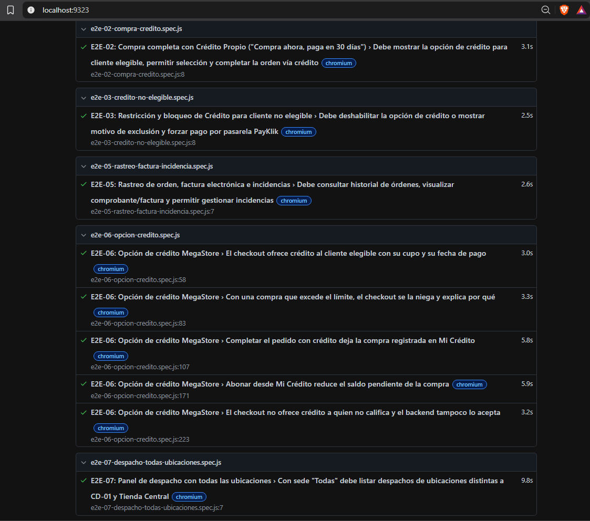

El job `e2e` de `cd.yml` corre solo E2E-01 a E2E-05 (`npx playwright test 'e2e-0[1-5]'`) contra la EC2. E2E-06 usa `POST /interno/credito/demo/reiniciar` en el puerto 8099, que no está expuesto en la nube, y se ejecuta a mano en local.

### 9.4 Pruebas de carga y estrés

**Dónde:** `SGO-Logic/scripts/pruebas-carga/credito-inventario/`. Documento completo, con umbrales y criterios: [PRUEBAS-CARGA-ESTRES-CREDITO.md](../docs/PRUEBAS-CARGA-ESTRES-CREDITO.md). k6 corre en contenedor dentro de la red `sgo-logic_default`; el orquestador mide recursos, espera el drenado de la saga y verifica la integridad en las bases.

Desde `SGO-Logic/`, con el stack levantado:

```bash
bash scripts/pruebas-carga/credito-inventario/ejecutar.sh carga    # C1 a C5
bash scripts/pruebas-carga/credito-inventario/ejecutar.sh estres   # E1 a E5
bash scripts/pruebas-carga/credito-inventario/ejecutar.sh c4       # una sola prueba
```

La evidencia queda en `SGO-Logic/scripts/pruebas/evidencia/cci-<RUN_ID>-*.txt` y el veredicto de cada corrida en `cci-resumen.txt`.

**Resultados de la corrida del 11/10/2026** (stack local, una instancia por servicio):

| Prueba | Qué mide | Resultado |
|---|---|---|
| C1 | Línea base, 11 órdenes por minuto a crédito | Aprobada; decisión p95 1.00 s, checkout p95 62.7 ms |
| C2 | Pico 8x mixto, 40 crédito y 40 tarjeta por minuto | Aprobada; 0 rechazos en ambas rutas |
| C3 | Pico con 50% de clientes no elegibles | Aprobada; 189 rechazos, todos con su liberación (p95 0.67 s) |
| C4 | Elegibilidad bajo carga (EAC-06) | Aprobada; elegibilidad p95 16.7 ms |
| C5 | Agotamiento de cupo | Aprobada; 101 rechazos por cupo, 0 líneas sobre el límite |
| E1 | Rampa hasta 640 órdenes por minuto | Aprobada en integridad; punto de quiebre en 320 por minuto (decisión p95 5.83 s) |
| E2 | Pico súbito de 600 por minuto | Rechazada por recuperación: p95 de los últimos 120 s de 22 s; se recupera solo y sin pérdidas |
| E3 | `credito-api` detenido en pleno pico | Aprobada; 0 rechazos de tarjeta, 42 timeouts con cargos anulados |
| E4 | Stock escaso con crédito y tarjeta | Aprobada; 0 ventas perdidas frente al control |
| E5 | Ráfaga de 100 compras del mismo cliente | Verificación aprobada (7 aprobadas por cliente, el tope); umbral de k6 no cumplido por 2 respuestas HTTP 500 por falta de conexiones de PostgreSQL |

En las once corridas la integridad quedó en cero: sin sobreventa, fugas, líneas sobre el límite ni cargos huérfanos. Los hallazgos (atraso de la saga desde unas 320 órdenes por minuto, agotamiento de conexiones ante ráfagas y el arranque en frío de `auditoria-worker`) están en la sección 9 del documento de pruebas.

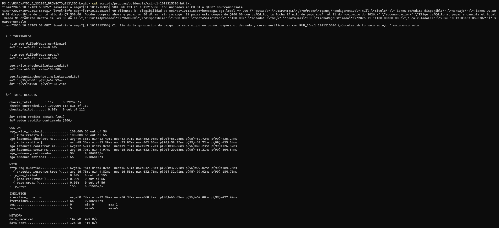

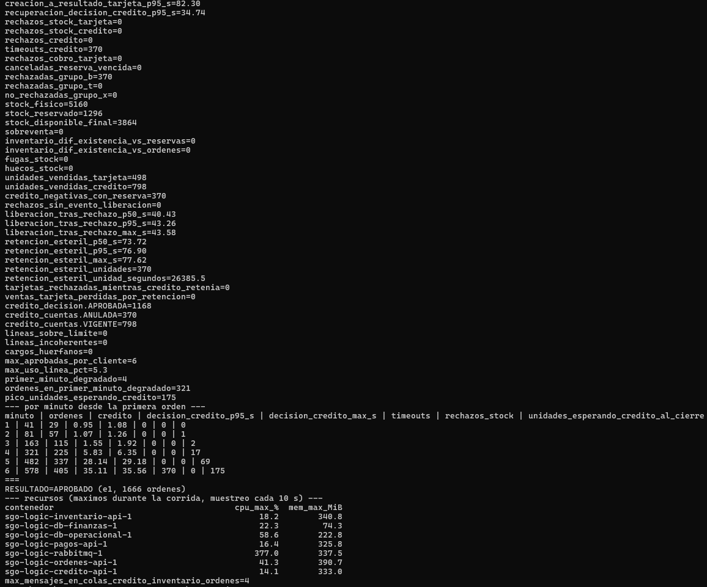

### 9.5 Otras verificaciones

| Script | Qué hace |
|---|---|
| `SGO-Logic/scripts/pruebas/camino-feliz.ps1` | Recorre la saga con tarjeta hasta `ENTREGADA` |
| `SGO-Logic/scripts/pruebas/credito-saga.ps1` | Escenarios de crédito: aprobado, cupo, no elegible, suplantación, sin sesión, cancelación, timeout, abonos y pago rechazado o pendiente |
| `SGO-Logic/scripts/pruebas-carga/eac01-hu023-carga.js` y `eac02-hu024-carga.js` | Cargas de EAC-01 y EAC-02 de la Fase 2 ([UMBRALES-DOD.md](../docs/UMBRALES-DOD.md)) |
| `SGO-Logic/scripts/seguridad/verificar.sh` | Pruebas de seguridad ([SEGURIDAD.md](../docs/SEGURIDAD.md)) |

---

## 10. CI/CD

El detalle completo está en [CICD-DESPLIEGUE.md](../docs/CICD-DESPLIEGUE.md) y la decisión en [ADR-025](../ADR/ADR-025-cicd-github-actions-y-despliegue-ec2-con-compose.md).

### 10.1 `ci.yml`: build y pruebas

Se dispara en pull requests hacia `develop` y `main`, en pushes a `develop`, `release/**` y `hotfix/**`, y cuando lo invoca `cd.yml` (`workflow_call`).

| Job | Depende de | Qué hace |
|---|---|---|
| `build` | Ninguno | Instala .NET 8, usa caché de NuGet, `dotnet restore` y `dotnet build` de `SGO-Logic/SgoLogic.sln` en Release con advertencias como error |
| `test-unitarias` | `build` | Ejecuta cada proyecto de pruebas que no es `*IntegrationTests`, agrupa la salida por proyecto, publica `resultados-unitarias` y falla al final si algún proyecto falló |
| `test-integracion` | `build` | Igual para los proyectos `*IntegrationTests`, con Testcontainers sobre el Docker del runner; publica `resultados-integracion` |

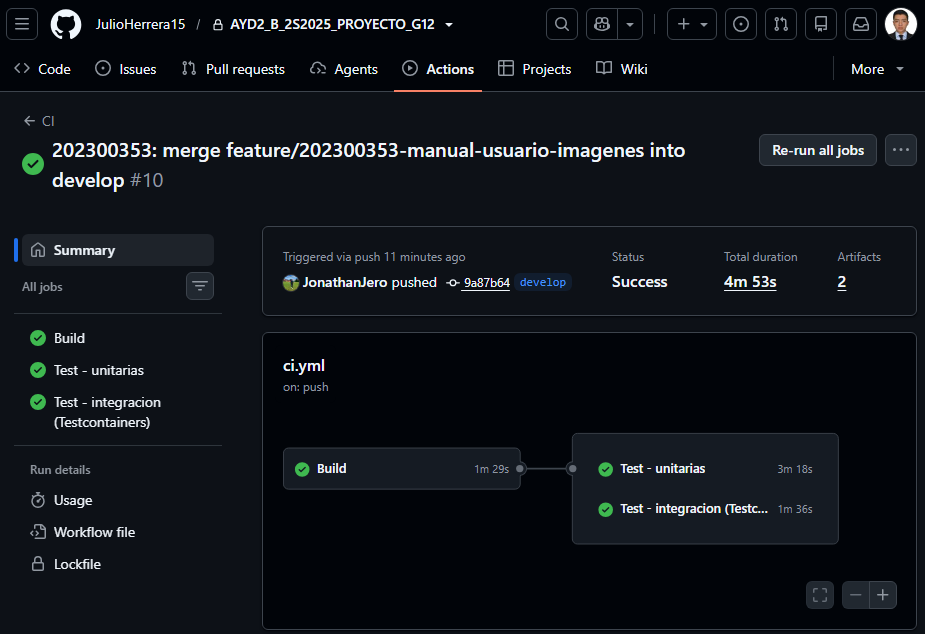

### 10.2 `cd.yml`: imágenes, despliegue y E2E

Se dispara con cada push a `main` y a mano con `workflow_dispatch`. Usa `concurrency: cd-deploy` para que nunca corran dos despliegues a la vez.

| Job | Depende de | Qué hace |
|---|---|---|
| `ci` | Ninguno | Invoca `ci.yml` completo |
| `images` | `ci` | Matriz de 20 imágenes con `docker/build-push-action`; publica `ghcr.io/<propietario>/sgo-<servicio>` con el tag del commit (7 caracteres) y `latest`, con caché de capas por servicio. Autentica con `GITHUB_TOKEN` |
| `deploy` | `images` | Configura SSH con los secrets, copia `SGO-Logic` y `Mocks` del commit con `git archive`, escribe `.env` y `.env.deploy` en la instancia y ejecuta `deploy/aws/deploy.sh` |
| `e2e` | `deploy` | Instala Node 22 y Chromium y corre E2E-01 a E2E-05 contra `http://<EC2_HOST>:8092`; publica `reporte-e2e`. Su fallo no revierte el despliegue |

Como `images` y `deploy` dependen de `ci`, un fallo en el build o en cualquier prueba impide publicar imágenes y desplegar.

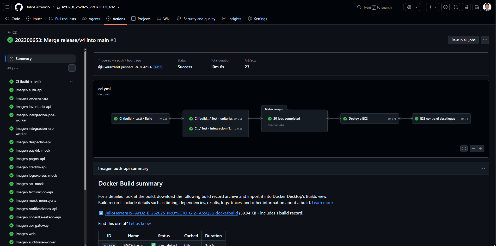

Cada run publica sus resultados como artefactos descargables (`resultados-unitarias`, `resultados-integracion` y, en el CD, `reporte-e2e`).

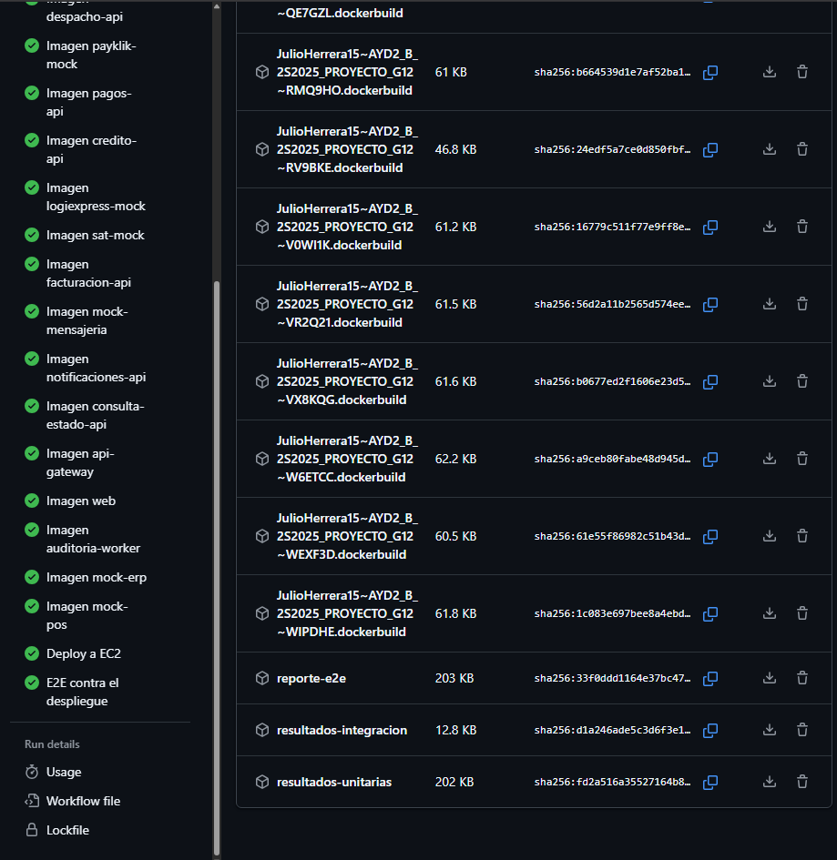

Las imágenes publicadas se ven en GitHub, en la sección Packages del propietario del repositorio.

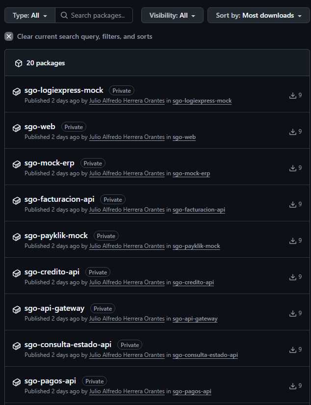

### 10.3 Secrets necesarios

Se configuran en *Settings, Secrets and variables, Actions*:

| Secret | Contenido |
|---|---|
| `EC2_HOST` | IP elástica de la instancia |
| `EC2_SSH_KEY` | Llave privada `.pem` completa, incluidas las líneas `BEGIN` y `END` |
| `ENV_FILE` | Contenido completo del `.env` de producción |

`GITHUB_TOKEN` lo genera GitHub en cada ejecución.

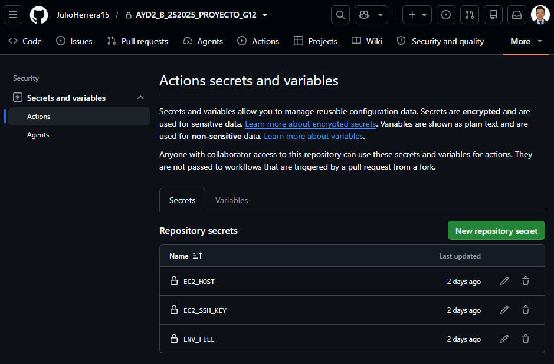

### 10.4 Flujo git-flow que dispara los pipelines

```
feature/*  --PR-->  develop  --PR (release)-->  main  -->  tag vN
   |                   |                          |
   CI (build+test)     CI (build+test)            CD (CI -> imágenes -> deploy -> E2E)
```

- Cada historia se trabaja en una rama `feature/*` creada desde `develop`; el pull request hacia `develop` ejecuta el CI.
- `release/*` y `hotfix/*` ejecutan el CI en cada push.
- El merge del release a `main` ejecuta el CD y después se crea el tag del release. Los tags `v1`, `v2` y `v3` marcan las entregas anteriores y `v4` es el release de cierre.
- Los mensajes de commit siguen el formato `carnet: mensaje`, por ejemplo `202300653: merge feature/historialParaCredito into develop`.

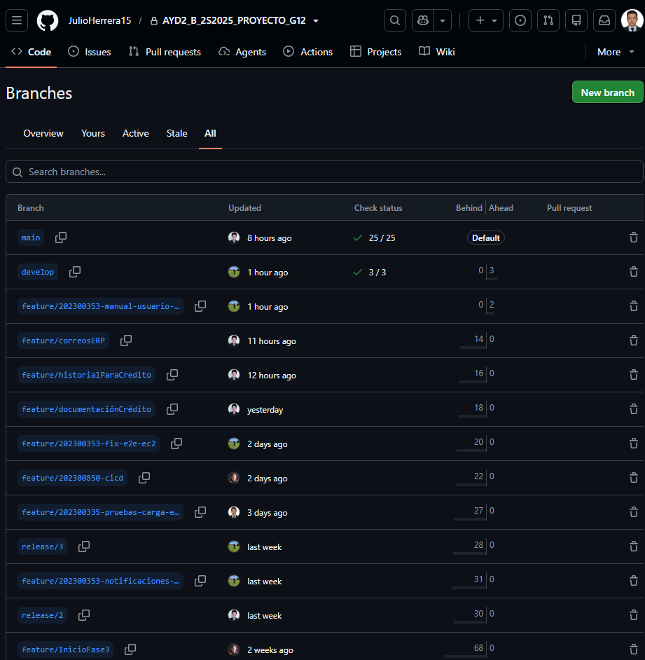

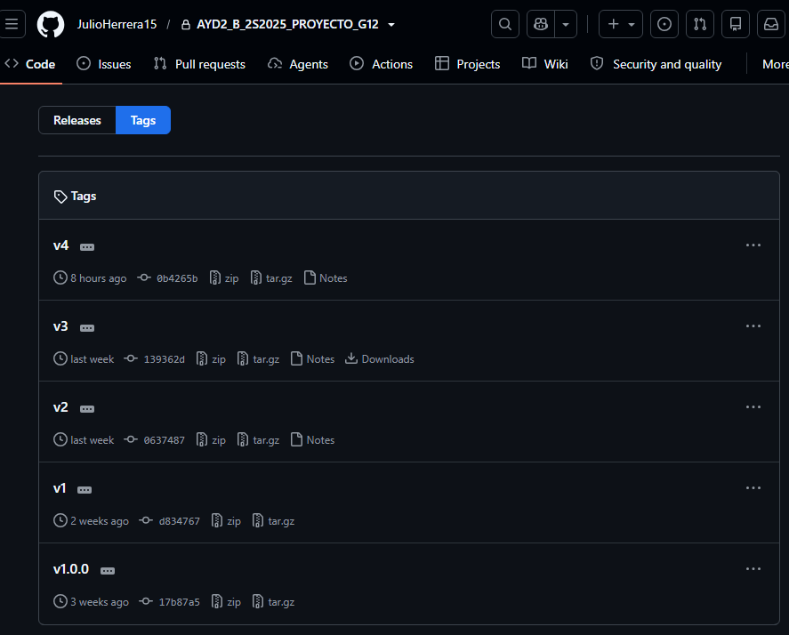

### 10.5 Desplegar a mano con `workflow_dispatch`

1. En GitHub, abra *Actions* y elija el workflow **CD**.
2. Pulse *Run workflow*, elija la rama (normalmente `main`) y confirme.
3. El run ejecuta los mismos jobs que un push a `main`: primero el CI, luego imágenes, despliegue y E2E.

---

## 11. Despliegue en AWS EC2

### 11.1 Preparación de la instancia

| Elemento | Valor |
|---|---|
| Región | us-east-2 (Ohio) |
| Instancia | `m7i-flex.large` (2 vCPU, 8 GiB) |
| Sistema operativo | Ubuntu Server 24.04 LTS |
| Disco | gp3, 30 GiB |
| IP | IP elástica asociada a la instancia |
| Directorio de trabajo | `~/sgo-logic/` |

Preparación de una instancia nueva:

```bash
sudo apt update && sudo apt install -y docker.io docker-compose-v2 git
sudo usermod -aG docker ubuntu
sudo fallocate -l 4G /swapfile && sudo chmod 600 /swapfile && sudo mkswap /swapfile && sudo swapon /swapfile
echo '/swapfile none swap sw 0 0' | sudo tee -a /etc/fstab
mkdir -p ~/sgo-logic
```

Después de `usermod`, cierre y abra la sesión SSH para que el usuario tome el grupo `docker`.

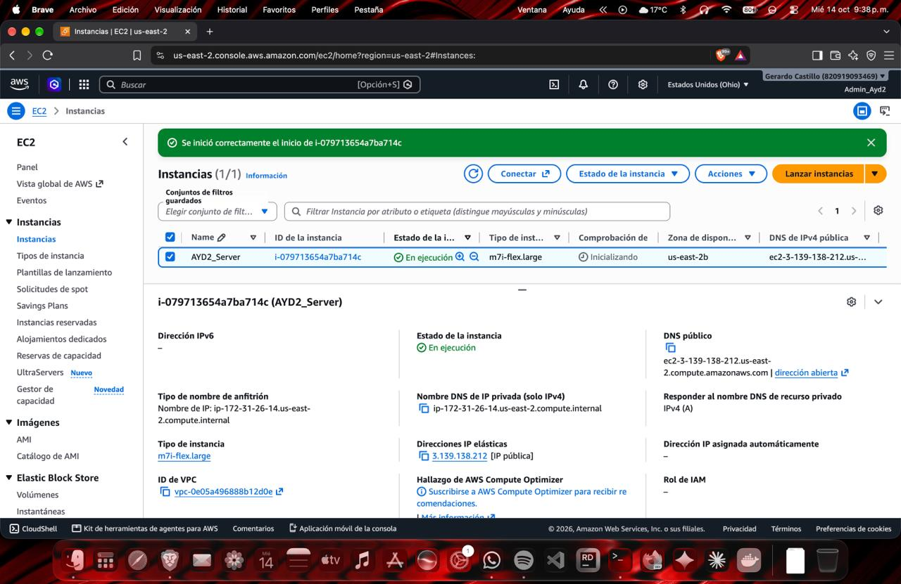

### 11.2 Security Group

| Puerto | Servicio | Origen |
|---|---|---|
| 22 | SSH (lo usa el job `deploy`) | `0.0.0.0/0`, solo con llave `.pem` |
| 8092 | Web | `0.0.0.0/0` |
| 8080 | API Gateway | `0.0.0.0/0` |
| 3000 | Grafana | Solo la IP de quien presenta (regla *Mi IP*) |
| Resto (5672, 15672, 6379, 9090, 4000, 4001, 8099 y demás puertos de servicios) | Infraestructura y servicios internos | Cerrados |

El compose base publica esos puertos en el host; en la EC2 solo los protege el Security Group, por lo que no deben abrirse. Para ver Grafana o la consola de RabbitMQ sin abrir puertos, use un túnel SSH:

```bash
ssh -i llave.pem -L 3000:localhost:3000 ubuntu@<EC2_HOST>
```

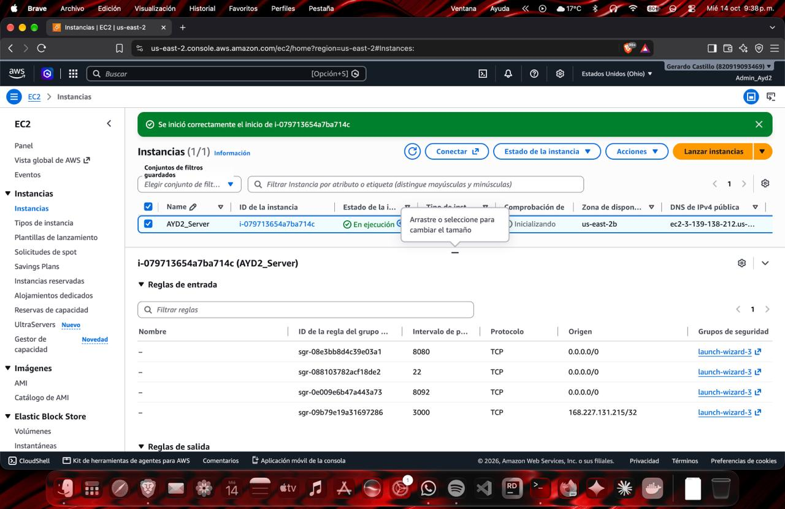

### 11.3 `deploy/aws/deploy.sh`

El job `deploy` lo ejecuta en la instancia por SSH con `GHCR_USER` y `GHCR_TOKEN`:

1. `docker login ghcr.io` con el token efímero del workflow.
2. `docker compose ... pull --quiet` para descargar las imágenes del tag.
3. `docker compose ... up -d --no-build --remove-orphans`.
4. Espera hasta 10 minutos (60 intentos cada 10 segundos) a que `api-gateway` y `web` estén `healthy`. Si no lo logran, imprime el estado y los últimos logs y termina con error.
5. Limpia imágenes huérfanas, cierra sesión en GHCR e imprime el tag desplegado.

Todos los comandos de Compose usan los dos archivos y las dos fuentes de variables:

```bash
docker compose --env-file .env --env-file .env.deploy \
  -f docker-compose.yml -f docker-compose.prod.yml <comando>
```

### 11.4 `docker-compose.prod.yml`

Es un override del compose del MVP. Para cada servicio que se construye define `image: ${IMAGE_PREFIX}/sgo-<servicio>:${IMAGE_TAG}` y agrega `restart: unless-stopped` a todos los servicios de larga duración, incluidas las bases, RabbitMQ, Redis, Prometheus y Grafana. Variables, dependencias, healthchecks y volúmenes siguen viniendo del compose base. `IMAGE_PREFIX` es obligatorio y `IMAGE_TAG` toma `latest` si no se define.

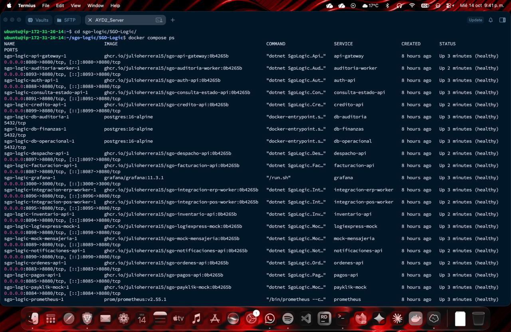

### 11.5 Rollback

Cada despliegue deja las imágenes etiquetadas con el commit. Para volver a una versión anterior, en `~/sgo-logic/SGO-Logic`:

```bash
alias dc='docker compose --env-file .env --env-file .env.deploy -f docker-compose.yml -f docker-compose.prod.yml'
sed -i 's/^IMAGE_TAG=.*/IMAGE_TAG=<commit_anterior_7_caracteres>/' .env.deploy
dc up -d --no-build
```

Si las imágenes anteriores ya se eliminaron, autentíquese en GHCR con un token personal con permiso `read:packages` y ejecute `dc pull` antes del `up`.

### 11.6 Problemas frecuentes

| Síntoma | Causa probable | Qué hacer |
|---|---|---|
| El job `deploy` falla en "Configurar SSH" | Falta la regla del puerto 22, `EC2_HOST` incorrecto o llave mal pegada | Revisar el Security Group y que `EC2_SSH_KEY` incluya `BEGIN` y `END` |
| `pagos-api` no arranca | Falta `PAGOS_CLAVE_CIFRADO` en `ENV_FILE`, o no son 32 bytes en base64 | Corregir el secret y relanzar el CD |
| El despliegue termina con "no está healthy" | Servicio caído o falta de memoria | Revisar `dc ps`, `dc logs` y `free -h` |
| `denied` al descargar imágenes | Paquetes de GHCR privados y no vinculados al repositorio | Vincularlos al repositorio o hacerlos públicos en *Package settings* |
| El job `images` agota el tiempo en el primer despliegue | No hay caché de capas | Relanzar; las siguientes ejecuciones usan la caché |
| `auditoria-worker` sale al arrancar en frío | RabbitMQ todavía no acepta conexiones | Reiniciarlo con `dc restart auditoria-worker` (hallazgo 7 de [PRUEBAS-CARGA-ESTRES-CREDITO.md](../docs/PRUEBAS-CARGA-ESTRES-CREDITO.md)) |

Limitaciones del entorno: un solo nodo sin alta disponibilidad, bases con volúmenes locales sin respaldo automático y poco margen de memoria; las pruebas de carga y estrés se ejecutan fuera de la instancia. Kubernetes on-premises sigue siendo la plataforma objetivo (ADR-001).

---

## 12. Observabilidad y operación

### 12.1 Herramientas

| Herramienta | URL local | Acceso |
|---|---|---|
| Prometheus | `http://localhost:9090` | Sin credenciales. Raspa `/metrics` de los servicios cada 5 segundos (`SGO-Logic/observabilidad/prometheus.yml`) |
| Grafana | `http://localhost:3000` | `GRAFANA_ADMIN_USER` y `GRAFANA_ADMIN_PASSWORD` de `.env` |
| Consola de RabbitMQ | `http://localhost:15672` | `RABBITMQ_USER` y `RABBITMQ_PASSWORD` de `.env` |
| Consola de monitoreo de la Web | `http://localhost:8092/Monitoreo` | Usuario ADMIN u OPERADOR |

Grafana se aprovisiona desde `SGO-Logic/observabilidad/grafana/provisioning/` con dos tableros: "SGO-Logic - Salud del sistema" y "SGO-Logic - Mensajería y resiliencia". Las métricas propias son `outbox_pendientes`, `outbox_publicados_total`, `outbox_fallidos_total`, `outbox_latencia_publicacion_segundos`, `mensajes_consumidos_total`, `mensajes_duplicados_total` y `alertas_fiscales_levantadas_total`, además de las métricas HTTP estándar. Crédito expone además el contador de consultas de elegibilidad por estado (`Application/MetricasCredito.cs`). Detalle en [OBSERVABILIDAD.md](../docs/OBSERVABILIDAD.md).

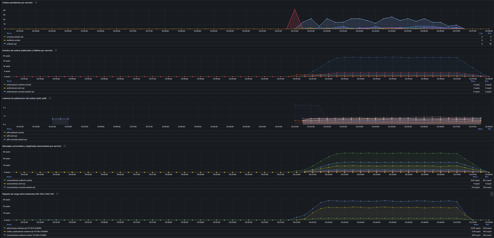

En la consola de RabbitMQ, la pestaña *Queues* muestra las colas quorum de cada contexto (por ejemplo `credito.ordenes`, `credito.pagos`, `credito.erp`, `notificaciones.ordenes`, `notificaciones.pagos`), sus mensajes listos y la dead letter.

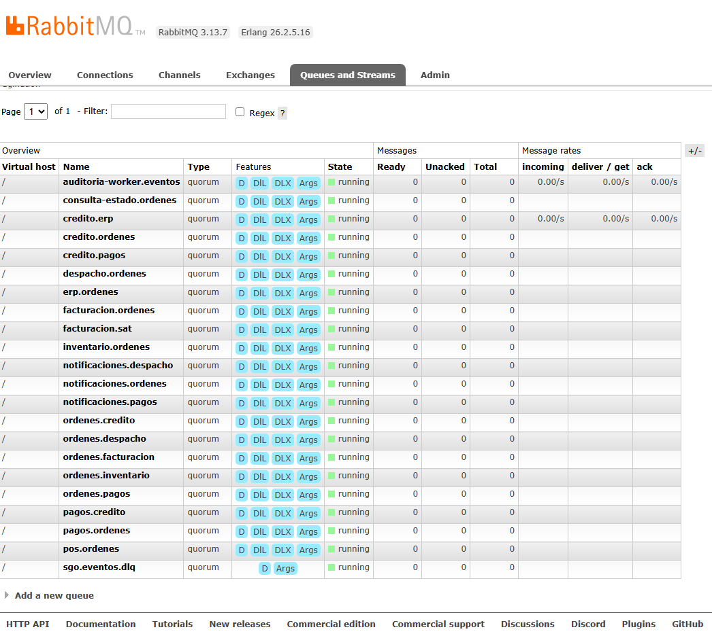

### 12.2 Logs y comandos útiles

En local se usa `docker compose`; en la EC2, el alias `dc` de la sección 11.5.

| Tarea | Comando |
|---|---|
| Estado de los servicios | `docker compose ps` |
| Logs de un servicio | `docker compose logs --tail=100 -f ordenes-api` |
| Código de verificación de un registro | `docker compose logs auth-api \| grep -i codigo` |
| Reiniciar un servicio | `docker compose restart credito-api` |
| Uso de memoria por contenedor | `docker stats --no-stream` |
| Memoria y swap de la EC2 | `free -h` |
| Estado de una orden | `curl http://localhost:8091/api/estado/ordenes/<ordenId>` |
| Evidencia de auditoría de una orden | `curl http://localhost:8093/auditoria/agregados/<ordenId>` |
| Alertas fiscales | `curl http://localhost:8083/api/ordenes/alertas-fiscales` |
| Plugins de notificación | `curl http://localhost:8090/api/kernel/plugins` |

### 12.3 Provocar fallas para demostrar resiliencia

| Falla | Comando |
|---|---|
| PayKlik rechaza | `curl -X PUT http://localhost:8084/admin/modo -H "Content-Type: application/json" -d '{"modo":"RECHAZO"}'` |
| PayKlik caído | `curl -X PUT http://localhost:8084/admin/modo -H "Content-Type: application/json" -d '{"modo":"CAIDO"}'` |
| SAT caída | `curl -X PUT http://localhost:8086/admin/modo -H "Content-Type: application/json" -d '{"modo":"CAIDO"}'` |
| LogiExpress caído | `curl -X PUT http://localhost:8098/admin/modo -H "Content-Type: application/json" -d '{"modo":"CAIDO"}'` |
| Proveedor de mensajería falla | `curl -X POST "http://localhost:8089/api/mensajes/config/falla?activa=true"` |
| ERP caído | `curl -X POST http://localhost:4000/erp/admin/caida -H "Content-Type: application/json" -d '{"activar":true,"tipo":"no_disponible","duracionMs":120000}'` |
| Crédito caído | `docker compose stop credito-api` (y `docker compose start credito-api` para volver) |

Al terminar, devuelva cada mock a `NORMAL` o desactive la falla. La lista completa de modos está en `SGO-Logic/README.md`, sección "Mocks de sistemas externos".

---

## 13. Estructura del repositorio

```
.
├── .github/workflows/          ci.yml y cd.yml
├── deploy/
│   ├── aws/deploy.sh           script de despliegue que corre en la EC2
│   └── k8s/                    consulta-estado-hpa.yaml (evidencia de Kubernetes)
├── documentacion/
│   ├── ADR/                    ADR-001 a ADR-025
│   ├── docs/                   DDA, CI/CD, pruebas, seguridad, observabilidad, topología y contratos/
│   ├── diagramas_CDU/          casos de uso y diagrama de componentes (drawio y svg)
│   ├── img/                    diagramas de la arquitectura y mockups
│   ├── Gestion_Proyecto/       backlog y tablero
│   └── manuales/               Manual_Tecnico.md, Manual_Usuario.md e img/
├── Mocks/
│   ├── mock-erp/               ERP AS/400 simulado (Node)
│   └── mock-pos/               32 POS simulados (Node)
└── SGO-Logic/
    ├── docker-compose.yml      stack completo del MVP
    ├── docker-compose.prod.yml override de producción (imágenes de GHCR)
    ├── .env.example            plantilla de variables
    ├── Directory.Build.props   advertencias como error
    ├── SgoLogic.sln
    ├── observabilidad/         prometheus.yml y aprovisionamiento de Grafana
    ├── scripts/
    │   ├── seed/               sembrar.sh y sql/ (servicio seed-datos)
    │   ├── demo/               sembrar-demo.sh (servicio seed-demo)
    │   ├── dev/dn.ps1          dotnet en contenedor
    │   ├── pruebas/            camino-feliz.ps1, credito-saga.ps1 y evidencia/
    │   ├── pruebas-carga/      k6: EAC-01, EAC-02 y credito-inventario/ (C1 a C5, E1 a E5)
    │   ├── escalabilidad/      réplicas y verificación de EAC-04
    │   ├── carga-locust/       carga por la interfaz con Locust
    │   ├── seguridad/          verificación de RES-08 y JWT
    │   └── postgres/           creación de bases por instancia
    ├── src/
    │   ├── BuildingBlocks/     SgoLogic.Contracts (eventos) y SgoLogic.BuildingBlocks (Outbox, mensajería, idempotencia, métricas)
    │   └── Services/           un proyecto por servicio, mock .NET y la Web
    └── tests/                  pruebas unitarias, de integración y E2E (SgoLogic.Web.E2E)
```
