# Manual de Usuario de MegaStore (SGO-Logic)

**Proyecto:** SGO-Logic, Sistema de Gestión de Órdenes y Logística Omnicanal de MegaStore
**Fase:** 3 (cierre)
**Fecha:** 14/10/2026

Este manual te guía paso a paso por la tienda en línea de MegaStore y por las pantallas del personal. No necesitas conocimientos técnicos: cada paso indica qué hacer y qué vas a ver en pantalla.

---

## Índice

1. Introducción y cómo acceder
2. Registro, verificación de correo e inicio de sesión
3. Si eres cliente
4. Si eres personal de tienda u operaciones
5. Si eres administrador
6. Preguntas frecuentes y mensajes comunes

---

## 1. Introducción y cómo acceder

La tienda en línea de MegaStore te permite ver el catálogo, apartar productos en tu carrito, pagar con tarjeta o con el Crédito MegaStore ("compra ahora, paga en 30 días"), seguir tus pedidos, descargar tus facturas y reportar problemas. El personal de MegaStore usa la misma página para vender en mostrador, despachar pedidos, atender clientes y supervisar el sistema.

### 1.1 Dirección de la página

- **En una computadora del equipo (instalación local):** abre el navegador y entra a `http://localhost:8092`.
- **En la nube:** entra a la dirección pública que te comparta el equipo, terminada en `:8092`.

Al entrar verás la página de inicio de MegaStore. Arriba tienes el menú con **Catálogo**, **Carrito** y **Rastreo**, y a la derecha los botones para iniciar sesión o registrarte.

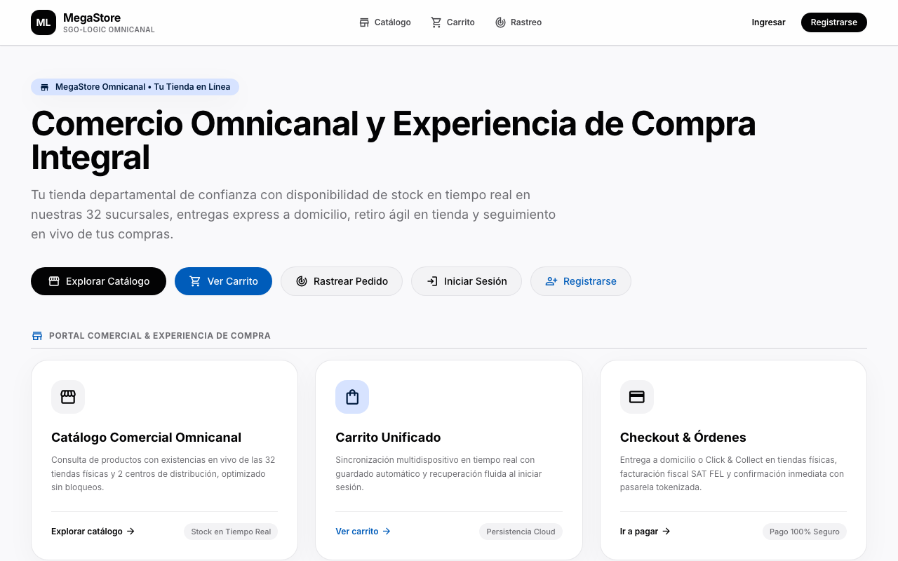

### 1.2 Usuarios de prueba

Los datos de demostración crean estas cuentas. Su contraseña es `1234`:

| Correo | Rol | Qué puede hacer |
|---|---|---|
| `cliente1@sgo.local` a `cliente6@sgo.local` | Cliente | Comprar, pagar, seguir pedidos y usar Mi crédito |
| `operador@sgo.local` | Operador | Pantallas del personal (secciones 4 y 5) |
| `admin@sgo.local`, `admin2@sgo.local` | Administrador | Pantallas del personal y funciones exclusivas de administrador |

También existen cuentas de demostración con la contraseña `Demo1234!`: `demo@sgo.local` (cliente), `admin.bodega@sgo.local` y `admin.ventas@sgo.local` (administradores) y `operador1@sgo.local` y `operador2@sgo.local` (operadores).

Cada cliente de prueba tiene un historial distinto, útil para ver las respuestas del crédito:

| Cliente | Qué verás en la opción de crédito |
|---|---|
| `cliente1` | Crédito disponible, con límite de Q7,500 |
| `cliente2` | Crédito disponible, con límite de Q3,500 |
| `cliente3` | Crédito disponible, con límite de Q1,500 (útil para probar una compra que excede el límite) |
| `cliente6` | Sin crédito: "Necesitamos revisar tu cuenta" |

Las cuentas del personal no pueden comprar: si una cuenta de operador o administrador entra al catálogo, al carrito o al pago, la página la envía al panel de despacho con el aviso "Las cuentas de administración...".

---

## 2. Registro, verificación de correo e inicio de sesión

### 2.1 Crear una cuenta

1. En la página de inicio pulsa **Registrarse** (arriba a la derecha).
2. Llena el formulario **Crear Cuenta**: nombre, apellido, teléfono, correo electrónico y contraseña dos veces. La contraseña debe tener al menos 8 caracteres.
3. Pulsa **Registrarse**.

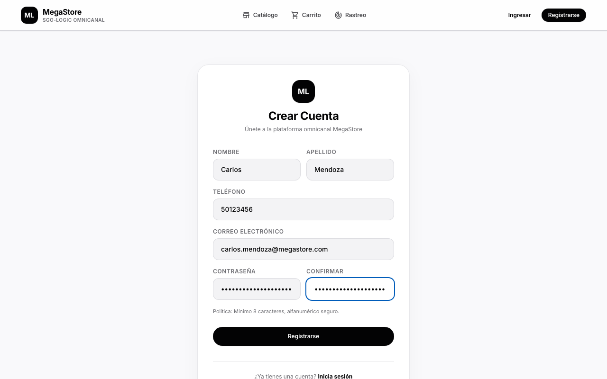

Si algo no está bien, verás uno de estos mensajes en rojo:

- "Las contraseñas no coinciden."
- "La contraseña debe cumplir la política mínima de seguridad (al menos 8 caracteres)."
- "Ya existe una cuenta registrada con este correo electrónico."

### 2.2 Verificar tu correo

1. Después de registrarte llegas a **Verificación de Correo**.
2. Revisa tu correo: te enviamos un código de 6 dígitos. Escríbelo en la casilla.
3. Pulsa **Validar y Activar Cuenta**. Verás "Cuenta verificada exitosamente. Ya puedes iniciar sesión."
4. Si no te llegó el código, pulsa el enlace "No recibiste el codigo? Reenviar codigo".

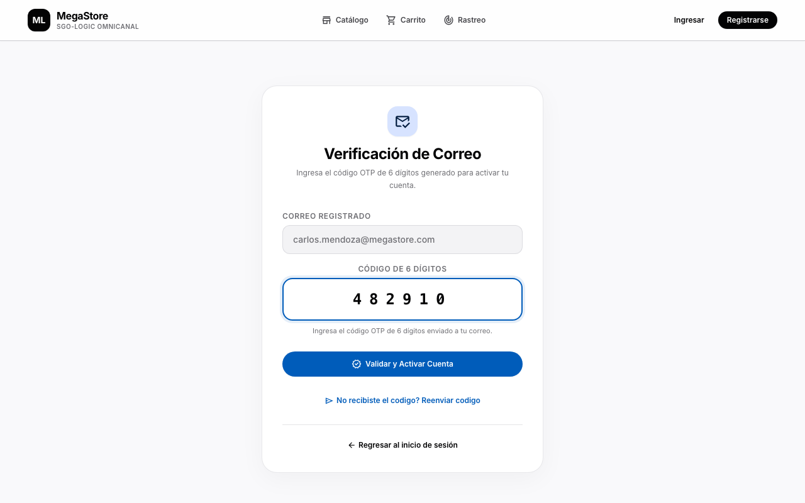

Si el código es incorrecto o ya venció, verás "El código de verificación es incorrecto o ha expirado. Verifica el código de 6 dígitos recibido."

### 2.3 Iniciar sesión

1. Pulsa **Iniciar sesión** (arriba a la derecha).
2. Escribe tu correo y tu contraseña y pulsa **Ingresar**.
3. Si tenías productos en el carrito antes de entrar, se conservan en tu cuenta.

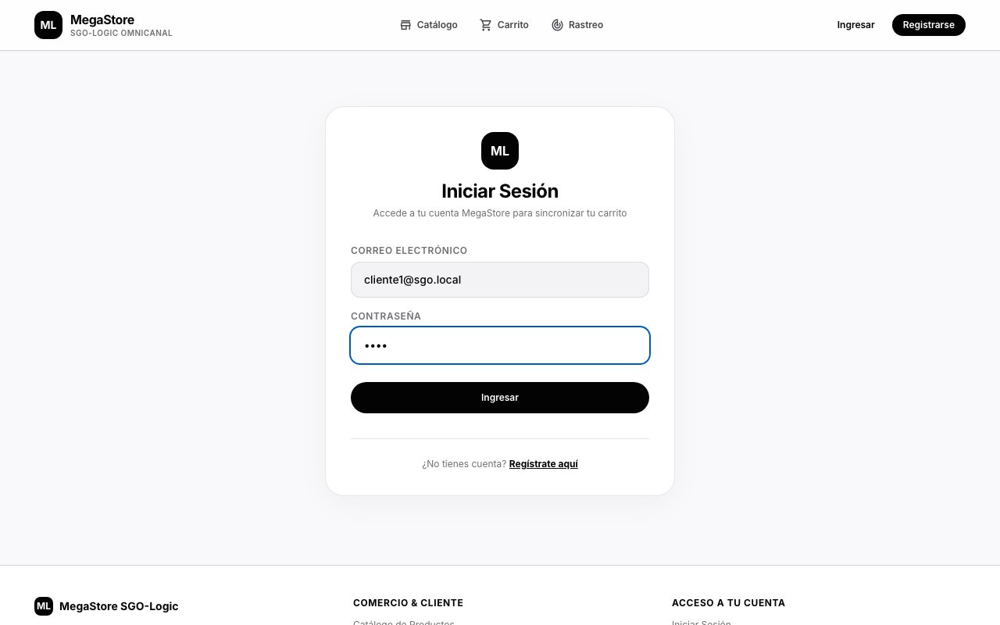

Mensajes que puedes ver:

- "Credenciales incorrectas. Por favor verifica tu correo y contraseña."
- "Tu cuenta aún no está verificada. Por favor ingresa el código de 6 dígitos enviado a tu correo." En este caso la página te lleva a la verificación.

Para salir, abre el menú de tu nombre (arriba a la derecha) y elige **Cerrar Sesión**.

---

## 3. Si eres cliente

### 3.1 Ver el catálogo

1. Pulsa **Catálogo** en el menú.
2. Arriba eliges tu **Sucursal Seleccionada**. Cada producto muestra cuántas unidades hay en esa sucursal ("Stock en Sucursal").
3. Usa las categorías o el buscador para filtrar.
4. Elige la cantidad y pulsa el botón para agregar al carrito. Verás una confirmación y el número del carrito aumenta.

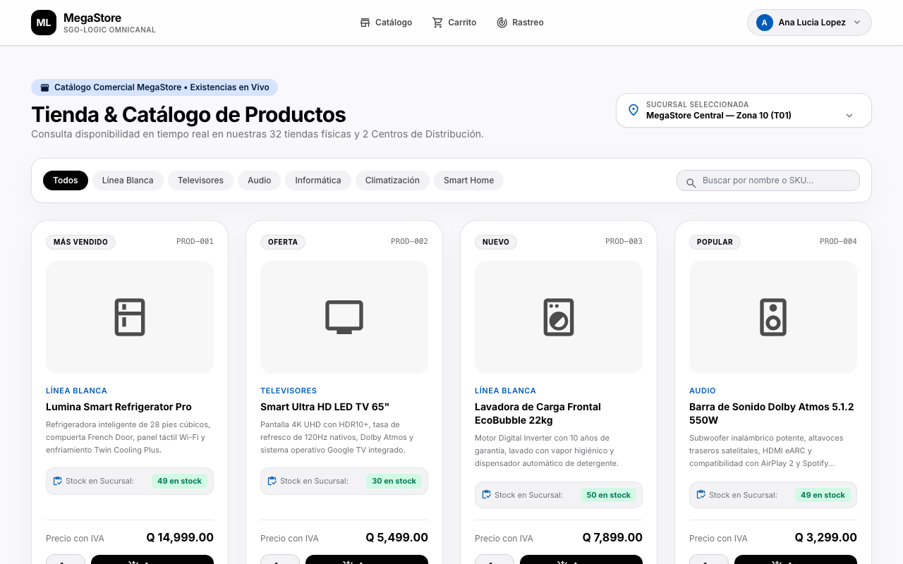

### 3.2 Aviso de sucursal más cercana con existencias

Si un producto se agotó en tu sucursal pero hay en otra tienda, el recuadro de stock lo dice, por ejemplo: "Agotado aquí - disponible en (nombre de la tienda) a (distancia) km". Debajo aparece el botón **Cambiar a esa sucursal**: al pulsarlo, el catálogo pasa a mostrar esa tienda. También puedes agregar el producto sin cambiar de sucursal; se apartará en la tienda que sí tiene.

Otros avisos del recuadro:

- "Agotado aquí - disponible en centro de distribución": ninguna tienda tiene, pero el centro de distribución sí.
- "Sin existencias en ninguna sucursal": no hay unidades y el botón de agregar queda deshabilitado.

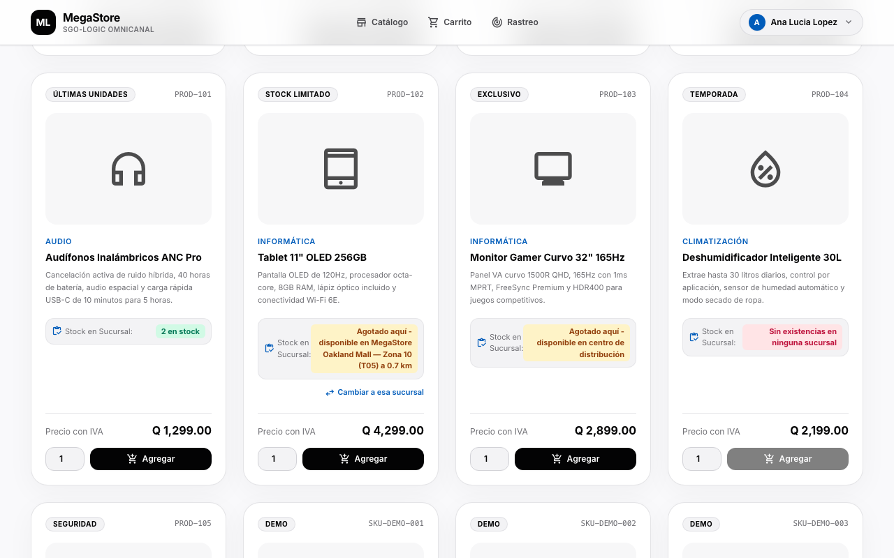

### 3.3 Aviso de producto que viene de otra tienda

Cuando agregas un producto que tu sucursal no tiene suficiente, se aparta en otra tienda. En el carrito, debajo del producto, verás "Apartado en (nombre de la tienda) porque tu sucursal no tiene suficiente". Al pagar con envío a domicilio, el checkout también te avisa: "Tu pedido se enviará desde la tienda (nombre), no desde tu sucursal ni desde el centro de distribución. Puede tardar más en llegar."

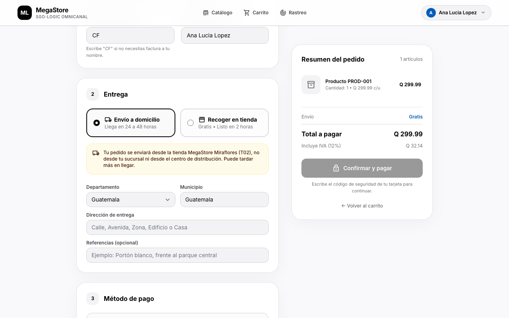

### 3.4 Carrito y reserva temporal del stock

1. Pulsa **Carrito** en el menú.
2. Revisa los productos, cambia cantidades con los botones de más y menos, o quítalos.
3. Arriba verás el aviso de reserva: "Tus productos están apartados por (tiempo restante). Si el tiempo se agota, otro cliente podría llevárselos." Mientras corre el tiempo, esas unidades no se le venden a nadie más. El tiempo de apartado es de 15 minutos y cada cambio en el carrito lo renueva para todos los productos.
4. Si el tiempo se agota, el aviso cambia a "Tu reserva venció. Renuévala para volver a apartar tus productos antes de pagar.", los productos se marcan "Reserva vencida" y aparece el botón **Renovar reserva**. Si ya no hay existencias de algún producto, verás "Algunos productos ya no tienen existencias para apartarse de nuevo. Quítalos o cambia la cantidad para continuar."
5. Pulsa **Ir a pagar** para continuar.

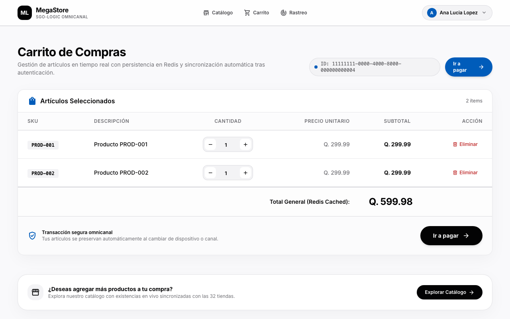

### 3.5 Pagar con tarjeta (PayKlik)

Para pagar necesitas haber iniciado sesión. Si no, la página te pide entrar primero.

1. En **Tus datos y facturación** revisa tu correo y escribe tu NIT o CUI. Escribe "CF" si no necesitas factura a tu nombre.
2. En **Entrega** elige envío a domicilio (llena departamento, municipio, dirección y, si quieres, referencias) o recoger en tienda (elige la tienda).
3. En **Método de pago** deja seleccionado **Tarjeta de crédito o débito**.
4. Escribe el número de tarjeta, el vencimiento (MM/AA), el código de seguridad y el nombre del titular. Si quieres, marca "Guardar esta tarjeta para futuras compras". Si ya tienes tarjetas guardadas, puedes elegir **Usar tarjeta guardada** y escribir solo su código de seguridad.
5. Pulsa **Validar tarjeta**. Cuando aparezca "Tarjeta validada" con la marca y los últimos cuatro dígitos, la tarjeta está lista. MegaStore nunca guarda el número completo ni el código de seguridad.
6. Marca "He leído y acepto la Política de Privacidad y Tratamiento de Datos."
7. Revisa el **Resumen del pedido** (el total incluye IVA) y pulsa **Confirmar y pagar**.

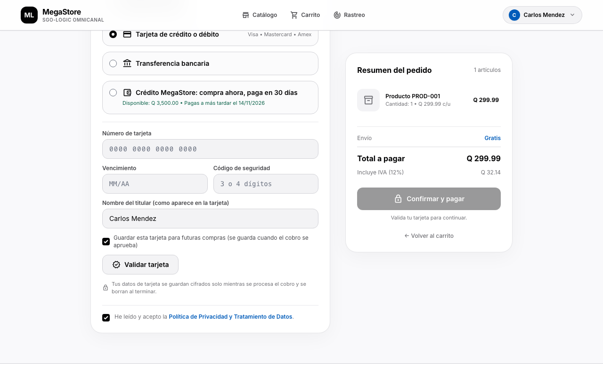

### 3.6 Pagar con el Crédito MegaStore

El Crédito MegaStore te permite comprar ahora y pagar en 30 días, sin intereses ni recargos. La opción **Crédito MegaStore: compra ahora, paga en 30 días** aparece siempre en el método de pago, pero solo puedes elegirla si tienes crédito disponible para el total de tu compra.

1. Llena tus datos y la entrega igual que en el pago con tarjeta.
2. En **Método de pago** mira la opción de crédito. Si está disponible, verás tu saldo disponible y la fecha límite de pago, por ejemplo "Disponible: Q 7,500.00 • Pagas a más tardar el 13/11/2026".
3. Selecciónala, acepta la Política de Privacidad y pulsa **Confirmar y pagar**. No necesitas tarjeta para esta compra.

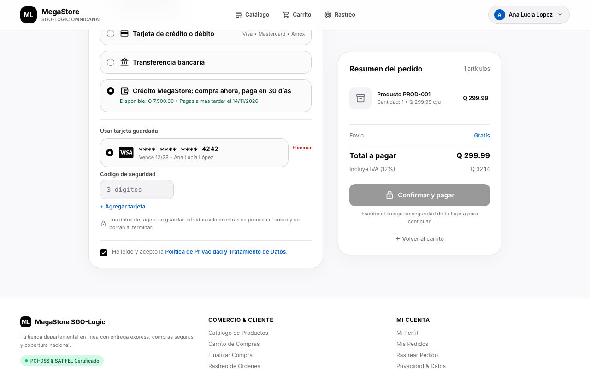

### 3.7 Cuando el crédito no está disponible, y por qué

Si no puedes usar crédito, la opción aparece gris, no se puede seleccionar y explica el motivo. Siempre puedes pagar con tarjeta o transferencia.

**La compra supera tu crédito disponible.** Verás "Tu crédito disponible no alcanza para esta compra" y "Tu crédito disponible es de Q(monto) y esta compra suma Q(monto).", con el enlace **Ver detalle en Mi crédito**. Puedes pagar con tarjeta o quitar productos para que el total entre en tu crédito.

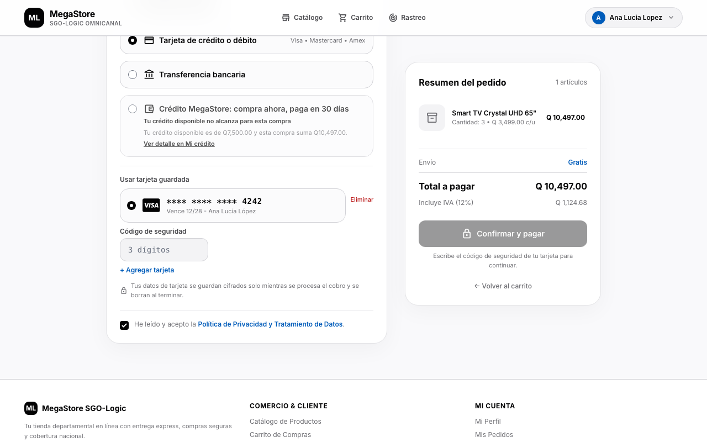

**No calificas para crédito por ahora.** Según tu historial verás uno de estos mensajes:

| Título | Mensaje |
|---|---|
| Aún no podemos ofrecerte crédito | "Todavía no tenemos suficiente historial de tus compras para ofrecerte crédito." |
| Tu cuenta es muy reciente | "El crédito se habilita cuando cumples (número) días como cliente." |
| Por ahora no podemos ofrecerte crédito | "Una parte alta de tus compras recientes terminó en devolución.", "Algunos de tus pagos recientes se hicieron después de la fecha acordada." o "Tu historial de compras con nosotros todavía es corto para ofrecerte crédito." |
| Necesitamos revisar tu cuenta | "Hay un caso pendiente asociado a tu cuenta que debe resolverse antes de habilitar el crédito." |

MegaStore revisa tu historial periódicamente y la opción se habilita sola cuando cumplas los requisitos.

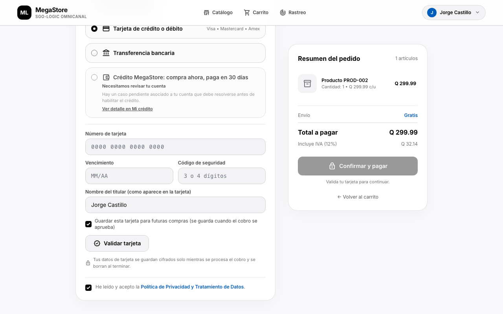

**Tienes una compra a crédito vencida.** Verás "Tu crédito está en pausa" y "Tienes una compra a crédito vencida, por eso por ahora no puedes usar tu crédito en nuevas compras.", con el enlace **Ir a Mi crédito para ponerte al día**. En cuanto pagues lo vencido, tu crédito se reactiva. Tus compras con tarjeta funcionan con normalidad.

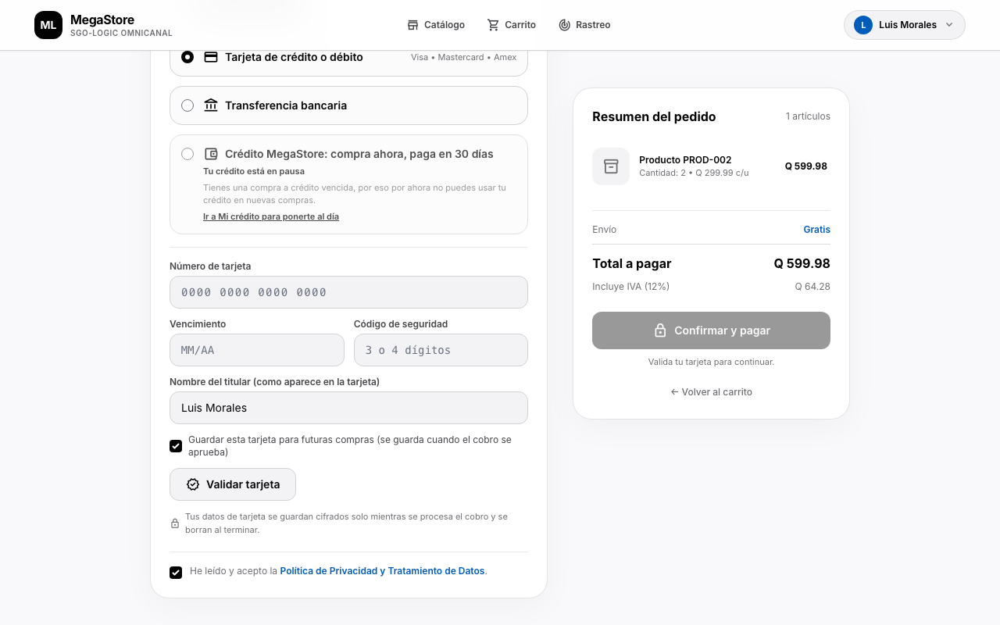

**El servicio de crédito no responde.** Verás "En este momento no contamos con la opción de crédito. Si deseas pagar con crédito, vuelve a intentarlo más tarde." Puedes terminar tu compra con tarjeta sin esperar.

**Tu sesión no está activa.** Verás "Inicia sesión para ver si tienes crédito disponible."

### 3.8 Confirmación del pedido

Después de pulsar **Confirmar y pagar** verás primero "Estamos procesando tu pago" (o "Estamos confirmando tu crédito. Toma solo unos segundos." si pagaste con crédito). No cierres la página: en unos segundos cambia al resultado.

- **¡Orden Confirmada Exitosamente!** con tu número de orden y el estado CONFIRMADA.
- **Tu pedido está registrado**: el pago todavía no se confirma; puedes seguirlo desde el seguimiento.
- **No pudimos completar tu pedido**: algunos productos ya no tenían existencias. No se hizo ningún cobro.
- **No pudimos aprobar tu compra a crédito**: explica el motivo y dice "No se realizó ningún cargo". Pulsa **Pagar con tarjeta** para volver al checkout con los mismos productos.
- **Tu pedido fue cancelado**: el pedido se canceló antes de completar el pago.

Pulsa **Ver seguimiento de mi pedido** para ver cómo avanza.

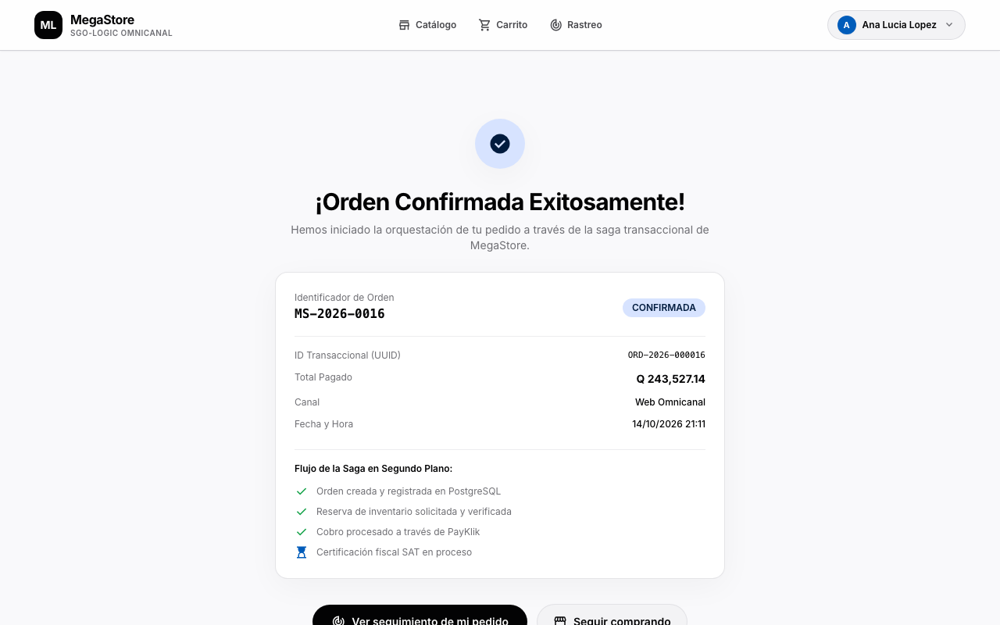

### 3.9 Mis pedidos

1. Abre el menú de tu nombre y elige **Mis Órdenes**. Se abre **Mis Pedidos**.
2. Verás tus compras con su estado. En cada una tienes:
   - **Seguimiento**: abre el detalle y la línea de tiempo del pedido.
   - **Factura**: descarga la factura electrónica.
   - **Nota de crédito**: aparece si tuviste una devolución.
   - El ícono de reportar problema, para crear una incidencia.
   - **Cancelar orden**: solo mientras el pedido no ha salido a ruta. La página te pide confirmar.

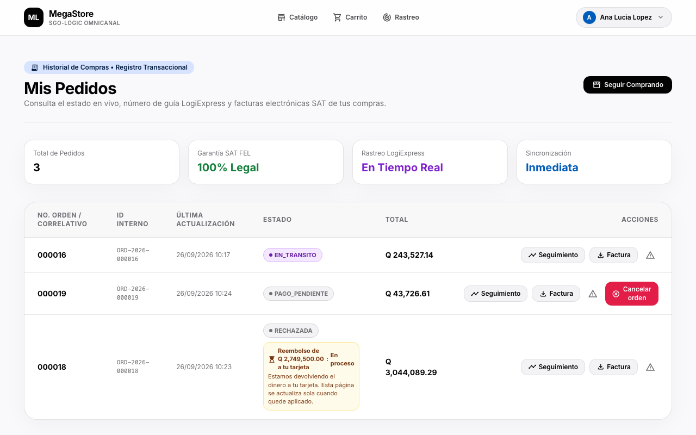

### 3.10 Rastrear un pedido

1. En **Mis Pedidos** pulsa **Seguimiento**, o entra a **Rastreo** desde el menú.
2. Verás el número de orden, la línea de tiempo con cada paso (reserva, pago, factura, preparación, envío, entrega), la guía de LogiExpress cuando exista, la factura y las incidencias del pedido.
3. Por privacidad, solo ves tus propios pedidos. Si intentas abrir otro, verás "Acceso denegado: Por razones de privacidad, solo puedes consultar las órdenes asociadas a tu cuenta."

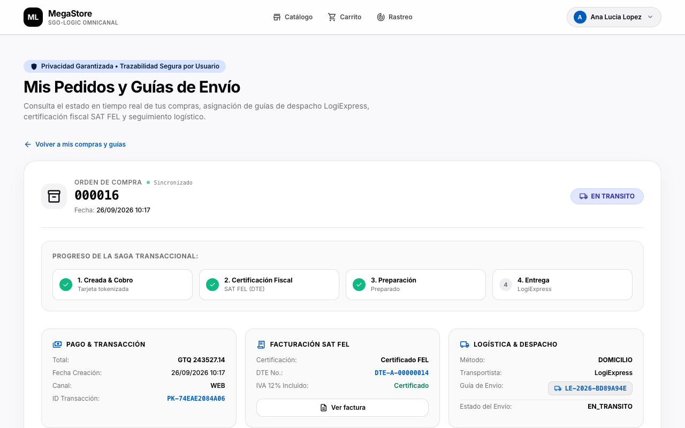

### 3.11 Factura y comprobante

**Factura.** Desde el seguimiento, en la sección de facturación, abre la factura del pedido. Verás "Factura de la orden (número)" con los datos de MegaStore y de tu compra. Si todavía no se certificó, verás "Factura pendiente de certificación". En **Mis Pedidos**, el botón **Factura** la descarga como archivo; si aún no existe, verás "La factura de esta orden aun no ha sido generada. Intenta de nuevo en unos minutos."

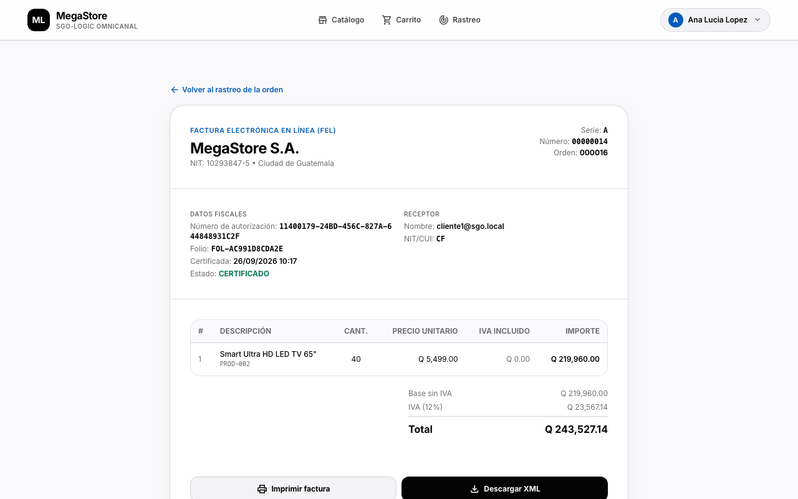

**Comprobante.** El comprobante es un ticket digital de tu compra que puedes compartir. Lo abres desde el botón del comprobante que aparece al completar un reintento de pago (sección 3.12) o desde el enlace que te comparte la tienda cuando compras en mostrador. Si el pedido no existe, verás "Comprobante No Disponible".

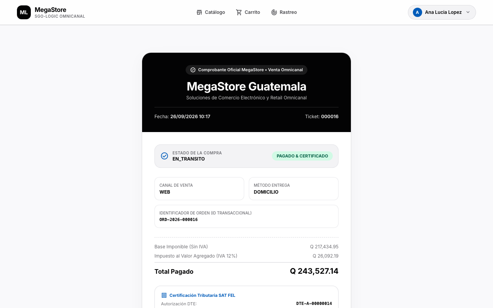

### 3.12 Reintentar un pago

Si tu pago con tarjeta no se pudo completar porque la pasarela no respondió, tu pedido queda guardado y no se te cobra nada. Recibirás un correo con el asunto "Pago pendiente para tu orden (número)" y un enlace seguro para completar el pago.

1. Abre el enlace del correo. Llegarás a **Reintento de Cobro**.
2. Revisa los datos del pedido. Si te lo pide, escribe de nuevo los datos de tu tarjeta (o solo el código de seguridad si era una tarjeta guardada).
3. Confirma el pago.

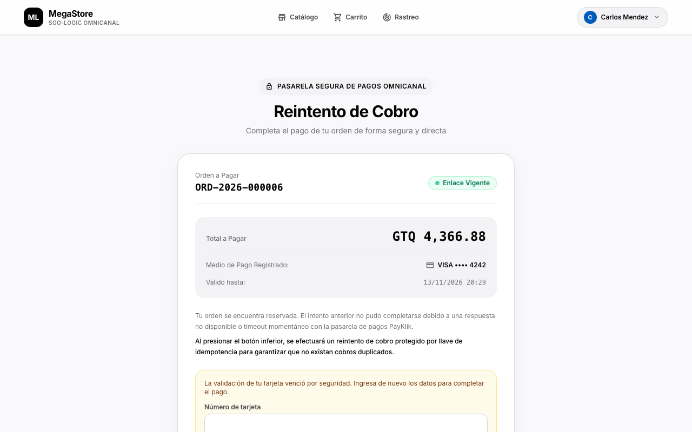

Si el pago se aprueba verás **¡Pago Procesado Exitosamente!** y el botón para ver tu comprobante.

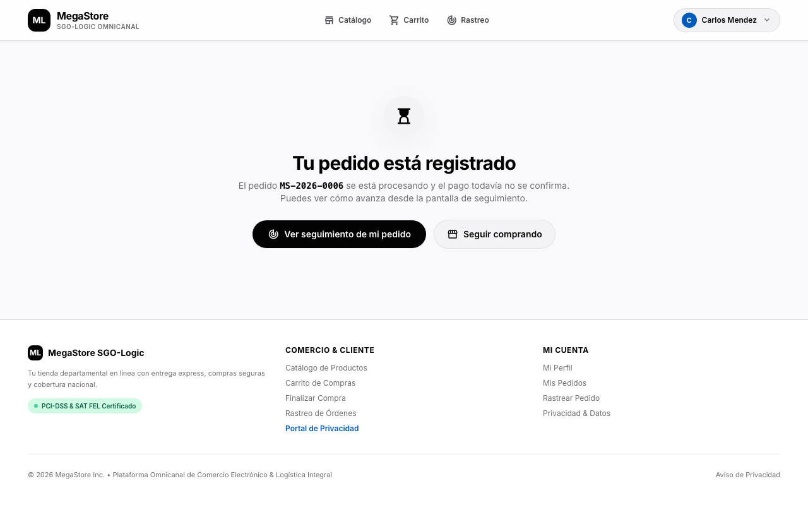

Si el enlace no sirve, verás "No se pudo procesar el enlace" con el motivo.

### 3.13 Reembolsos

Si cancelas un pedido que ya pagaste con tarjeta, MegaStore devuelve el dinero a tu tarjeta. En **Mis Pedidos** aparece el aviso "Reembolso de Q (monto) a tu tarjeta" con su estado:

- **En proceso**: "Estamos devolviendo el dinero a tu tarjeta. Esta página se actualiza sola cuando quede aplicado."
- **Aplicado**: "Ya devolvimos el dinero a tu tarjeta. Según tu banco, puede tardar unos días en verse en tu estado de cuenta."
- **No se pudo completar**: "No pudimos completar el reembolso. Comunícate con atención al cliente para resolverlo."

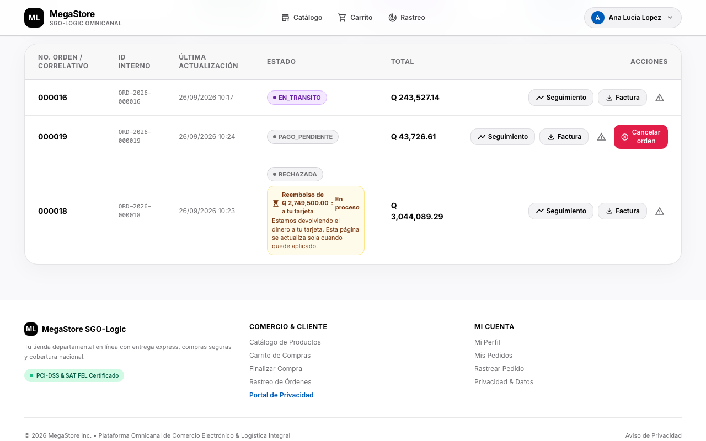

Si el pedido era a crédito, no hay reembolso a tarjeta por el saldo pendiente: la compra se anula y el monto vuelve a tu crédito disponible. Lo que ya hubieras abonado se devuelve a tu tarjeta.

### 3.14 Reportar una incidencia

1. En **Mis Pedidos** pulsa el ícono de reportar problema del pedido, o en el seguimiento pulsa **Levantar Nueva Incidencia**.
2. En **Reportar Incidencia** revisa el número de orden y describe el problema.
3. Envía el formulario. Verás "Incidencia registrada con éxito para la orden (número)." y volverás al seguimiento, donde la incidencia aparece en "Incidencias del Pedido".

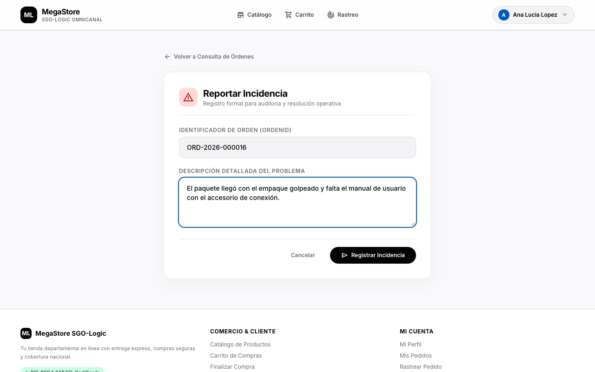

Si falta el número de orden o la descripción, verás "Debe proporcionar el ID de la orden y una descripción válida." El personal de MegaStore atiende las incidencias desde su propia bandeja (sección 4.4).

### 3.15 Mi crédito

1. Abre el menú de tu nombre y elige **Mi crédito**.
2. Arriba verás tu situación: tu **Disponible**, tu **Límite** y lo **Utilizado**, con un mensaje que explica tu estado. Si tienes compras vencidas o por vencer, aparecen avisos destacados como "Tienes una compra que vence pronto" o "Tienes una compra vencida".
3. En **Tus compras a crédito** ves cada compra con su saldo, su **Fecha límite** y su estado ("Por pagar", "Vence pronto", "Vencida", "Pagada", "Anulada" o "Devuelta"), primero las más próximas a vencer.
4. En **Qué tomamos en cuenta** ves los factores de tu historial (pagos a tiempo, monto de compras, tiempo y frecuencia como cliente, devoluciones y reclamos), sin puntajes.

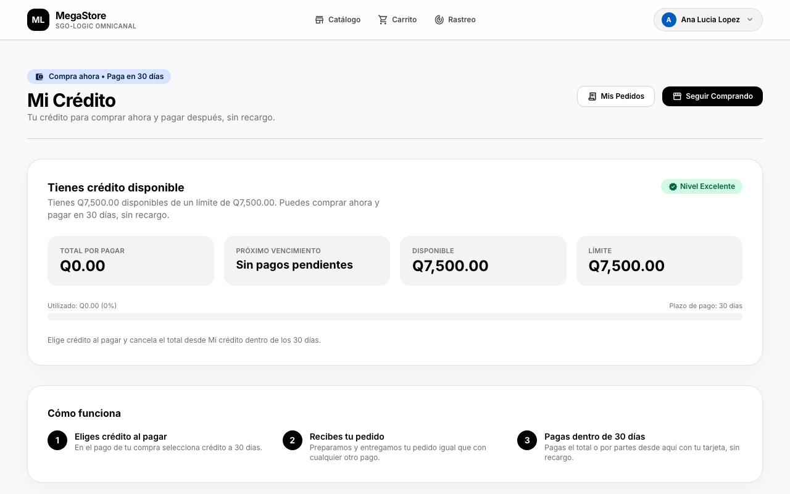

**Hacer un abono.**

1. En la compra que quieres pagar pulsa **Pagar**.
2. En el panel **Pagar compra** escribe el **Monto a pagar** (el total o una parte; el mínimo es Q10, salvo que te quede menos, en cuyo caso pagas el saldo completo).
3. Elige una tarjeta guardada y escribe su código de seguridad, o elige **Usar una tarjeta nueva** y llena sus datos.
4. Confirma. Verás "Estamos procesando tu pago" y después el resultado:
   - "Recibimos tu pago de Q(monto). Te quedan Q(monto) por pagar de esta compra."
   - "Tu compra quedó pagada": tu crédito disponible aumenta.
   - "Tu banco no autorizó el pago": no se hizo ningún cargo; revisa la tarjeta o usa otra.
   - "Estamos confirmando tu pago": no pagues de nuevo todavía; en unos minutos aparece el botón **Reintentar pago**.

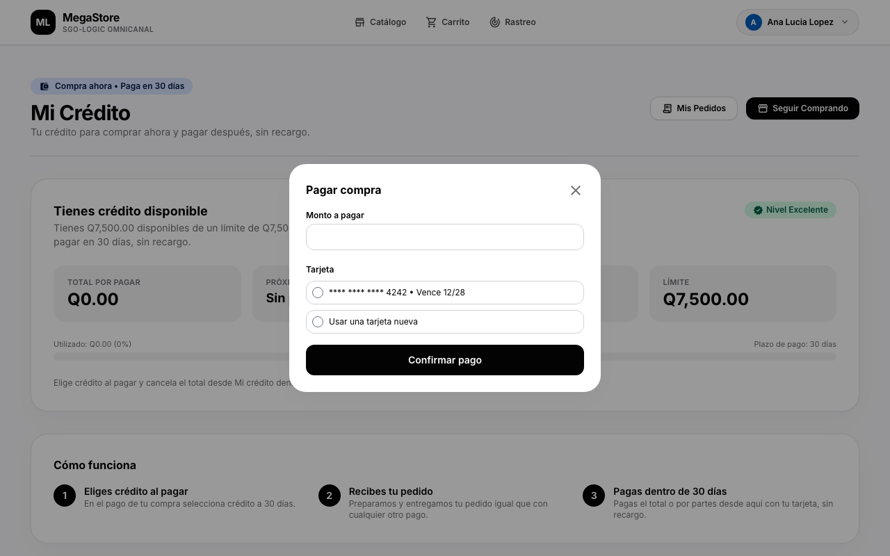

### 3.16 Perfil

Abre el menú de tu nombre y elige **Mi Perfil**. En **Mi Perfil Omnicanal** ves tu nombre, tu correo, la seguridad de tu sesión y accesos rápidos a tus pedidos y a tu carrito.

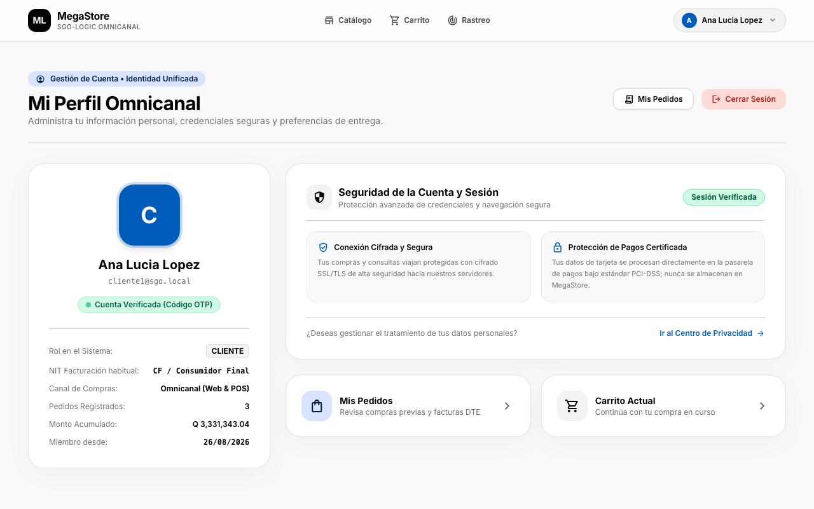

### 3.17 Tarjetas guardadas

Abre el menú de tu nombre y elige **Mis Tarjetas**. Verás las tarjetas que guardaste al pagar, con su marca, sus últimos cuatro dígitos y su vencimiento; las vencidas se marcan "Vencida". Pulsa el ícono de borrar para eliminar una; verás "Tarjeta eliminada." MegaStore nunca guarda el número completo ni el código de seguridad. Si no tienes tarjetas, verás "No tienes tarjetas guardadas".

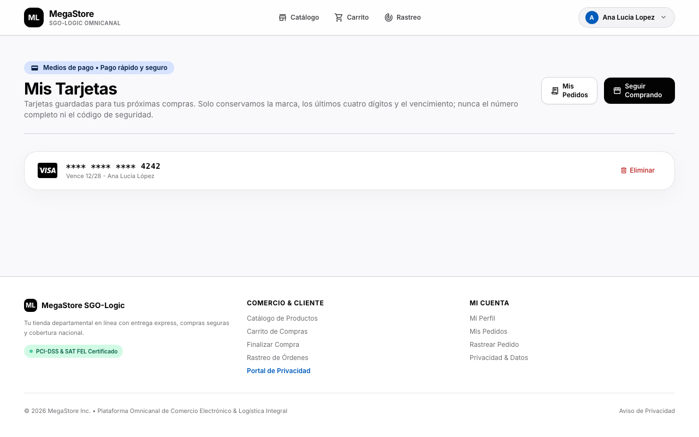

### 3.18 Privacidad

Abre el menú de tu nombre y elige **Privacidad & Datos**. En el **Centro de Privacidad y Protección de Datos** puedes:

- Descargar tus datos personales y pedidos (derecho de acceso y portabilidad).
- Configurar tus consentimientos de comunicaciones y telemetría en **Gestión de Consentimientos y Notificaciones**. Al guardar verás "Tus preferencias de privacidad y consentimientos han sido actualizadas con exito."
- Solicitar la supresión de tus datos. Recibirás un folio; las facturas y registros de auditoría se conservan por obligación fiscal y los datos promocionales y de contacto se dan de baja en un máximo de 72 horas.

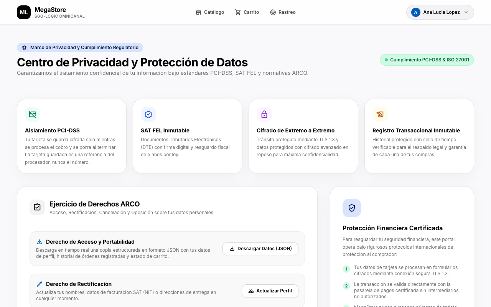

---

## 4. Si eres personal de tienda u operaciones

Estas pantallas las pueden usar las cuentas con rol **Operador** o **Administrador**. Al iniciar sesión con una de ellas, el menú muestra **Despacho**, **Todas las Órdenes**, **OmniPOS**, **Visión 360**, **Usuarios & Roles**, **Incidencias**, **Informe de Ventas** y **Monitoreo**. Si un cliente intenta abrirlas, verá un mensaje de "Acceso denegado".

### 4.1 Punto de venta (OmniPOS)

1. Pulsa **OmniPOS** en el menú. Se abre **OmniPOS — Terminal de Ventas en Mostrador**.
2. Elige la **Sucursal Emisora POS** y revisa el **Terminal Asignado**.
3. Si el cliente empezó su compra en línea, búscalo en "Recuperar carrito web por correo del cliente o número de orden..." para traer su carrito.
4. En **Venta en Mostrador — Agregar Producto al Ticket** elige el **Producto del Catálogo** y la **Cantidad** y agrégalo. Verás "(producto) (cantidad un.) agregado al ticket POS."
5. En **Forma de Pago en Caja** elige **Efectivo** (cobro directo) o **Tarjeta POS** (terminal bancario).
6. Pulsa **Finalizar Cobro en Mostrador**. Verás "Venta en POS registrada con exito en (terminal). Orden: (número) (Total: Q ...)". Si escribes el teléfono del cliente, el comprobante se le envía por SMS.

Mensajes comunes: "No hay productos para cobrar.", "No hay stock suficiente en la sucursal seleccionada: ..." y "La sucursal seleccionada no tiene existencias registradas: ...".

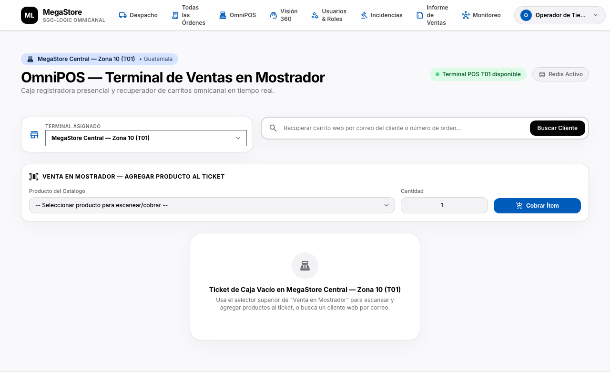

### 4.2 Despacho

1. Pulsa **Despacho** en el menú. Se abre **Centro de Control — Despacho Logístico**.
2. Filtra por método (todos, a domicilio o recogida en tienda) y por ubicación (todas, CD-01 o Tienda Central).
3. Cada fila muestra el despacho, la orden, el método, el destino, el transportista y la guía, y el estado.
4. Usa los botones para avanzar el pedido: **A Ruta** (envío a domicilio) o **Listo Tienda** (recogida), y luego **Entregar**. Verás "Despacho de la orden (número) actualizado a (estado) exitosamente."

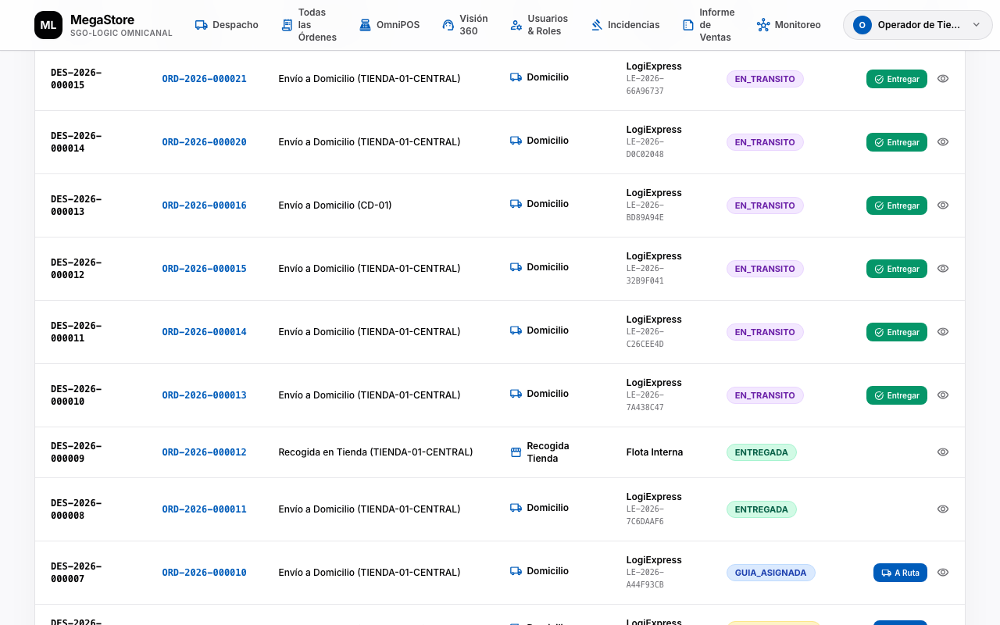

### 4.3 Visión 360 del cliente

1. Pulsa **Visión 360** en el menú.
2. Escribe el correo o el identificador del cliente en "Buscar por email o ID..." y busca.
3. Verás en una sola pantalla sus órdenes con su estado en vivo y su total, sus incidencias y reclamaciones y el registro de notificaciones que se le enviaron. Desde aquí también puedes cambiar su rol.

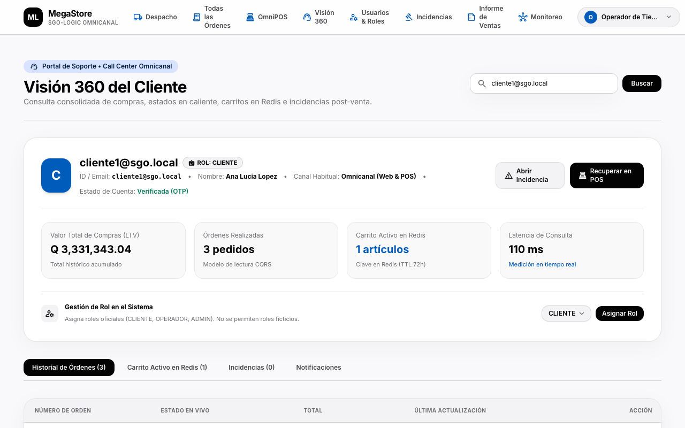

### 4.4 Bandeja de incidencias

1. Pulsa **Incidencias** en el menú. Se abre el **Centro de Incidencias Operativas** con todas las incidencias que reportaron los clientes.
2. Filtra por número de orden o por estado.
3. Pulsa **Gestionar Incidencia**, describe la acción correctiva, elige el nuevo estado (En investigación, Resuelta o Cerrada) y guarda. Verás "Incidencia (número) actualizada a (estado) exitosamente."

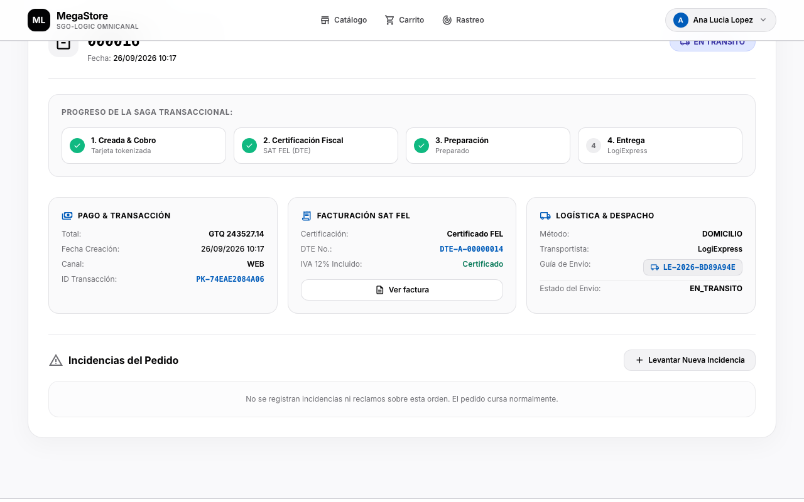

---

## 5. Si eres administrador

Las pantallas de esta sección están en el menú del personal. En la aplicación actual también las pueden abrir las cuentas con rol Operador; la única función exclusiva de Administrador es la consulta del historial del ERP en Monitoreo.

### 5.1 Usuarios y roles

1. Pulsa **Usuarios & Roles** en el menú. Se abre **Usuarios y Asignación de Roles**.
2. Busca por correo, nombre o rol.
3. En el **Directorio de Usuarios**, elige el nuevo rol del usuario (CLIENTE, OPERADOR o ADMIN) y guárdalo. Verás "Rol del usuario (correo) actualizado correctamente a (rol)."

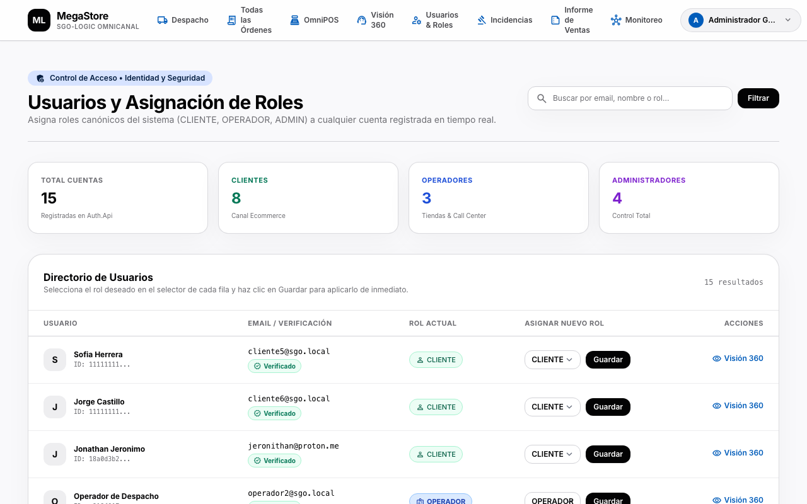

### 5.2 Informe de ventas

1. Pulsa **Informe de Ventas** en el menú. Se abre el **Informe de Ventas Conciliado**.
2. Elige las fechas **Desde** y **Hasta** y pulsa **Filtrar**.
3. Verás las ventas por fecha, canal y tienda, y los lotes enviados al ERP con su monto y su estado de conciliación. Pulsa **Exportar CSV** para descargarlo o **Conciliar ahora** para ejecutar la conciliación con el ERP; al terminar verás "Consolidación y conciliación con el ERP ejecutadas."

Si el ERP no responde, verás "No se pudo obtener el informe de ventas del servicio ERP."

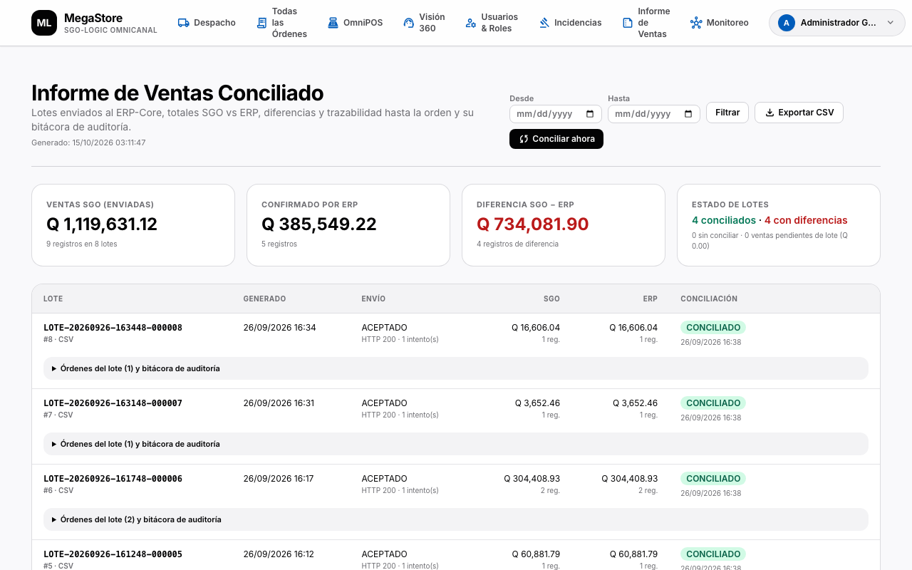

### 5.3 Monitoreo

1. Pulsa **Monitoreo** en el menú. Se abre el **Centro de Control y Monitoreo**.
2. En **Estado de Seguridad del Perímetro** ves si la validación de sesión en la entrada está activa y cuándo vence tu sesión.
3. En **Topología de Microservicios en Vivo** ves si cada servicio del sistema responde.
4. En **Gobernanza y Resiliencia del Ecosistema** ves el estado de la autenticación, la bitácora inmutable y la orquestación de pedidos.
5. Solo para administradores: en **Snapshot de historial del ERP** escribe el correo de un cliente para ver el historial que MegaStore recibió del ERP (compras, pagos puntuales y tardíos, devoluciones e incidentes), que es la base de su crédito.

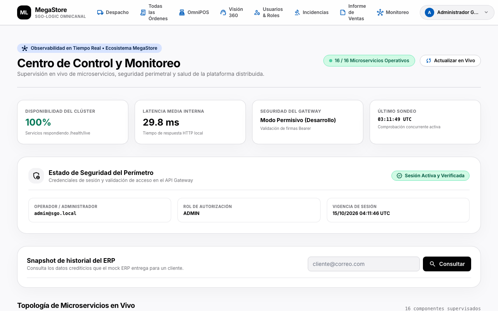

---

## 6. Preguntas frecuentes y mensajes comunes

**¿Por qué no puedo pagar sin iniciar sesión?**
El pago exige una cuenta. Verás "Por favor inicia sesión o regístrate para proceder al checkout y completar tu compra de forma segura."

**Mi carrito dice que la reserva venció. ¿Perdí mis productos?**
No necesariamente. Pulsa **Renovar reserva**: si todavía hay existencias, se apartan de nuevo y verás "Renovamos el apartado de tus productos." Si al pagar la reserva ya no se puede renovar, verás "Tu reserva venció y algunos productos ya no tienen existencias para apartarse de nuevo. Revisa tu carrito antes de pagar."

**Al pagar me dice "Valida tu tarjeta antes de confirmar el pedido."**
Después de escribir los datos de tu tarjeta debes pulsar **Validar tarjeta** y esperar "Tarjeta validada".

**Me aparece "No hay unidades suficientes para todo tu pedido en una misma ubicación. Revisa las cantidades de tu carrito."**
Ninguna tienda ni centro de distribución tiene todo lo que pediste junto. Reduce cantidades o quita algún producto.

**¿Por qué la opción de crédito está gris?**
La página explica el motivo debajo de la opción (sección 3.7). Puedes pagar con tarjeta o transferencia sin problema.

**Me rechazaron el crédito después de confirmar. ¿Me cobraron?**
No. Verás "No pudimos aprobar tu compra a crédito" y "No se realizó ningún cargo". Pulsa **Pagar con tarjeta** para terminar la compra.

**Mi pago quedó pendiente. ¿Lo pago de nuevo?**
No. Tu pedido sigue registrado y no se hizo ningún cobro. Usa el enlace del correo "Pago pendiente para tu orden" (sección 3.12).

**¿Cuándo se reactiva mi crédito si está en pausa?**
En cuanto pagas desde **Mi crédito** las compras vencidas. No se cobran intereses ni recargos.

**Intenté abonar y dice "Ya hay un pago en proceso para esta compra. Espera a que termine antes de pagar de nuevo."**
Solo se permite un pago a la vez por compra. Espera el resultado del anterior.

**Mensajes de sesión**

| Mensaje | Qué significa |
|---|---|
| "Sesión expirada. Inicia sesión nuevamente para procesar tu compra." | Tu sesión venció mientras pagabas; vuelve a entrar. |
| "Tu sesión expiró. Inicia sesión de nuevo para pagar con crédito." | Igual, en una compra a crédito. |
| "Tu sesión expiró. Inicia sesión nuevamente para ver tu crédito." | Igual, al abrir Mi crédito. |

**Mensajes de carga**

| Mensaje | Qué hacer |
|---|---|
| "No pudimos cargar el catálogo en este momento. Intenta de nuevo en unos minutos." | Espera un momento y recarga la página. |
| "No pudimos validar tu tarjeta en este momento. Intenta de nuevo en unos momentos." | Vuelve a pulsar **Validar tarjeta** más tarde o usa otra tarjeta. |
| "Esta orden aún no tiene nota de crédito. Intenta de nuevo en unos minutos." | La nota de crédito de tu devolución todavía se está generando. |
